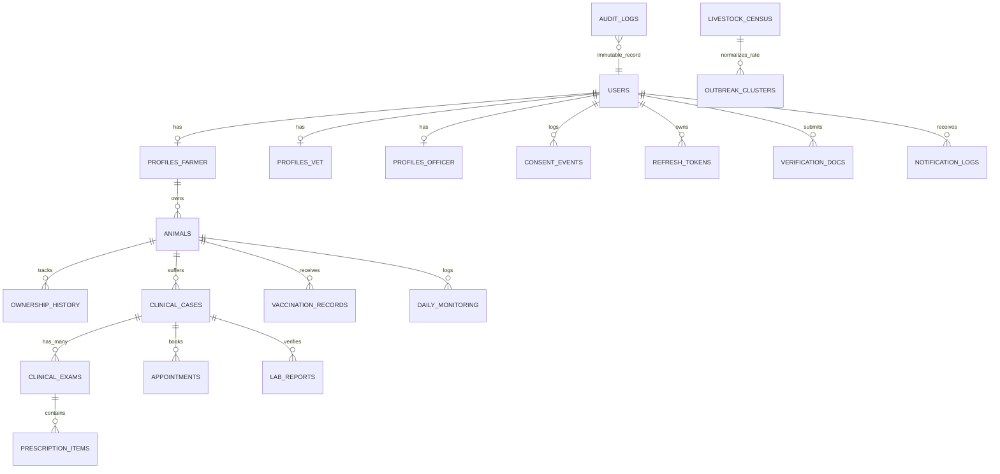
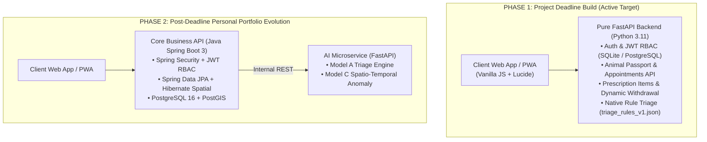

# ⚙️ PashuSachet (पशूसचेत) — Corrected Backend Architecture & Schema Blueprint

> **Document Type:** Production Backend Architecture & Corrected Schema Blueprint  
> **Status:** Revised & Corrected (Post-Audit)  
> **Associated Specs:** [`FRONTEND_DESIGN_SPEC.md`](file:///g:/Chetan/pashuSachet/FRONTEND_DESIGN_SPEC.md) | [`plans.md`](file:///g:/Chetan/pashuSachet/plans.md) | [`ML_AI_SYSTEM_PLAN.md`](file:///g:/Chetan/pashuSachet/ML_AI_SYSTEM_PLAN.md)  
> **Stack Execution Strategy:** 
> - **Active Build Target (Project Deadline):** **Pure FastAPI (Python 3.11)** with SQLite / PostgreSQL. Single runtime, fast execution, unified rules evaluation.
> - **Post-Deadline Evolution (Personal Portfolio Upgrade):** Extract Core Business API to **Java Spring Boot 3 + Hibernate Spatial**, retaining FastAPI strictly for the AI/ML triage microservice.
> - **Database:** PostgreSQL 16 + PostGIS (with SQLite + aiosqlite for zero-friction local prototype runs).
> - **Security:** Object-level authorization, DPDP consent event ledger, hashed OTPs, refresh token rotation.

---

## 1. Architectural Bug Fixes & Corrections Summary

| Area | Previous Flaw | Corrected Architectural Design |
| :--- | :--- | :--- |
| **Withdrawal Clock** | $T_{\text{end}} = \text{exam\_signed} + \text{hours}$ (starts at exam, ignoring multi-day courses). | **Counts from the final dose:**<br>$T_{\text{end}} = \text{last\_dose\_timestamp} + \text{withdrawal\_hours} \times 3600$.<br>Calculated per drug item, taking $\max(T_{\text{end}})$ across all prescribed drugs. |
| **Prescription Granularity** | JSONB blob on examination table; hardcoded defaults. | Normalized into `prescription_items` table with individual start, duration, end timestamps, and vet-entered milk/meat withdrawal hours. **Zero hardcoded defaults.** |
| **Examination Multiplicity & State** | `UNIQUE(case_id)` broke follow-ups and reopened cases. Exam set status directly to `RESOLVED`. | `clinical_examinations` is now **one-to-many** with `case_id`. Added lifecycle states: `UNDER_TREATMENT`, `FOLLOW_UP_DUE`, `RESOLVED`, `CLOSED`. |
| **Idempotency** | Mentioned in offline sync but missing from schema. | Added `idempotency_key UUID UNIQUE NOT NULL` across `clinical_cases`, `animals`, and `appointments`. |
| **Triage Drift** | Frontend and Backend had separate rule engines. | **Single Source of Truth:** `triage_rules_v1.json` bundled in both PWA and Backend. `rules_version` stored in every case record. Red flag circuit breaker works 100% offline. |
| **Clinical Confidence** | Misleading decimal precision (`0.88`, `0.08`). | Replaced with clinical decision-support bands: `Likely`, `Possible`, `Less Likely`. |
| **Missing Flows** | No appointments, census denominator, transfer history, or vet docs. | Added tables: `appointments`, `livestock_census`, `lab_reports`, `animal_ownership_history`, and `verification_documents`. |
| **Privacy & Security** | Raw GPS exposed; unthrottled OTP; single consent bool. | Farm locations truncated to village centroids for surveillance; 3-attempt OTP lockout with bcrypt hashing; normalized `consent_events` ledger. |

---

## 2. Complete Corrected Relational & Spatial DDL (PostgreSQL 16 + PostGIS)



### 2.1 Core Identity, Security & Consent Tables

```sql
-- Extensions
CREATE EXTENSION IF NOT EXISTS "uuid-ossp";
CREATE EXTENSION IF NOT EXISTS "postgis";

-- Sequences for Human-Readable Identifiers
CREATE SEQUENCE IF NOT EXISTS ps_tag_seq START WITH 10001;
CREATE SEQUENCE IF NOT EXISTS case_number_seq START WITH 4001;

-- User Roles & Account Status
CREATE TYPE user_role AS ENUM ('farmer', 'vet', 'officer', 'admin');
CREATE TYPE user_status AS ENUM ('active', 'pending_verification', 'suspended');

CREATE TABLE users (
    id UUID PRIMARY KEY DEFAULT gen_random_uuid(),
    phone_number VARCHAR(15) UNIQUE NOT NULL,
    role user_role NOT NULL DEFAULT 'farmer',
    status user_status NOT NULL DEFAULT 'active',
    language_pref VARCHAR(5) NOT NULL DEFAULT 'mr', -- 'mr', 'hi', 'en'
    created_at TIMESTAMPTZ NOT NULL DEFAULT NOW(),
    updated_at TIMESTAMPTZ NOT NULL DEFAULT NOW()
);

CREATE INDEX idx_users_phone ON users(phone_number);
CREATE INDEX idx_users_role_status ON users(role, status);

-- Single-Use, Salted & Hashed Mobile OTPs with Attempt Throttling
CREATE TABLE auth_otps (
    id UUID PRIMARY KEY DEFAULT gen_random_uuid(),
    phone_number VARCHAR(15) NOT NULL,
    otp_hash VARCHAR(128) NOT NULL, -- SHA256 / Bcrypt hash of 6-digit OTP
    attempts_remaining INT NOT NULL DEFAULT 3,
    is_used BOOLEAN NOT NULL DEFAULT FALSE,
    expires_at TIMESTAMPTZ NOT NULL,
    created_at TIMESTAMPTZ NOT NULL DEFAULT NOW()
);

CREATE INDEX idx_auth_otps_phone ON auth_otps(phone_number) WHERE is_used = FALSE;

-- Refresh Token Rotation & Revocation Storage
CREATE TABLE refresh_tokens (
    id UUID PRIMARY KEY DEFAULT gen_random_uuid(),
    user_id UUID NOT NULL REFERENCES users(id) ON DELETE CASCADE,
    token_hash VARCHAR(128) UNIQUE NOT NULL,
    is_revoked BOOLEAN NOT NULL DEFAULT FALSE,
    expires_at TIMESTAMPTZ NOT NULL,
    created_at TIMESTAMPTZ NOT NULL DEFAULT NOW()
);

CREATE INDEX idx_refresh_tokens_hash ON refresh_tokens(token_hash) WHERE is_revoked = FALSE;

-- Granular DPDP Act (2023) Consent Event Ledger
CREATE TYPE consent_purpose AS ENUM (
    'HEALTH_RECORDS_PRESERVATION',
    'ANONYMIZED_GIS_SURVEILLANCE',
    'SMS_WHATSAPP_ALERTS',
    'DATA_SHARING_COOPERATIVE'
);
CREATE TYPE consent_action AS ENUM ('GRANTED', 'WITHDRAWN');

CREATE TABLE consent_events (
    id BIGSERIAL PRIMARY KEY,
    user_id UUID NOT NULL REFERENCES users(id) ON DELETE CASCADE,
    purpose consent_purpose NOT NULL,
    action consent_action NOT NULL,
    policy_version VARCHAR(20) NOT NULL,
    ip_address INET,
    user_agent TEXT,
    created_at TIMESTAMPTZ NOT NULL DEFAULT NOW()
);

CREATE INDEX idx_consent_user_purpose ON consent_events(user_id, purpose, created_at DESC);
```

### 2.2 Profiles & Verification Documents

```sql
-- Farmer Profile (Farm GPS is private; surveillance uses village centroid)
CREATE TABLE profiles_farmer (
    user_id UUID PRIMARY KEY REFERENCES users(id) ON DELETE CASCADE,
    full_name VARCHAR(100) NOT NULL,
    village VARCHAR(100) NOT NULL,
    taluka VARCHAR(100) NOT NULL,
    district VARCHAR(100) NOT NULL,
    village_centroid GEOMETRY(Point, 4326) NOT NULL, -- Publicly usable for cluster maps
    private_farm_location GEOMETRY(Point, 4326),    -- Encrypted / Private; used only for doorstep vet routing
    dairy_coop_member BOOLEAN DEFAULT FALSE,
    dairy_coop_name VARCHAR(100),
    created_at TIMESTAMPTZ NOT NULL DEFAULT NOW()
);

CREATE INDEX idx_farmer_taluka ON profiles_farmer(district, taluka);
CREATE INDEX idx_farmer_village_centroid ON profiles_farmer USING GIST(village_centroid);

-- Veterinarian Profile
CREATE TABLE profiles_vet (
    user_id UUID PRIMARY KEY REFERENCES users(id) ON DELETE CASCADE,
    full_name VARCHAR(100) NOT NULL,
    qualification VARCHAR(100) NOT NULL, -- e.g. "B.V.Sc & A.H."
    msvc_reg_no VARCHAR(50) UNIQUE NOT NULL,
    dispensary_name VARCHAR(150) NOT NULL,
    dispensary_type VARCHAR(50) NOT NULL DEFAULT 'Government Dispensary',
    clinic_location GEOMETRY(Point, 4326) NOT NULL,
    service_radius_km NUMERIC(4, 1) NOT NULL DEFAULT 25.0,
    is_available BOOLEAN NOT NULL DEFAULT TRUE,
    created_at TIMESTAMPTZ NOT NULL DEFAULT NOW()
);

CREATE INDEX idx_vet_clinic_location ON profiles_vet USING GIST(clinic_location);

-- Livestock Development Officer Profile
CREATE TABLE profiles_officer (
    user_id UUID PRIMARY KEY REFERENCES users(id) ON DELETE CASCADE,
    full_name VARCHAR(100) NOT NULL,
    department_id VARCHAR(50) UNIQUE NOT NULL,
    designation VARCHAR(100) NOT NULL, -- "LDO", "ADVO", "DVO"
    assigned_district VARCHAR(100) NOT NULL,
    assigned_talukas TEXT[] NOT NULL DEFAULT '{}',
    created_at TIMESTAMPTZ NOT NULL DEFAULT NOW()
);

CREATE INDEX idx_officer_district ON profiles_officer(assigned_district);

-- Verification Documents (Proof of MSVC / Government Department ID)
CREATE TYPE doc_type AS ENUM ('MSVC_REGISTRATION_CERT', 'GOVT_OFFICER_ID', 'CLINIC_LICENSE');
CREATE TYPE doc_status AS ENUM ('PENDING', 'VERIFIED', 'REJECTED');

CREATE TABLE verification_documents (
    id UUID PRIMARY KEY DEFAULT gen_random_uuid(),
    user_id UUID NOT NULL REFERENCES users(id) ON DELETE CASCADE,
    document_type doc_type NOT NULL,
    document_url TEXT NOT NULL,
    status doc_status NOT NULL DEFAULT 'PENDING',
    reviewed_by UUID REFERENCES users(id),
    reviewed_at TIMESTAMPTZ,
    rejection_reason TEXT,
    created_at TIMESTAMPTZ NOT NULL DEFAULT NOW()
);

CREATE INDEX idx_verif_status ON verification_documents(status);
```

### 2.3 Animals & Ownership Continuity

```sql
CREATE TYPE animal_species AS ENUM ('cattle', 'buffalo', 'goat', 'sheep', 'poultry');
CREATE TYPE animal_status AS ENUM ('active', 'transferred', 'deceased');

CREATE TABLE animals (
    id UUID PRIMARY KEY DEFAULT gen_random_uuid(),
    idempotency_key UUID UNIQUE NOT NULL, -- Enforces safe offline sync
    ps_tag VARCHAR(32) UNIQUE NOT NULL,  -- e.g. "PS-MH-2026-08149" (Generated via sequence)
    bharat_pashudhan_id VARCHAR(12),      -- Optional 12-digit national INAPH tag
    owner_id UUID NOT NULL REFERENCES users(id) ON DELETE RESTRICT,
    name VARCHAR(50),
    species animal_species NOT NULL,
    breed VARCHAR(50) NOT NULL,
    gender VARCHAR(10) NOT NULL,
    birth_date DATE,
    age_months_estimated INT NOT NULL,
    lactation_status VARCHAR(30) DEFAULT 'dry',
    photo_url TEXT,
    status animal_status NOT NULL DEFAULT 'active',
    created_at TIMESTAMPTZ NOT NULL DEFAULT NOW(),
    updated_at TIMESTAMPTZ NOT NULL DEFAULT NOW()
);

CREATE INDEX idx_animals_owner ON animals(owner_id);
CREATE INDEX idx_animals_ps_tag ON animals(ps_tag);

-- Ownership Transfer Ledger (Never overwrites historical chain of custody)
CREATE TYPE transfer_status AS ENUM ('PENDING_CLAIM', 'COMPLETED', 'CANCELLED', 'EXPIRED');

CREATE TABLE animal_ownership_history (
    id UUID PRIMARY KEY DEFAULT gen_random_uuid(),
    animal_id UUID NOT NULL REFERENCES animals(id) ON DELETE RESTRICT,
    from_owner_id UUID NOT NULL REFERENCES users(id),
    to_owner_id UUID REFERENCES users(id),
    transfer_code VARCHAR(12) UNIQUE NOT NULL, -- 6-8 character secure claim code
    status transfer_status NOT NULL DEFAULT 'PENDING_CLAIM',
    initiated_at TIMESTAMPTZ NOT NULL DEFAULT NOW(),
    completed_at TIMESTAMPTZ,
    expires_at TIMESTAMPTZ NOT NULL DEFAULT (NOW() + INTERVAL '72 hours')
);

CREATE INDEX idx_transfer_code ON animal_ownership_history(transfer_code) WHERE status = 'PENDING_CLAIM';
```

### 2.4 Clinical Cases, Appointments & Examinations

```sql
CREATE TYPE urgency_tier AS ENUM ('CRITICAL', 'URGENT', 'MODERATE', 'ROUTINE');
CREATE TYPE case_status AS ENUM (
    'REPORTED',
    'ASSIGNED',
    'UNDER_TREATMENT',
    'FOLLOW_UP_DUE',
    'RESOLVED',
    'CLOSED',
    'REOPENED'
);

CREATE TABLE clinical_cases (
    id UUID PRIMARY KEY DEFAULT gen_random_uuid(),
    idempotency_key UUID UNIQUE NOT NULL,
    case_number VARCHAR(32) UNIQUE NOT NULL, -- "HC-2026-XXXX" (Generated via sequence)
    animal_id UUID NOT NULL REFERENCES animals(id) ON DELETE RESTRICT,
    farmer_id UUID NOT NULL REFERENCES users(id) ON DELETE RESTRICT,
    assigned_vet_id UUID REFERENCES users(id),
    
    -- Triage Output & Drift Prevention
    rules_version VARCHAR(20) NOT NULL DEFAULT 'v1.0.0', -- Version of shared triage_rules.json
    urgency urgency_tier NOT NULL DEFAULT 'MODERATE',
    indicative_condition VARCHAR(150),
    confidence_band VARCHAR(20) NOT NULL, -- 'Likely', 'Possible', 'Less Likely'
    symptoms_observed JSONB NOT NULL DEFAULT '[]',
    reported_temp_f NUMERIC(4, 1),
    onset_days INT NOT NULL DEFAULT 1,
    red_flag_triggered BOOLEAN NOT NULL DEFAULT FALSE,
    safe_first_aid JSONB NOT NULL DEFAULT '[]',
    
    status case_status NOT NULL DEFAULT 'REPORTED',
    created_at TIMESTAMPTZ NOT NULL DEFAULT NOW(),
    updated_at TIMESTAMPTZ NOT NULL DEFAULT NOW()
);

CREATE INDEX idx_cases_vet ON clinical_cases(assigned_vet_id);
CREATE INDEX idx_cases_status ON clinical_cases(status);
CREATE INDEX idx_cases_animal ON clinical_cases(animal_id);

-- Appointments Table (Dispensary Booking & Mobile Clinic Visits)
CREATE TYPE appointment_type AS ENUM ('DISPENSARY_VISIT', 'DOORSTEP_FIELD_VISIT');
CREATE TYPE appointment_status AS ENUM ('PENDING', 'CONFIRMED', 'COMPLETED', 'CANCELLED', 'NO_SHOW');

CREATE TABLE appointments (
    id UUID PRIMARY KEY DEFAULT gen_random_uuid(),
    idempotency_key UUID UNIQUE NOT NULL,
    case_id UUID NOT NULL REFERENCES clinical_cases(id) ON DELETE CASCADE,
    farmer_id UUID NOT NULL REFERENCES users(id),
    vet_id UUID NOT NULL REFERENCES users(id),
    visit_type appointment_type NOT NULL DEFAULT 'DISPENSARY_VISIT',
    scheduled_slot TIMESTAMPTZ NOT NULL,
    status appointment_status NOT NULL DEFAULT 'PENDING',
    notes TEXT,
    created_at TIMESTAMPTZ NOT NULL DEFAULT NOW(),
    updated_at TIMESTAMPTZ NOT NULL DEFAULT NOW()
);

CREATE INDEX idx_appointments_vet_slot ON appointments(vet_id, scheduled_slot);
CREATE INDEX idx_appointments_farmer ON appointments(farmer_id);

-- One-to-Many Clinical Examinations (Supports Initial Exam + Follow-Ups + Reopened Cases)
CREATE TABLE clinical_examinations (
    id UUID PRIMARY KEY DEFAULT gen_random_uuid(),
    case_id UUID NOT NULL REFERENCES clinical_cases(id) ON DELETE CASCADE,
    vet_id UUID NOT NULL REFERENCES users(id) ON DELETE RESTRICT,
    exam_number INT NOT NULL DEFAULT 1, -- 1 = Initial Exam, 2 = Follow-up
    rectal_temp_f NUMERIC(4, 1) NOT NULL,
    physical_findings TEXT NOT NULL,
    confirmed_diagnosis VARCHAR(150) NOT NULL,
    follow_up_required BOOLEAN NOT NULL DEFAULT FALSE,
    next_follow_up_date DATE,
    
    -- Cryptographic Integrity & Demo Flag
    integrity_hash VARCHAR(128) NOT NULL, -- SHA256(vet_id + case_id + diagnosis + timestamp)
    is_demo_stamp BOOLEAN NOT NULL DEFAULT TRUE,
    created_at TIMESTAMPTZ NOT NULL DEFAULT NOW()
);

CREATE INDEX idx_exams_case ON clinical_examinations(case_id);

-- Normalized Prescription Items & Food Safety Withholding
CREATE TABLE prescription_items (
    id UUID PRIMARY KEY DEFAULT gen_random_uuid(),
    examination_id UUID NOT NULL REFERENCES clinical_examinations(id) ON DELETE CASCADE,
    drug_name VARCHAR(150) NOT NULL,
    dosage VARCHAR(100) NOT NULL,
    route VARCHAR(50) NOT NULL, -- 'IM', 'IV', 'SC', 'Oral', 'Topical'
    start_date DATE NOT NULL,
    duration_days INT NOT NULL DEFAULT 1,
    end_date DATE NOT NULL,     -- start_date + duration_days - 1
    
    -- Vet-Entered Withdrawal Hours (Zero hardcoded defaults)
    milk_withdrawal_hours INT NOT NULL DEFAULT 0,
    meat_withdrawal_hours INT NOT NULL DEFAULT 0,
    withdrawal_source VARCHAR(150) NOT NULL, -- "Drug Package Label (Flunixin Meglumine)"
    
    -- Calculated Correctly: end_date at 23:59:59 + withdrawal_hours
    milk_withdrawal_end_timestamp TIMESTAMPTZ,
    meat_withdrawal_end_timestamp TIMESTAMPTZ,
    created_at TIMESTAMPTZ NOT NULL DEFAULT NOW()
);

CREATE INDEX idx_rx_items_exam ON prescription_items(examination_id);
CREATE INDEX idx_rx_milk_end ON prescription_items(milk_withdrawal_end_timestamp) 
    WHERE milk_withdrawal_hours > 0;
```

### 2.5 Surveillance Pipeline, Lab Verification & Census

```sql
-- Taluka Livestock Census (The mandatory denominator for attack rate calculation)
CREATE TABLE livestock_census (
    id SERIAL PRIMARY KEY,
    district VARCHAR(100) NOT NULL,
    taluka VARCHAR(100) NOT NULL,
    species animal_species NOT NULL,
    census_year INT NOT NULL DEFAULT 2024,
    estimated_population INT NOT NULL,
    UNIQUE(district, taluka, species, census_year)
);

CREATE INDEX idx_census_lookup ON livestock_census(district, taluka, species);

-- Laboratory Diagnostic Confirmations (Tier 3 Elevation Path)
CREATE TYPE lab_test_type AS ENUM ('RT_PCR', 'ANTIGEN_ELISA', 'ANTIBODY_ELISA', 'BLOOD_SMEAR', 'CULTURE');
CREATE TYPE lab_result AS ENUM ('POSITIVE', 'NEGATIVE', 'INCONCLUSIVE');

CREATE TABLE lab_reports (
    id UUID PRIMARY KEY DEFAULT gen_random_uuid(),
    case_id UUID NOT NULL REFERENCES clinical_cases(id) ON DELETE RESTRICT,
    lab_name VARCHAR(150) NOT NULL, -- "Western Regional Disease Diagnostic Laboratory (WRDDL), Pune"
    sample_type VARCHAR(100) NOT NULL, -- "Nasal Swab", "Scab Tissue", "Whole Blood"
    test_type lab_test_type NOT NULL,
    disease_targeted VARCHAR(100) NOT NULL,
    result lab_result NOT NULL,
    verified_by VARCHAR(100) NOT NULL,
    report_document_url TEXT,
    reported_at TIMESTAMPTZ NOT NULL DEFAULT NOW()
);

CREATE INDEX idx_lab_case ON lab_reports(case_id);

-- 3-Tier Outbreak Clusters
CREATE TYPE cluster_tier AS ENUM ('SIGNAL', 'CLINICAL', 'CONFIRMED');
CREATE TYPE alert_status AS ENUM ('ACTIVE', 'ACKNOWLEDGED', 'RING_DISPATCHED', 'CONTAINED');

CREATE TABLE outbreak_clusters (
    id UUID PRIMARY KEY DEFAULT gen_random_uuid(),
    district VARCHAR(100) NOT NULL,
    taluka VARCHAR(100) NOT NULL,
    disease_name VARCHAR(100) NOT NULL,
    confidence_tier cluster_tier NOT NULL DEFAULT 'SIGNAL',
    case_count INT NOT NULL DEFAULT 1,
    census_population_denominator INT NOT NULL,
    attack_rate_pct NUMERIC(5, 3) NOT NULL, -- (case_count / denominator) * 100
    centroid GEOMETRY(Point, 4326) NOT NULL,
    radius_km NUMERIC(4, 1) NOT NULL DEFAULT 5.0,
    status alert_status NOT NULL DEFAULT 'ACTIVE',
    acknowledged_by UUID REFERENCES users(id),
    acknowledged_at TIMESTAMPTZ,
    notes TEXT,
    created_at TIMESTAMPTZ NOT NULL DEFAULT NOW(),
    updated_at TIMESTAMPTZ NOT NULL DEFAULT NOW()
);

CREATE INDEX idx_outbreak_centroid ON outbreak_clusters USING GIST(centroid);
```

### 2.6 Daily Monitoring, Vaccinations, Notification Logs & Immutable Audit

```sql
-- Daily Vital Monitoring (Individual Animal Time Series)
CREATE TABLE daily_monitoring_logs (
    id UUID PRIMARY KEY DEFAULT gen_random_uuid(),
    animal_id UUID NOT NULL REFERENCES animals(id) ON DELETE CASCADE,
    log_date DATE NOT NULL,
    milk_yield_liters NUMERIC(4, 1),
    rectal_temp_f NUMERIC(4, 1),
    rumination_score INT CHECK (rumination_score BETWEEN 1 AND 5),
    feed_intake_pct INT CHECK (feed_intake_pct BETWEEN 0 AND 100),
    anomaly_detected BOOLEAN NOT NULL DEFAULT FALSE,
    anomaly_type VARCHAR(50), -- "SUDDEN_MILK_DROP", "FEBRILE_SPIKE"
    created_at TIMESTAMPTZ NOT NULL DEFAULT NOW(),
    UNIQUE(animal_id, log_date)
);

CREATE INDEX idx_daily_monitoring ON daily_monitoring_logs(animal_id, log_date DESC);

-- Vaccination History
CREATE TABLE vaccination_records (
    id UUID PRIMARY KEY DEFAULT gen_random_uuid(),
    animal_id UUID NOT NULL REFERENCES animals(id) ON DELETE CASCADE,
    vaccine_name VARCHAR(100) NOT NULL,
    target_disease VARCHAR(100) NOT NULL,
    dose_number INT NOT NULL DEFAULT 1,
    batch_number VARCHAR(50) NOT NULL,
    manufacturer VARCHAR(100) NOT NULL,
    administered_by_id UUID REFERENCES users(id),
    administered_date DATE NOT NULL,
    next_booster_date DATE,
    cert_hash VARCHAR(64) NOT NULL,
    created_at TIMESTAMPTZ NOT NULL DEFAULT NOW()
);

-- Notification Log (Prevents duplicate SMS/WhatsApp messages)
CREATE TABLE notification_logs (
    id BIGSERIAL PRIMARY KEY,
    recipient_id UUID NOT NULL REFERENCES users(id),
    event_type VARCHAR(50) NOT NULL, -- 'WITHDRAWAL_24H_REMINDER', 'WITHDRAWAL_EXPIRED'
    entity_id VARCHAR(64) NOT NULL,  -- case_id or rx_item_id
    channel VARCHAR(20) NOT NULL,    -- 'SMS_MOCK', 'WHATSAPP_MOCK', 'IN_APP'
    payload TEXT,
    sent_at TIMESTAMPTZ NOT NULL DEFAULT NOW()
);

CREATE UNIQUE INDEX idx_unique_notification ON notification_logs(recipient_id, event_type, entity_id);

-- Enforced Immutable Audit Ledger (Zero UPDATE or DELETE permissions)
CREATE TABLE audit_logs (
    id BIGSERIAL PRIMARY KEY,
    actor_id UUID REFERENCES users(id) ON DELETE RESTRICT,
    actor_phone VARCHAR(15) NOT NULL, -- Preserved even if user is ever anonymized
    actor_role VARCHAR(20) NOT NULL,
    action VARCHAR(100) NOT NULL,     -- 'VET_EXAM_SIGNED', 'WITHDRAWAL_ENTERED', 'TRANSFER_CLAIMED'
    target_entity VARCHAR(50) NOT NULL,
    target_id VARCHAR(64) NOT NULL,
    details JSONB NOT NULL DEFAULT '{}',
    ip_address INET,
    created_at TIMESTAMPTZ NOT NULL DEFAULT NOW()
);

-- Database Trigger to Revoke UPDATE and DELETE on audit_logs
CREATE OR REPLACE FUNCTION enforce_audit_immutability()
RETURNS TRIGGER AS $$
BEGIN
    RAISE EXCEPTION 'Audit logs are immutable. UPDATE and DELETE operations are forbidden.';
END;
$$ LANGUAGE plpgsql;

CREATE TRIGGER trg_audit_immutable
BEFORE UPDATE OR DELETE ON audit_logs
FOR EACH ROW EXECUTE FUNCTION enforce_audit_immutability();
```

---

## 3. Dynamic Withdrawal Calculation (Zero Sweeper Dependency)

Instead of relying on a background cron sweeper that risks data drift or server failure, **active withdrawal status is derived deterministically at read time**:

```sql
-- Query: Fetch active milk withholding status for any animal
SELECT 
    a.ps_tag,
    a.name AS animal_name,
    p.drug_name,
    p.milk_withdrawal_hours,
    p.withdrawal_source,
    p.milk_withdrawal_end_timestamp,
    GREATEST(0, EXTRACT(EPOCH FROM (p.milk_withdrawal_end_timestamp - NOW())))::INT AS seconds_remaining
FROM prescription_items p
JOIN clinical_examinations ce ON p.examination_id = ce.id
JOIN clinical_cases cc ON ce.case_id = cc.id
JOIN animals a ON cc.animal_id = a.id
WHERE a.owner_id = :farmer_id
  AND p.milk_withdrawal_hours > 0
  AND p.milk_withdrawal_end_timestamp > NOW()
ORDER BY p.milk_withdrawal_end_timestamp DESC;
```

* **Correctness Guarantee:** If treatment is 3 days ($D = 3$), the last dose is given on Day 3. The withholding timer starts when the *last dose* is administered, exactly protecting the dairy supply chain!

---

## 4. Stack Architecture & Phased Execution Strategy

To balance **rapid prototype delivery for the upcoming project deadline** with **long-term personal portfolio value for enterprise campus placements**, the project follows a two-phase architecture:



### Phase Breakdown & Deliverables

#### Phase 1: Pure FastAPI (Python 3.11) — The Deadline Build
* **Why:** Single runtime, single environment, zero inter-service network overhead, fast execution and immediate debugging.
* **Database Flexibility:** Runs seamlessly on embedded **SQLite + aiosqlite** for immediate local demo/testing without Docker, while fully compatible with **PostgreSQL 16 + PostGIS** via configuration flag (`DATABASE_URL`).
* **Direct ML/Rule Access:** Python natively imports `shared/rules/triage_rules_v1.json` and evaluates Model A decision bands without HTTP hops.

#### Phase 2: Polyglot Enterprise Migration — The Self-Project & Placement Upgrade
* **Why:** Demonstrates production microservices, enterprise Java competency (Spring Boot 3, Hibernate Spatial, Spring Data), and polyglot architecture on your resume.
* **Seamless Migration:** Because Phase 1 already uses the exact relational schema, DDL, table names, and REST endpoint contracts documented in Section 2, transitioning the Core API to Java Spring Boot requires zero database schema redesign or frontend rewrites!

---

> 📌 **Saved as [`BACKEND_ARCHITECTURE_PLAN.md`](file:///g:/Chetan/pashuSachet/BACKEND_ARCHITECTURE_PLAN.md).**
