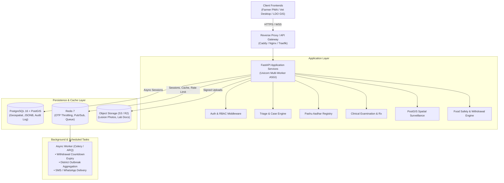
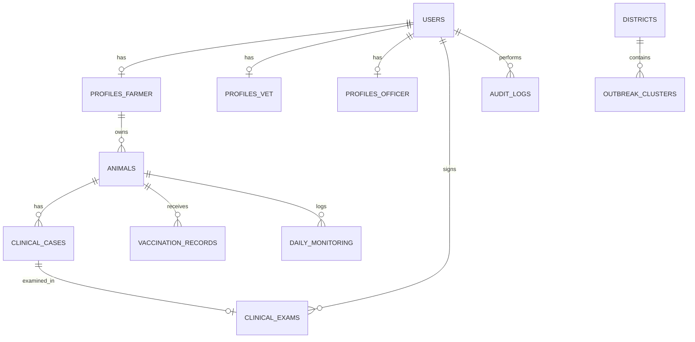
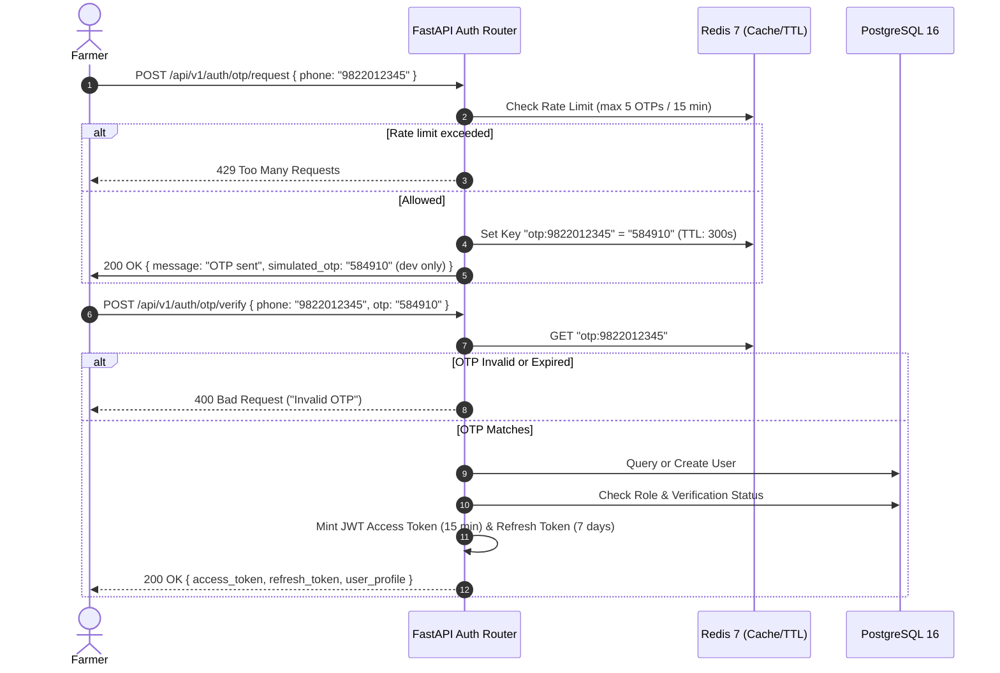
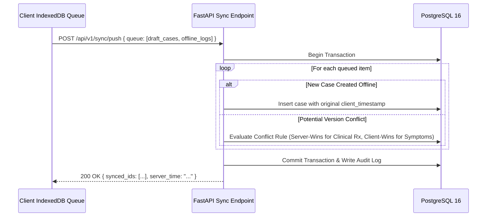

# ⚙️ PashuSachet (पशूसचेत) — Backend Architecture & Engineering Blueprint

> **Document Type:** Production Backend System Architecture & API Blueprint  
> **Status:** Specification Ready for Implementation  
> **Associated Specs:** [`FRONTEND_DESIGN_SPEC.md`](file:///g:/Chetan/pashuSachet/FRONTEND_DESIGN_SPEC.md) | [`plans.md`](file:///g:/Chetan/pashuSachet/plans.md) | [`ML_AI_SYSTEM_PLAN.md`](file:///g:/Chetan/pashuSachet/ML_AI_SYSTEM_PLAN.md)  
> **Target Stack:** FastAPI (Python 3.11+), PostgreSQL 16 + PostGIS, SQLAlchemy 2.0 (Async), Redis 7, Pydantic v2

---

## 1. System Topology & Core Stack



### Technology Selection Rationale
| Component | Technology | Rationale |
| :--- | :--- | :--- |
| **API Framework** | **FastAPI (Python 3.11)** | High-throughput asynchronous I/O, native Pydantic v2 data validation, automated OpenAPI/Swagger documentation, seamless integration with Python ML packages (`scikit-learn`, `numpy`). |
| **Relational Database** | **PostgreSQL 16** | ACID compliance, JSONB support for dynamic symptom vectors and audit logs, robust transactional integrity for medical records. |
| **Spatial Engine** | **PostGIS Extension** | Native spatial geometry (`GEOMETRY(Point, 4326)`), fast indexed spatial queries (`ST_DWithin`, `ST_ClusterDBSCAN`) for dispensary radius lookups and disease cluster mapping. |
| **ORM & Migrations** | **SQLAlchemy 2.0 (Async) + Alembic** | Modern async query engine, strict type safety, zero legacy sync blocking during database access. |
| **Cache & Task Broker** | **Redis 7** | Sub-millisecond rate-limiting token buckets, OTP temporary keys (TTL), background job dispatch for food-safety countdown workers. |
| **Photo Storage** | **S3-Compatible Object Store** | Pre-signed PUT/GET URLs ensuring application servers never ingest large multimedia binary payloads directly into memory. |

---

## 2. Complete Relational & Spatial Database Schema



### 2.1 Core Relational Tables & DDL

#### Table: `users`
```sql
CREATE TYPE user_role AS ENUM ('farmer', 'vet', 'officer', 'admin');
CREATE TYPE user_status AS ENUM ('active', 'pending_verification', 'suspended');

CREATE TABLE users (
    id UUID PRIMARY KEY DEFAULT gen_random_uuid(),
    phone_number VARCHAR(15) UNIQUE NOT NULL,
    role user_role NOT NULL DEFAULT 'farmer',
    status user_status NOT NULL DEFAULT 'active',
    language_pref VARCHAR(5) NOT NULL DEFAULT 'mr', -- 'mr', 'hi', 'en'
    consent_dpdp_agreed BOOLEAN NOT NULL DEFAULT FALSE,
    consent_timestamp TIMESTAMPTZ,
    created_at TIMESTAMPTZ NOT NULL DEFAULT NOW(),
    updated_at TIMESTAMPTZ NOT NULL DEFAULT NOW()
);

CREATE INDEX idx_users_phone ON users(phone_number);
CREATE INDEX idx_users_role ON users(role);
```

#### Table: `profiles_farmer`
```sql
CREATE TABLE profiles_farmer (
    user_id UUID PRIMARY KEY REFERENCES users(id) ON DELETE CASCADE,
    full_name VARCHAR(100) NOT NULL,
    village VARCHAR(100) NOT NULL,
    taluka VARCHAR(100) NOT NULL,
    district VARCHAR(100) NOT NULL,
    location GEOMETRY(Point, 4326),
    dairy_coop_member BOOLEAN DEFAULT FALSE,
    dairy_coop_name VARCHAR(100),
    created_at TIMESTAMPTZ NOT NULL DEFAULT NOW()
);

CREATE INDEX idx_profiles_farmer_location ON profiles_farmer USING GIST(location);
CREATE INDEX idx_profiles_farmer_district ON profiles_farmer(district, taluka);
```

#### Table: `profiles_vet`
```sql
CREATE TABLE profiles_vet (
    user_id UUID PRIMARY KEY REFERENCES users(id) ON DELETE CASCADE,
    full_name VARCHAR(100) NOT NULL,
    qualification VARCHAR(100) NOT NULL, -- e.g. "B.V.Sc & A.H."
    msvc_reg_no VARCHAR(50) UNIQUE NOT NULL,
    msvc_verified_by UUID REFERENCES users(id),
    msvc_verified_at TIMESTAMPTZ,
    dispensary_name VARCHAR(150) NOT NULL,
    dispensary_type VARCHAR(50) NOT NULL DEFAULT 'Government Dispensary', -- 'Government', 'Private Mobile'
    location GEOMETRY(Point, 4326) NOT NULL,
    coverage_radius_km NUMERIC(4, 1) NOT NULL DEFAULT 25.0,
    is_available BOOLEAN NOT NULL DEFAULT TRUE,
    created_at TIMESTAMPTZ NOT NULL DEFAULT NOW()
);

CREATE INDEX idx_profiles_vet_location ON profiles_vet USING GIST(location);
CREATE INDEX idx_profiles_vet_msvc ON profiles_vet(msvc_reg_no);
```

#### Table: `profiles_officer`
```sql
CREATE TABLE profiles_officer (
    user_id UUID PRIMARY KEY REFERENCES users(id) ON DELETE CASCADE,
    full_name VARCHAR(100) NOT NULL,
    department_id VARCHAR(50) UNIQUE NOT NULL,
    designation VARCHAR(100) NOT NULL, -- "LDO", "ADVO", "DVO"
    assigned_district VARCHAR(100) NOT NULL,
    assigned_talukas TEXT[] NOT NULL DEFAULT '{}',
    created_at TIMESTAMPTZ NOT NULL DEFAULT NOW()
);

CREATE INDEX idx_profiles_officer_district ON profiles_officer(assigned_district);
```

#### Table: `animals` (Pashu Aadhar Registry)
```sql
CREATE TYPE animal_species AS ENUM ('cattle', 'buffalo', 'goat', 'sheep', 'poultry');
CREATE TYPE animal_status AS ENUM ('active', 'transferred', 'deceased');

CREATE TABLE animals (
    id UUID PRIMARY KEY DEFAULT gen_random_uuid(),
    tag_id VARCHAR(32) UNIQUE NOT NULL, -- "PS-MH-2026-XXXX" or 12-digit INAPH
    owner_id UUID NOT NULL REFERENCES users(id) ON DELETE RESTRICT,
    name VARCHAR(50),
    species animal_species NOT NULL,
    breed VARCHAR(50) NOT NULL,
    gender VARCHAR(10) NOT NULL, -- 'female', 'male'
    dob_or_age_months INT NOT NULL,
    lactation_status VARCHAR(30) DEFAULT 'dry', -- 'in_milk', 'dry', 'heifer', 'pregnant'
    daily_milk_yield_liters NUMERIC(4, 1) DEFAULT 0.0,
    photo_url TEXT,
    status animal_status NOT NULL DEFAULT 'active',
    created_at TIMESTAMPTZ NOT NULL DEFAULT NOW(),
    updated_at TIMESTAMPTZ NOT NULL DEFAULT NOW()
);

CREATE INDEX idx_animals_tag ON animals(tag_id);
CREATE INDEX idx_animals_owner ON animals(owner_id);
CREATE INDEX idx_animals_species ON animals(species);
```

#### Table: `clinical_cases` (Triage & Case Dispatch)
```sql
CREATE TYPE urgency_tier AS ENUM ('CRITICAL', 'URGENT', 'MODERATE', 'ROUTINE');
CREATE TYPE case_status AS ENUM ('REPORTED', 'ASSIGNED', 'UNDER_EXAM', 'RESOLVED', 'REOPENED');

CREATE TABLE clinical_cases (
    id UUID PRIMARY KEY DEFAULT gen_random_uuid(),
    case_number VARCHAR(32) UNIQUE NOT NULL, -- "HC-2026-XXXX"
    animal_id UUID NOT NULL REFERENCES animals(id) ON DELETE RESTRICT,
    farmer_id UUID NOT NULL REFERENCES users(id) ON DELETE RESTRICT,
    assigned_vet_id UUID REFERENCES users(id),
    urgency urgency_tier NOT NULL DEFAULT 'MODERATE',
    symptoms_observed JSONB NOT NULL DEFAULT '[]', -- array of symptom IDs
    reported_temp_f NUMERIC(4, 1),
    onset_days INT NOT NULL DEFAULT 1,
    red_flag_triggered BOOLEAN NOT NULL DEFAULT FALSE,
    triage_model_output JSONB NOT NULL DEFAULT '{}', -- Indicative condition, confidence, safe first aid
    status case_status NOT NULL DEFAULT 'REPORTED',
    case_notes TEXT,
    created_at TIMESTAMPTZ NOT NULL DEFAULT NOW(),
    updated_at TIMESTAMPTZ NOT NULL DEFAULT NOW()
);

CREATE INDEX idx_cases_animal ON clinical_cases(animal_id);
CREATE INDEX idx_cases_vet ON clinical_cases(assigned_vet_id);
CREATE INDEX idx_cases_urgency ON clinical_cases(urgency);
CREATE INDEX idx_cases_status ON clinical_cases(status);
```

#### Table: `clinical_examinations` (Vet Examination & Food Safety Withholding)
```sql
CREATE TABLE clinical_examinations (
    id UUID PRIMARY KEY DEFAULT gen_random_uuid(),
    case_id UUID UNIQUE NOT NULL REFERENCES clinical_cases(id) ON DELETE CASCADE,
    vet_id UUID NOT NULL REFERENCES users(id) ON DELETE RESTRICT,
    rectal_temp_f NUMERIC(4, 1) NOT NULL,
    physical_findings TEXT NOT NULL,
    confirmed_diagnosis VARCHAR(150) NOT NULL,
    prescription JSONB NOT NULL DEFAULT '[]', -- Array of {drug_name, dose, route, duration_days}
    
    -- Food Safety Withdrawal Mandate
    milk_withdrawal_required BOOLEAN NOT NULL DEFAULT FALSE,
    milk_withdrawal_hours INT NOT NULL DEFAULT 0,
    meat_withdrawal_hours INT NOT NULL DEFAULT 0,
    withdrawal_source VARCHAR(150), -- "Drug Package Label (Flunixin Meglumine)"
    withdrawal_end_timestamp TIMESTAMPTZ,
    
    vet_signature_hash VARCHAR(128) NOT NULL, -- SHA256(vet_id + case_id + diagnosis + timestamp)
    is_demo_stamp BOOLEAN NOT NULL DEFAULT TRUE,
    created_at TIMESTAMPTZ NOT NULL DEFAULT NOW()
);

CREATE INDEX idx_exams_case ON clinical_examinations(case_id);
CREATE INDEX idx_exams_vet ON clinical_examinations(vet_id);
CREATE INDEX idx_exams_withdrawal ON clinical_examinations(withdrawal_end_timestamp) 
    WHERE milk_withdrawal_required = TRUE;
```

#### Table: `vaccination_records`
```sql
CREATE TABLE vaccination_records (
    id UUID PRIMARY KEY DEFAULT gen_random_uuid(),
    animal_id UUID NOT NULL REFERENCES animals(id) ON DELETE CASCADE,
    vaccine_name VARCHAR(100) NOT NULL, -- "FMD Dual Antigen", "LSD Live Attenuated"
    target_disease VARCHAR(100) NOT NULL,
    dose_number INT NOT NULL DEFAULT 1,
    batch_number VARCHAR(50) NOT NULL,
    manufacturer VARCHAR(100) NOT NULL,
    administered_by_id UUID REFERENCES users(id),
    administered_date DATE NOT NULL,
    next_booster_date DATE,
    cert_hash VARCHAR(64) NOT NULL,
    created_at TIMESTAMPTZ NOT NULL DEFAULT NOW()
);

CREATE INDEX idx_vaccines_animal ON vaccination_records(animal_id);
CREATE INDEX idx_vaccines_next_due ON vaccination_records(next_booster_date);
```

#### Table: `daily_monitoring_logs` (Model C Sensor / Manual Input)
```sql
CREATE TABLE daily_monitoring_logs (
    id UUID PRIMARY KEY DEFAULT gen_random_uuid(),
    animal_id UUID NOT NULL REFERENCES animals(id) ON DELETE CASCADE,
    log_date DATE NOT NULL,
    milk_yield_liters NUMERIC(4, 1),
    rectal_temp_f NUMERIC(4, 1),
    rumination_score INT, -- 1 to 5 scale
    feed_intake_pct INT,   -- percentage of normal feed eaten
    anomaly_detected BOOLEAN NOT NULL DEFAULT FALSE,
    anomaly_type VARCHAR(50), -- "SUDDEN_MILK_DROP", "FEBRILE_SPIKE"
    anomaly_confidence NUMERIC(3, 2),
    created_at TIMESTAMPTZ NOT NULL DEFAULT NOW(),
    UNIQUE(animal_id, log_date)
);

CREATE INDEX idx_monitoring_animal_date ON daily_monitoring_logs(animal_id, log_date DESC);
```

#### Table: `outbreak_clusters` (Spatial Surveillance Engine)
```sql
CREATE TYPE cluster_tier AS ENUM ('SIGNAL', 'CLINICAL', 'CONFIRMED');
CREATE TYPE alert_status AS ENUM ('ACTIVE', 'ACKNOWLEDGED', 'RING_DISPATCHED', 'CONTAINED');

CREATE TABLE outbreak_clusters (
    id UUID PRIMARY KEY DEFAULT gen_random_uuid(),
    district VARCHAR(100) NOT NULL,
    taluka VARCHAR(100) NOT NULL,
    disease_name VARCHAR(100) NOT NULL,
    confidence_tier cluster_tier NOT NULL DEFAULT 'SIGNAL',
    case_count INT NOT NULL DEFAULT 1,
    attack_rate_pct NUMERIC(4, 2) NOT NULL DEFAULT 0.0,
    centroid GEOMETRY(Point, 4326) NOT NULL,
    status alert_status NOT NULL DEFAULT 'ACTIVE',
    acknowledged_by UUID REFERENCES users(id),
    acknowledged_at TIMESTAMPTZ,
    containment_notes TEXT,
    created_at TIMESTAMPTZ NOT NULL DEFAULT NOW(),
    updated_at TIMESTAMPTZ NOT NULL DEFAULT NOW()
);

CREATE INDEX idx_outbreak_centroid ON outbreak_clusters USING GIST(centroid);
CREATE INDEX idx_outbreak_status ON outbreak_clusters(status, confidence_tier);
```

#### Table: `audit_logs` (Immutable Clinical & System Ledger)
```sql
CREATE TABLE audit_logs (
    id BIGSERIAL PRIMARY KEY,
    actor_id UUID REFERENCES users(id) ON DELETE SET NULL,
    actor_role VARCHAR(20) NOT NULL,
    action VARCHAR(100) NOT NULL, -- e.g. "CASE_CREATED", "VET_EXAM_SIGNED", "WITHDRAWAL_LOGGED"
    target_entity VARCHAR(50) NOT NULL, -- "clinical_cases", "animals"
    target_id VARCHAR(64) NOT NULL,
    details JSONB NOT NULL DEFAULT '{}',
    ip_address INET,
    created_at TIMESTAMPTZ NOT NULL DEFAULT NOW()
);

CREATE INDEX idx_audit_target ON audit_logs(target_entity, target_id);
CREATE INDEX idx_audit_actor ON audit_logs(actor_id);
CREATE INDEX idx_audit_time ON audit_logs(created_at DESC);
```

---

## 3. Authentication, RBAC & Token Lifecycle



### 3.1 Role Verification Matrix & Endpoint Guards

| Role | Verification Gate | Accessible Domains | Escalation Protection |
| :--- | :--- | :--- | :--- |
| **Farmer** | Mobile OTP verified. | Herd inventory, triage wizard, appointment booking, own care calendar, own food-safety warnings. | Cannot view or modify cases belonging to other farmers. |
| **Veterinarian** | MSVC State Council Registration number required; marked `pending_verification` until approved by Admin. | Triage inbox, clinical examination forms, Rx creation, withdrawal hour logging, clinic availability. | Endpoints protected by `@require_verified_vet`. 403 Forbidden returned if unverified. |
| **Officer (LDO)** | Government department ID required; verified by Admin. | 3-tier GIS map, district cluster analysis, outbreak acknowledgment, ring-vaccination dispatch. | Endpoints protected by `@require_officer`. Restricted to assigned district/talukas. |
| **Admin** | Provisioned strictly out-of-band (CLI bootstrap or superadmin invite); public signup forbidden. | Vet license verification queue, system triage rules manager, immutable audit ledger, system telemetry. | Endpoints protected by `@require_admin`. Requires dedicated MFA header in production. |

---

## 4. RESTful API Endpoints & Contracts

All endpoints return uniform response envelopes and use Pydantic v2 schemas:

```json
{
  "success": true,
  "data": { ... },
  "error": null,
  "meta": {
    "timestamp": "2026-11-04T00:52:00Z",
    "request_id": "req-89a1c4df"
  }
}
```

### 4.1 Authentication & Profile Endpoints
* `POST /api/v1/auth/otp/request`: Request 6-digit SMS OTP (rate-limited via Redis).
* `POST /api/v1/auth/otp/verify`: Verify OTP, return JWT access token (`Bearer <token>`).
* `POST /api/v1/auth/token/refresh`: Refresh expired 15-minute access token.
* `GET /api/v1/auth/me`: Fetch authenticated user profile, active role, and verification flags.
* `PUT /api/v1/auth/profile`: Update language preference (`mr`, `hi`, `en`), village, or dairy cooperative.

### 4.2 Animal Herd Registry (Pashu Aadhar)
* `GET /api/v1/animals`: List farmer's registered herd with status badges and tag IDs.
* `POST /api/v1/animals`: Register new animal with species, breed, age, and optional INAPH tag.
* `GET /api/v1/animals/{animal_id}`: Fetch complete Animal Passport, vitals, and timeline.
* `POST /api/v1/animals/{animal_id}/transfer`: Generate secure ownership transfer code.
* `POST /api/v1/animals/transfer/claim`: Claim animal using transfer code by new owner.

### 4.3 Guided Symptom Triage (Model A Engine)
* `POST /api/v1/triage/screen`:
  * **Payload:**
    ```json
    {
      "animal_id": "9b1deb4d-3b7d-4bad-9bdd-2b0d7b3dcb6d",
      "species": "cattle",
      "symptom_ids": ["nodules", "high_fever", "off_feed"],
      "rectal_temp_f": 103.8,
      "duration_days": 2,
      "red_flags": { "severe_bloat": false, "continuous_convulsions": false }
    }
    ```
  * **Response:**
    ```json
    {
      "urgency": "URGENT",
      "indicative_condition": "Suspected Lumpy Skin Disease",
      "confidence": 0.88,
      "differential_diagnoses": [
        { "name": "Bovine Papular Stomatitis", "probability": 0.08 },
        { "name": "Pseudo-Cowpox", "probability": 0.04 }
      ],
      "safe_first_aid": [
        "Isolate animal in well-ventilated shaded pen.",
        "Apply neem-based herbal fly repellant around lesions.",
        "Provide cool clean water; avoid unprescribed human medicines."
      ],
      "red_flag_alert": false,
      "suggested_action": "BOOK_LOCAL_DISPENSARY"
    }
    ```
* `POST /api/v1/triage/dispatch`: Convert screening result into active clinical case (`#HC-2026-XXXX`).

### 4.4 Veterinarian Workbench & Clinical Execution
* `GET /api/v1/vet/inbox`: Fetch urgency-sorted queue of pending triage cases.
* `GET /api/v1/vet/cases/{case_id}`: Fetch split-view case dossier (animal history + symptoms + vitals).
* `POST /api/v1/vet/cases/{case_id}/examine`:
  * **Payload:**
    ```json
    {
      "rectal_temp_f": 103.8,
      "physical_findings": "Multiple 2-3cm firm cutaneous nodules on neck and flank.",
      "confirmed_diagnosis": "Suspected Lumpy Skin Disease (Secondary Prophylaxis)",
      "prescription": [
        { "drug": "Flunixin Meglumine", "dose": "2.2 mg/kg IV", "days": 3 },
        { "drug": "Antiseptic Wound Spray", "dose": "Twice daily topical", "days": 5 }
      ],
      "milk_withdrawal_required": true,
      "milk_withdrawal_hours": 72,
      "withdrawal_source": "Drug Package Label (Flunixin Meglumine)"
    }
    ```
  * **Side Effects:**
    1. Case status set to `RESOLVED`.
    2. Digital signature hash computed and stamped.
    3. `withdrawal_end_timestamp` calculated (`NOW() + 72 hours`).
    4. Audit log event `VET_EXAM_SIGNED` written.
    5. WebSocket/Push event broadcast to farmer client to show Food Safety Warning.

### 4.5 Food Safety & Active Withholding Tracker
* `GET /api/v1/food-safety/active-withholding`: Returns active milk/meat withholding warnings for farmer's herd:
  ```json
  [
    {
      "animal_tag": "PS-MH-2026-08149",
      "animal_name": "Gauri",
      "prescribed_drug": "Flunixin Meglumine",
      "withdrawal_hours_total": 72,
      "seconds_remaining": 187200,
      "safe_consumption_datetime": "2026-11-07T11:00:00Z",
      "dispensary_vet": "Dr. Rajesh Kute (MSVC-2018-0941)"
    }
  ]
  ```

### 4.6 Spatial Surveillance & GIS (LDO Role)
* `GET /api/v1/surveillance/clusters`: Returns spatial clusters filtered by tier:
  * Query params: `district=Ahmednagar&tier=SIGNAL,CLINICAL,CONFIRMED`.
  * Returns GeoJSON FeatureCollection with attack rates and polygon boundaries.
* `POST /api/v1/surveillance/clusters/{cluster_id}/acknowledge`:
  * Records official officer action (`Acknowledged`, `Ring Vaccination Team Dispatched`).

### 4.7 Administrator Management & Auditing
* `GET /api/v1/admin/verifications/pending`: List veterinarians awaiting MSVC review.
* `POST /api/v1/admin/verifications/{vet_id}/approve`: Approve vet license.
* `GET /api/v1/admin/audit-ledger`: Paginated read of immutable audit records.

---

## 5. Offline Sync & Delta Reconciliation Protocol

Because rural field dispensaries and farms experience intermittent 2G/3G connectivity, the backend implements a resilient **Delta Sync Protocol**:



### Conflict Resolution Discipline:
1. **Clinical Diagnoses & Prescriptions:** **Server-Wins**. Only a licensed veterinarian's authenticated server action can commit clinical diagnoses and withdrawal rules.
2. **Symptom Reports & Vitals:** **Client-Wins with Original Timestamp**. The farmer's offline symptom submission preserves the time the farmer observed the illness.
3. **Idempotency Keys:** Every offline draft generates a client UUID `idempotency_key`. Retried sync pushes never create duplicate cases or duplicate animals.

---

## 6. Food Safety Countdown Worker & Automation

1. **Precision Calculation:**  
   $$T_{\text{remaining}} = \max\left(0, T_{\text{end}} - T_{\text{now}}\right)$$
   Where:
   $$T_{\text{end}} = T_{\text{exam\_signed}} + \text{WithdrawalHours} \times 3600$$
2. **Scheduled Sweeper (ARQ / Redis):**
   * Runs every 15 minutes.
   * Scans `clinical_examinations` where `milk_withdrawal_required = TRUE` and `withdrawal_end_timestamp > NOW()`.
   * Sends automated SMS/WhatsApp alerts to the farmer:
     * **At 24 hours remaining:** *"Reminder: Milk from Gauri is still under withholding. 24 hours remaining."*
     * **At 0 hours:** *"SAFE NOTICE: Withholding period complete for Gauri. Milk may now be safely collected for dairy cooperative supply."*

---

## 7. Implementation File Tree

```
backend/
├── app/
│   ├── api/
│   │   ├── v1/
│   │   │   ├── auth.py             # OTP request, verify, JWT refresh
│   │   │   ├── animals.py          # Pashu Aadhar CRUD, transfer protocol
│   │   │   ├── triage.py           # Model A symptom screening & dispatch
│   │   │   ├── vet.py              # Workbench inbox, clinical exam, withdrawal input
│   │   │   ├── food_safety.py      # Active milk/meat withholding queries
│   │   │   ├── surveillance.py     # PostGIS 3-tier outbreak GIS queries
│   │   │   └── admin.py            # Vet MSVC verification & audit ledger
│   │   └── deps.py                 # Dependency-injected RBAC security guards
│   ├── core/
│   │   ├── config.py               # Pydantic BaseSettings, env variables
│   │   ├── security.py             # JWT encode/decode, bcrypt hashing
│   │   └── database.py             # Async SQLAlchemy engine & session factory
│   ├── models/                     # SQLAlchemy 2.0 ORM database models
│   │   ├── user.py
│   │   ├── animal.py
│   │   ├── clinical.py
│   │   ├── surveillance.py
│   │   └── audit.py
│   ├── schemas/                    # Pydantic v2 validation schemas
│   │   ├── animal_schema.py
│   │   ├── triage_schema.py
│   │   ├── exam_schema.py
│   │   └── surveillance_schema.py
│   ├── services/
│   │   ├── triage_engine.py        # Calibrated Model A rule evaluator
│   │   ├── spatial_service.py      # PostGIS distance & clustering utilities
│   │   └── notification.py         # SMS / WhatsApp delivery adapter
│   └── workers/
│       ├── tasks.py                # ARQ background worker tasks
│       └── withdrawal_sweeper.py   # Scheduled withholding expiry checker
├── alembic/                        # Database migration scripts
├── tests/                          # Pytest test suites (unit, integration, auth)
├── Dockerfile                      # Production container spec
└── pyproject.toml                  # Python package dependencies & tool settings
```

---

> 📌 **Next Phase Execution:** This backend architecture cleanly pairs with [`FRONTEND_DESIGN_SPEC.md`](file:///g:/Chetan/pashuSachet/FRONTEND_DESIGN_SPEC.md) and [`ML_AI_SYSTEM_PLAN.md`](file:///g:/Chetan/pashuSachet/ML_AI_SYSTEM_PLAN.md).
