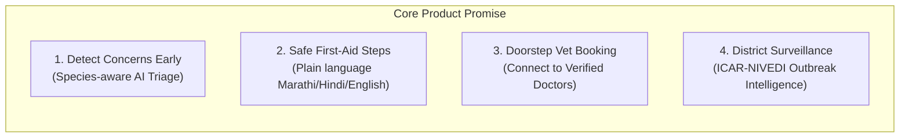
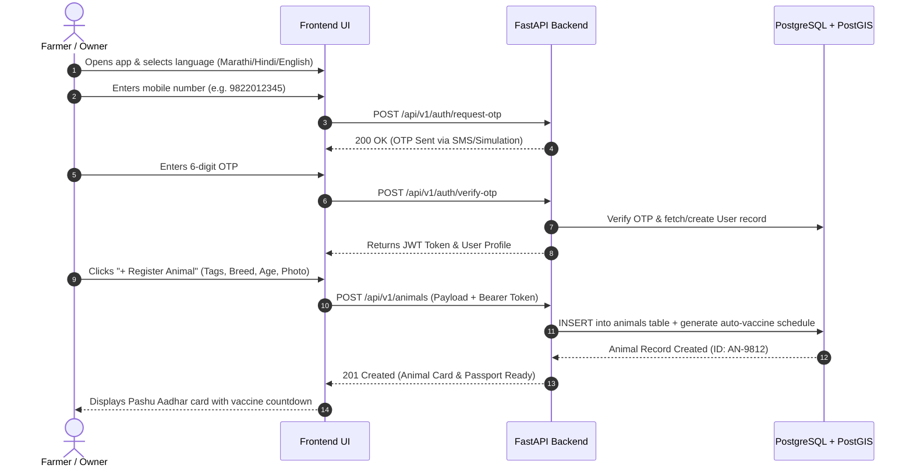
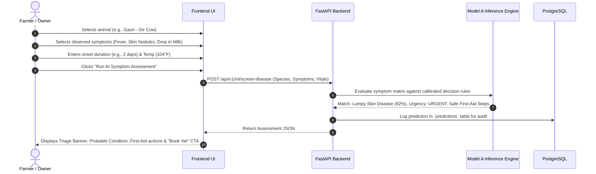
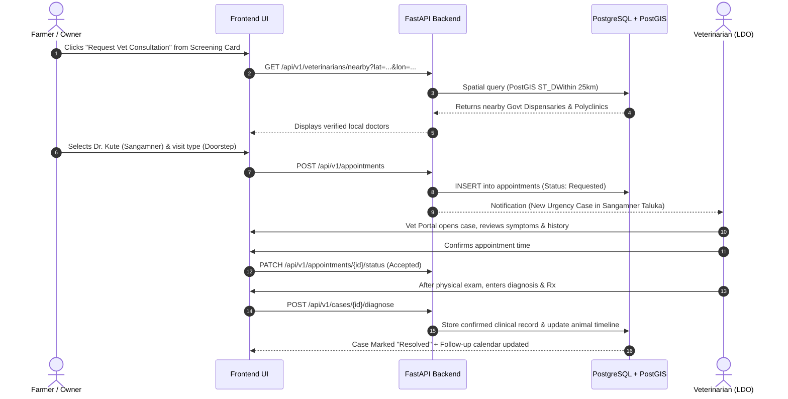
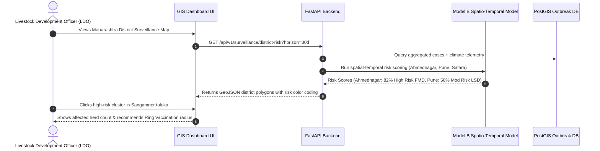
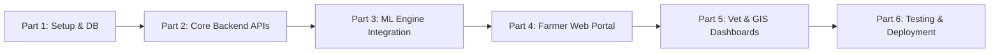

# 🐄 PashuSachet (पशूसचेत / Seva First)
# Master Prototype Architecture, User Flows & Phased Implementation Plan

> **Project Reference:** Seva First – Multilingual AI-assisted livestock health and veterinary-service platform for rural Maharashtra.  
> **Status:** Architecture & Specification Stage (Awaiting User Sign-off Before Code Implementation)

---


---

## 0. New Core Positioning & Architecture of Value

Seva First is **not another disease-forecasting or animal-registry platform**. It is the missing **last-mile participatory layer** that turns fragmented farmer observations into structured, real-time, village-level early warning signals and closed-loop action — while feeding cleaned data upward into existing national systems (**NADRES V2** and **Bharat Pashudhan / NDLM**).

> **One-Line Promise:**  
> *“Every farmer and para-vet in rural Maharashtra can report a concern in under 90 seconds (voice or simple form, even offline), receive an immediate safe-next-step + urgency score, trigger local verification and referral, and contribute to district-level intelligence — without creating a parallel silo.”*

### The 5 Differentiated Pillars:
1. **Participatory Real-Time Sentinel:** Farmers + para-vets submit structured micro-reports. System creates a live village-level “signal heat” (bottom-up continuous generation vs NADRES top-down monthly forecasts).
2. **Uncertainty-Aware Triage & Escalation Engine:** Rule + lightweight ML hybrid that outputs urgency tier, safe next action, confidence band, and escalation path (*self-monitor / para-vet visit / vet / sample kit / lab*). Explicit abstention on ambiguous data.
3. **Closed-Loop Referral & Sample Tracker:** End-to-end tracking from report ➔ appointment / MVU dispatch ➔ clinical examination ➔ sample collection ➔ lab status ➔ outcome.
4. **Federated Contribution Layer:** Verified cases de-identified and pushed to NADRES / state surveillance pipelines. Animal identity links to existing Pashu Aadhaar ear tags.
5. **Offline-First + Voice + Community Verification:** Full offline queue, Marathi-primary voice reporting, and para-vet confirmation of serious reports before high-urgency escalation.

---

## The Six Unclosed Operational Gaps Solved by Gram Signal System (GSS)

1. **Proactive, Continuous Village-Level Signal Generation:** Low-effort, always-available intake for signs, unusual patterns, and mortality (under 60–90 seconds via Missed call, USSD, Marathi voice IVR, WhatsApp voice).
2. **Very Low Digital Inclusion:** Prioritizes basic non-smartphone feature phones (*Missed call ➔ Marathi IVR callback ➔ USSD menu ➔ WhatsApp voice ➔ Offline Web App*). No smartphone, internet, or typing required for the basic report.
3. **Closed-Loop Sample ➔ Lab ➔ Result ➔ Action Tracking:** Transparent tracking for every case needing lab confirmation (*Sample Needed ➔ Collected + ID ➔ Dispatched to RDDL ➔ Lab Testing ➔ Result Linked ➔ Final Action Taken*). Visible to farmer, para-vet, and officer.
4. **Live Village / Block Operational Visibility:** Live “Village Signal Board” showing real-time verified ground observations (not speculative forecasting), with small-count privacy suppression ($<3$).
5. **Verification and Trust Layer:** Fast local verification step by trained village sentinels / para-vets (*Unverified ➔ Local Physical/Voice Check ➔ Verified Signal*), turning noisy crowd data into trusted actionable signals.
6. **Measurable Coordinated Response at Local Level:** Co-designed escalation rules (village vs block vs 1962 MVU), explicit ownership at each step, and automated lifecycle timestamp tracking (*Signal ➔ Verified ➔ Action ➔ Sample/Result ➔ Closed*).

### Linkage to Existing National Systems (Feeder & Enhancer)
* **1962 / MVUs:** Automatically notifies or creates a service request when escalation rules are triggered.
* **Bharat Pashudhan (NDLM):** Links to existing 12-digit Pashu Aadhaar ear tags without creating a parallel registry.
* **ICAR-NIVEDI NADRES:** Contributes cleaned, consented, de-identified verified signals as a continuous ground-truth field data feed.

### Core Success Metrics (Tied Directly to Gaps)
1. **Proactive Signal Volume:** Number of early, non-treatment-seeking signals per village per month.
2. **Digital Inclusion Ratio:** % of reports received through non-smartphone channels (Target: $>60\%$).
3. **Verification Speed:** Average turnaround time from signal to para-vet verification (Target: $<4$ hours).
4. **Sample Closure Rate:** % of sample cases reaching confirmed result and action taken (Target: $>90\%$).
5. **Officer Board Engagement:** Daily active officer usage of the Village Signal Board.
6. **Time to First Action:** Average elapsed time from verified signal to first official intervention (Target: $<12$ hours).

---

---

## Critical Real-World Flaws & How PashuSachet Solves Them

| Core Deficiency | Impact If Unfixed | PashuSachet Engineering Fix |
| :--- | :--- | :--- |
| **1. Complex App / Form Channels** | Excludes 70% of older, basic-phone farmers | Missed-Call + USSD + Marathi IVR as **primary**; smartphone web as secondary. |
| **2. Weak Immediate Farmer Benefit** | Farmers report only when animals are dying | Instant plain-Marathi action card + live status SMS + case-closure feedback message. |
| **3. Untrusted Raw Crowd Reports** | Officers dismiss incoming data as noise | Mandatory 30-second local para-vet verification gate before signals become actionable. |
| **4. Broken Diagnostic Sample Loop** | Loss of traceability on critical lab samples | Central 5-stage tracker: *Sample Needed ➔ Collected + ID ➔ Lab ➔ Result ➔ Action*. |
| **5. Extra Workload for Field Staff** | Resistance and boycott by busy veterinarians | Every field action $<30$–40 seconds; one-tap buttons, voice notes, eliminates phone tag. |
| **6. Slower than Direct 1962 Calls** | Farmers stick to traditional phone lines | System auto-injects critical tickets directly into 1962 MVU API with pre-populated GPS. |
| **7. Passive Aesthetic Dashboards** | Ignored by officers needing daily decisions | Action-oriented queue sorting cases by *“Decisions Required Today”* with simple filters. |
| **8. Lack of Real-World Field Proof** | Dismissed by evaluators as an academic demo | Immediate 5–10 village pilot measuring missed-call usage, verification time, and sample closure. |

---

## 1. System Vision & Non-Negotiable Boundaries

PashuSachet is designed to bridge the gap between rural livestock farmers, field veterinarians, and district livestock development officers (LDOs).



### Strict Clinical & AI Boundaries (From Blueprint)
1. **Decision Support, NOT Autonomous Prescription:** The platform provides preliminary screening and triage urgency ratings. Final diagnosis and pharmaceutical prescriptions are strictly reserved for certified veterinarians.
2. **Immediate Emergency Override:** If urgent signs are present (e.g. respiratory collapse, severe hemorrhage, acute bloat), the system immediately displays emergency helpline (1962) instructions without making the farmer wait for model inference.
3. **Abstention Policy:** If an input species is unsupported or clinical input is ambiguous/out-of-distribution, the model explicitly abstains rather than giving a low-confidence hallucination.
4. **Data Sovereignty & Privacy:** Farm-level outbreak reports are aggregated at the taluka/district level to prevent social stigma or disruption to local dairy cooperative procurement.

---

## 2. Complete Feature & Function Catalogue

### A. Frontend Feature Inventory

| Module | Feature Name | Description & Capabilities |
| :--- | :--- | :--- |
| **F-01** | **Multilingual Engine** | Real-time switching across Marathi (मराठी), Hindi (हिन्दी), and English. Voice-friendly labels and icons. |
| **F-02** | **Farmer Auth & Profile** | Mobile number + OTP sign-in, profile management (Village, Taluka, District, Milk Cooperative affiliation). |
| **F-03** | **Pashu Aadhaar Federated Link** | Integration-first identity: Links directly to official 12-digit Bharat Pashudhan ear tags (no competing silo). |
| **F-03B** | **Para-Vet Sensor Module** | Dedicated mobile interface for field workers to verify farmer reports, check vitals, and request sample kits. |
| **F-04** | **Vaccination Tracker** | Visual calendar tracking completed vs. upcoming vaccines (FMD, LSD, BQ, HS, PPR, Deworming) with due-date alerts. |
| **F-05** | **90-Second Report Flow** | Voice-first Marathi or 4-6 tap simple form, auto-location, optional photo, offline queueing. |
| **F-05B** | **Uncertainty Triage & Safe Steps** | Action routing with urgency grading and explicit abstention when observations are ambiguous. |
| **F-06** | **Triage & First-Aid Card** | Dynamic urgency banner (`CRITICAL`, `URGENT`, `MODERATE`), probability matches, rule-out conditions, and first-aid checklist. |
| **F-07** | **Veterinary Directory** | Geo-filtered list of Government Dispensaries, Taluka Polyclinics, and verified private mobile clinics with calling shortcut. |
| **F-08** | **Closed-Loop Referral & Sample Tracker** | End-to-end audit tracking: Report ➔ MVU Dispatch ➔ Clinical Exam ➔ Sample Hand-off ➔ Lab Status ➔ Outcome. |
| **F-08B** | **Village Signal Map** | Micro-spatial signal heat map at village/block level with small-count privacy suppression ($k$-anonymity). |
| **F-09** | **Veterinarian Portal** | Vet triage queue, case inspection, clinical record documentation, prescription entry, and follow-up scheduling. |
| **F-10** | **Officer GIS Map** | Interactive district & taluka outbreak heatmap, active cluster cards, vaccination drive dispatch triggers. |
| **F-11** | **Offline Queue** | Local storage of case drafts and animal edits when rural connectivity is lost; auto-syncs when online. |

---

### B. Backend Services & API Inventory

```
app/
├── api/
│   ├── v1/
│   │   ├── auth.py            # OTP generation, verification, JWT session tokens
│   │   ├── users.py           # Farmer, Vet, and Officer profile endpoints
│   │   ├── animals.py         # Pashu Aadhar CRUD, health passport timelines
│   │   ├── screening.py       # Model A symptom screening and triage evaluation
│   │   ├── cases.py           # Case state machine (Draft -> Submitted -> Under Care -> Resolved)
│   │   ├── appointments.py    # Appointment scheduling, acceptance, reschedule, completion
│   │   ├── veterinarians.py   # Geo-spatial vet discovery (PostGIS radius search)
│   │   ├── surveillance.py    # Outbreak telemetry, district risk scores (Model B)
│   │   └── anomalies.py       # Daily milk/rumination anomaly detection (Model C)
```

| Service | Endpoint | HTTP | Purpose |
| :--- | :--- | :--- | :--- |
| **Auth** | `/api/v1/auth/request-otp` | `POST` | Generate and dispatch 6-digit OTP |
| **Auth** | `/api/v1/auth/verify-otp` | `POST` | Validate OTP and issue JWT access token |
| **Users** | `/api/v1/users/me` | `GET/PATCH` | Retrieve or update user profile and language preference |
| **Animals** | `/api/v1/animals` | `GET/POST` | List herd animals or register new livestock with tag ID |
| **Animals** | `/api/v1/animals/{id}` | `GET/PATCH` | Fetch animal health history timeline or edit details |
| **Screening** | `/api/v1/ml/screen-disease` | `POST` | Run Model A triage inference on symptom vector |
| **Cases** | `/api/v1/cases` | `POST` | Create formal clinical case from screening result |
| **Cases** | `/api/v1/cases/{id}` | `GET` | Retrieve case details, clinical timeline, and status |
| **Cases** | `/api/v1/cases/{id}/diagnose` | `POST` | Vet adds confirmed diagnosis, treatments, and follow-up |
| **Vets** | `/api/v1/veterinarians/nearby` | `GET` | Find verified vets within radius using PostGIS `ST_DWithin` |
| **Appts** | `/api/v1/appointments` | `POST` | Submit visit request with animal ID, case ID, preferred time |
| **Appts** | `/api/v1/appointments/{id}/status` | `PATCH` | Vet accepts, reschedules, or marks completed |
| **GIS** | `/api/v1/surveillance/district-risk` | `GET` | Retrieve 30-day forecasted disease risk scores (Model B) |
| **Anomalies** | `/api/v1/ml/detect-anomaly` | `POST` | Evaluate vital/milk deviation from baseline (Model C) |

---

## 3. End-to-End User & System Flows

### Flow 1: Farmer Onboarding & Animal Registration (Pashu Aadhar)



---

### Flow 2: Guided Symptom Reporting & AI Screening (Model A)



---

### Flow 3: Veterinary Booking & Clinical Case Lifecycle



---

### Flow 4: Outbreak Surveillance & GIS Alerting (Model B)



---

## 4. Machine Learning Design & Clinical Rules

```
                      +-----------------------------+
                      |   Structured Symptom Input  |
                      |  (Species, Signs, Vitals)   |
                      +--------------+--------------+
                                     |
                                     v
                       +---------------------------+
                       |    Safety Gate Check      |
                       | Any acute fatal signs?    |
                       +-------------+-------------+
                                     |
                    +----------------+----------------+
                    |                                 |
              [Yes: Acute]                      [No: Standard]
                    |                                 |
                    v                                 v
        +-----------------------+         +-----------------------+
        | Immediate Emergency   |         | Model A Inference     |
        | Banner (Call 1962)    |         | (Species-Aware Rules) |
        +-----------------------+         +-----------+-----------+
                                                      |
                                     +----------------+----------------+
                                     |                                 |
                               [High Match]                     [Low / Unclear]
                                     |                                 |
                                     v                                 v
                         +-----------------------+         +-----------------------+
                         | Ranked Conditions,    |         | Abstention Flagged    |
                         | Urgency & First Aid   |         | "Require Physical Vet"|
                         +-----------------------+         +-----------------------+
```

### Supported Species & Key Targets
* **Cattle (Cow 🐄):** Lumpy Skin Disease (LSD), Foot & Mouth Disease (FMD), Haemorrhagic Septicaemia (HS), Black Quarter (BQ), Clinical Mastitis.
* **Buffalo 🐃:** FMD, HS, Mastitis, Non-specific Ruminal Indigestion.
* **Goat 🐐 & Sheep 🐑:** Peste des Petits Ruminants (PPR), Enterotoxaemia (ET), Contagious Ecthyma (Orf).
* **Poultry 🐔:** Newcastle Disease (Ranikhet), Coccidiosis, Infectious Coryza.

---

## 5. Multi-Part Phased Implementation Roadmap

To build this methodically without getting overwhelmed, we break the development into **6 concrete parts**:



### 🔹 Part 1: Project Scaffolding, Database Models & Local Environment
* Configure directory structure (`backend/` with FastAPI, `frontend/` with modern web bundle).
* PostgreSQL 16 + PostGIS Docker Compose configuration.
* SQLAlchemy 2.0 ORM models (`User`, `Animal`, `HealthCase`, `Appointment`, `ClinicalRecord`, `OutbreakRecord`).
* Alembic database migration scripts.

### 🔹 Part 2: Backend Core Services & Authentication
* Mobile OTP generation and validation simulation.
* JWT bearer token authorization middleware with role verification (`farmer`, `vet`, `officer`, `admin`).
* Animal Health Passport CRUD endpoints.
* Verified Veterinarian directory endpoints with PostGIS spatial radius query.

### 🔹 Part 3: ML Inference Engines & Triage Rules
* Model A inference service with species-specific rule matrix and calibrated uncertainty score.
* Vet-approved first-aid advice library in English, Marathi, and Hindi.
* Model B spatio-temporal outbreak risk calculator using ICAR-NIVEDI baseline records.
* Model C rolling baseline anomaly calculation module.

### 🔹 Part 4: Farmer Portal & Symptom Screening Interface
* Touch-friendly responsive mobile UI for farmers.
* Interactive 3-step symptom checklist with species filtering.
* Color-coded assessment card with emergency warnings and first-aid recommendations.
* LocalStorage / IndexedDB offline draft queue for low-connectivity environments.

### 🔹 Part 5: Veterinarian Triage & District Officer GIS Portals
* Veterinarian Portal: Incoming triage queue, case inspection, diagnosis documentation, and appointment calendar.
* Officer GIS Dashboard: Interactive Maharashtra district map with disease filters and cluster indicators.
* One-click appointment booking modal linking farmers directly to local dispensaries.

### 🔹 Part 6: Real-World Data Seeding, End-to-End Testing & Deployment
* Seed script loading authentic Maharashtra district coordinates, historical outbreak baselines (DAHD / ICAR-NIVEDI), and sample herds.
* Pytest test suite covering API contracts, auth, triage rules, and spatial queries.
* CI/CD deployment configuration (Vercel for Frontend, Render/Railway/Docker for Backend API).

---

## 6. Key Decisions for User Sign-Off

Before we write code for Part 1, please review and confirm the following design decisions:

1. **Frontend Architecture:**
   - **Option A (Recommended for Prototype):** High-performance modular HTML5/ES6/CSS SPA that runs cleanly on Vercel without heavy node build overhead, instant mobile loading on rural 2G/3G connections.
   - **Option B:** Full Next.js (React + TypeScript + Tailwind) application requiring full Node server or static export.
2. **Backend Framework:**
   - **FastAPI (Python 3.11):** Clean async REST endpoints, automatic Swagger/OpenAPI documentation at `/docs`, native integration with Python ML packages (`scikit-learn`, `numpy`).
3. **Database Choice:**
   - **PostgreSQL 16 + PostGIS:** Local via Docker Compose or free cloud database (e.g. Supabase Postgres with PostGIS enabled).

