# 🐄 PashuSachet (पशूसचेत) — Frontend Design Specification & Execution Plan
## “The Village Animal-Care Notebook” (गावची पशु-नोंदवही)

> **Design Paradigm:** Moving away from sterile SaaS dashboards and AI templates toward a warm, dependable, field-ready digital care register.  
> **Brand Subtitle:** PashuSachet — पशु आरोग्य साथी  
> **Core Visual Metaphor:** The physical animal-care notebook + the livestock ear tag + the village care network.  
> **Rule:** Specification & Execution Blueprint only — **no implementation code until approved.**

---

## 1. Visual Personality & Design Foundations

| Attribute | Direction | Field Implementation Details |
| :--- | :--- | :--- |
| **Overall Feel** | Warm, grounded, dependable | Feels like a modern, clean physical notebook used by trusted dairy cooperatives and field livestock supervisors. |
| **Layout** | Editorial, spacious, task-led | Generous breathing room, clear reading hierarchy, focused one-step-at-a-time tasks. |
| **Visual Motif** | Notebook rules, animal tags, field stamps | Subtle paper textures, tactile ear-tag badge shapes, verified clinical ink stamps. |
| **Photography** | Real livestock & rural life | Natural morning/evening daylight, indigenous breeds (Gir, Khillari, Murrah, Osmanabadi), authentic Indian farmers. |
| **Icons** | Simple line icons (2px stroke) | Used strictly to assist task comprehension, never as decorative filler. |
| **Card Discipline** | Functional grouping only | Cards used only when grouping distinct records; avoided when clean notebook rules work better. |
| **Data Display** | Practical field progress | Milestone timelines, clear calendar grids, and geographical risk bands—zero decorative pie charts. |

> 🚫 **Anti-Patterns Strictly Prohibited:**
> * No dark-glass glassmorphism or neon drop shadows.
> * No generic medical crosses, dog/cat paws, or AI sparkle badges (`✨`).
> * No sterile hospital-white canvases or generic bootstrap purple/blue gradients.
> * No endless rows of meaningless high-level metrics on the farmer's screen.

---

## 2. Palette: “Ink, Turmeric, Clay & Paper”

```
┌────────────────────────────────────────────────────────────────────────┐
│  Field Ink        Turmeric         Notebook Paper   Terracotta         │
│  #243B32          #E4A72D          #F6F0E4          #B9654B            │
│  (Brand/Nav)      (Primary Action) (Main Canvas)    (Field Notes/Tags) │
├────────────────────────────────────────────────────────────────────────┤
│  Clean White      Slate Sage       Urgent Red                          │
│  #FFFFFF          #6D756E          #DC2626                             │
│  (Panels/Slips)   (Secondary Text) (Critical Alert Only)               │
└────────────────────────────────────────────────────────────────────────┘
```

### Color Roles & Behavioral Rules:
* **Notebook Paper (`#F6F0E4`):** The primary background canvas for the entire application. Soft on the eyes under harsh sunlight and distinctly warmer than sterile pure white.
* **Field Ink (`#243B32`):** Primary brand anchor, header navigation, professional left-rails, and primary typography.
* **Turmeric (`#E4A72D`):** The primary call-to-action button, active step indicator, and key touchpoint.  
  * *Accessibility Rule:* Turmeric buttons **always use dark Field Ink text (`#243B32`)** to guarantee a 7:1 contrast ratio.
* **Terracotta (`#B9654B`):** Secondary accents, tag accents, field notes, and non-urgent clinical flags.
* **Clean White (`#FFFFFF`):** Reserved for paper record slips, form inputs, modal sheets, and animal passport cards.
* **Slate Sage (`#6D756E`):** Secondary timestamps, helper labels, and subtle borders.
* **Urgent Red (`#DC2626`):** Strictly reserved for emergency triage alerts, severe symptom red flags, and food safety withdrawal warnings.

---

## 3. Brand Identity & Design Language

### 3.1 Logo & Mark
* **Symbol:** A minimal 24×24px mark combining the silhouette of a livestock ear tag with an organic leaf/check curve. Recognizable on low-resolution feature-phone browsers and app icons.
* **Wordmark:** `PashuSachet` in sturdy semi-bold type, accompanied by the vernacular descriptor: **पशु आरोग्य साथी** (Livestock Health Companion).

### 3.2 Dual-Script Typography System
* **English & Numerics:** **Manrope** (geometric, highly readable at small tag sizes, clear numeric distinction for tag IDs).
* **Marathi & Hindi:** **Noto Sans Devanagari** (crafted for natural Devanagari ligatures, balanced conjuncts, generous line heights).
* **Scale:** Body text set at **16px–18px** with a **1.6 line-height** to prevent cluttered reading in Devanagari scripts.

### 3.3 Signature Tactile Elements
* **The Ear-Tag ID Pill:** Styled with a subtle notched top and brass-grommet punch, displaying `PS-MH-2026-XXXX`.
* **The Clinical Verification Stamp:** A circular stamped border with rotation `transform: rotate(-3deg)` marking records confirmed by licensed veterinarians: `[✓ MSVC VERIFIED CLINICAL RECORD]`.
* **The Record Slip:** Vaccination certificates and prescriptions render as perforated physical slips with monospace serial numbers and clean tabular lines.

---

## 4. Entire Application Workspace Map

```
PashuSachet Platform
│
├── 👨‍🌾 1. FARMER WORKSPACE (Mobile-First, Touch & Voice-Led)
│   ├── Home ("Today's Care")
│   ├── My Animals (Herd Inventory & Pashu Aadhar Passports)
│   ├── Health Check (Guided Symptom Triage Flow)
│   ├── Vet Visits (Directory & Doorstep Booking)
│   ├── Care Calendar (Vaccinations & Deworming)
│   ├── Food Safety (Milk & Meat Withholding Tracker)
│   └── Profile & Settings (Village, Offline Sync, DPDP Data Rights)
│
├── 🩺 2. VETERINARIAN WORKSPACE (Desktop & Tablet Clinical Workbench)
│   ├── Operational Workbench (Urgent cases, today's visits, follow-up list)
│   ├── Triage Inbox (Urgency-sorted work queue with symptom vectors)
│   ├── Case Inspection (Split view: Animal History + Exam/Rx Form)
│   ├── Clinical Examination (Diagnosis, medications, withdrawal duration)
│   ├── Appointment Manager (Calendar dispatch & visit completion)
│   └── Clinic Profile (MSVC license, coverage radius, hours)
│
├── 🏛️ 3. LIVESTOCK OFFICER (LDO) WORKSPACE (Field Surveillance Tool)
│   ├── Situation Overview (Active clusters, attack rates, species breakdown)
│   ├── 3-Tier GIS Heatmap (Signal vs. Clinical vs. Confirmed outbreaks)
│   ├── Outbreak Alert Console (Structured action acknowledgment log)
│   ├── Field Response & Campaigns (Ring-vaccination planner, mobile teams)
│   └── Official Bulletins (Automated PDF/CSV district exports)
│
└── 🛡️ 4. ADMINISTRATOR WORKSPACE (Securely Provisioned Governance)
    ├── User Verification Queue (MSVC Vet review & LDO jurisdiction approval)
    ├── Disease Rules Engine (Triage matrices & species symptom weights)
    ├── Vaccination Schedule Editor (Curated clinical guidance config)
    ├── Data Quality Monitor (Duplicate tags, missing records, stale telemetry)
    └── System Audit Ledger (Immutable clinical modifications & access logs)
```

---

## 5. Shared Navigation & Responsive Shell Architecture

### 5.1 Farmer: Mobile-First Bottom Navigation
Designed for one-thumb field use while holding a notebook or tending cattle.

```
┌─────────────────────────────────────────────────────────────┐
│  PashuSachet • पशु आरोग्य साथी                [EN | म | हि]  │
├─────────────────────────────────────────────────────────────┤
│                                                             │
│                      [SCREEN CONTENT]                       │
│                                                             │
├─────────────────────────────────────────────────────────────┤
│   [🏠 Home]    [🐄 Animals]   (🩺 CHECK)   [📅 Care]   [⚙️ More] │
│                               ▲ Prominent                   │
│                                 Turmeric                    │
│                                 Fab Button                  │
└─────────────────────────────────────────────────────────────┘
```
* **Destinations:**
  1. `Home`: Today's care tasks, active cases, weather alerts.
  2. `Animals`: Photo herd inventory, Pashu Aadhar cards.
  3. `Health Check (Center Action)`: High-contrast Turmeric action button invoking the guided screening assistant.
  4. `Care`: Vaccination timeline, deworming, food safety withdrawal countdown.
  5. `More`: Profile, emergency 1962 hotline, offline queue, privacy settings.

### 5.2 Professional Portals: Desktop & Tablet Left Navigation
* **Left Sidebar:** Dark Field Ink (`#243B32`) background, crisp white/turmeric active states, role badge (`Veterinarian Workspace` or `LDO Surveillance`).
* **Header Bar:** Active jurisdiction / clinic name, quick search, language toggle, notification bell, user profile.
* **Split View Work Area:** Left side for queue/case list; right side for live patient passport, photo evidence, and clinical actions.
* **Mobile Responsiveness:** Collapses seamlessly into a slide-over drawer with stacked touch cards.

---

## 6. Farmer Experience: Screen-by-Screen Specification

### 6.1 Welcome, Language & Onboarding
* **Screen 1: Welcome:** Real portrait of an Indian farmer with cow in soft natural light. Headline: *"Care for every animal, one step at a time."* Prominent language buttons (`मराठी`, `हिन्दी`, `English`) right up front.
* **Screen 2: Mobile OTP:** Clean phone input with pre-filled `+91`. Automatic 6-digit focus, 30-second resend countdown, plain-language error messaging for expired codes.
* **Screen 3: Profile Setup:** Farmer's name, village, taluka, district, and optional milk society name.
* **Screen 4: First Animal Prompt:** Immediate warm empty-state prompt: *"Let's add your first animal to your care notebook."*

### 6.2 Farmer Home: “Today's Care” (आजची काळजी)
Replaces sterile dashboards with a daily action-oriented care notebook.
1. **Header:** *"नमस्कार, राम | Your village: Sangamner | Last synced: Just now"*.
2. **Prominent Action Banner:** *"Need help with an animal? Tell us what you noticed."* ➔ `[Start a health check →]` button.
3. **Today's Care List:**
   * 🟡 **Vaccination Due Today:** *Gauri (Gir Cow) • FMD Booster* ➔ `[View Slip]`.
   * 🟢 **Vet Visit Tomorrow:** *Moti (Bullock) • Dr. Kute at 10:30 AM* ➔ `[Details]`.
   * ⚠️ **Active Milk Withholding:** *Laxmi (Murrah Buffalo) • 48 hours remaining* ➔ `[Food Safety Note]`.
4. **My Animals Strip:** Horizontal carousel of animal portrait cards with ear tags.
5. **Emergency Bar:** Instant tap-to-call for local dispensary and **1962 National Helpline**.

### 6.3 Animal Registry & Pashu Aadhar Passport
* **Animal List View:** Photo-led grid/list showing animal name, species icon, `PS-` ear tag badge, and health status pill (`Care Due`, `Under Treatment`, `Healthy`).
* **Register Animal (Progressive 4-Step Form):**
  * *Step 1 (Identity):* Species, name, breed, sex, estimated age/birth date, coat markings, photo upload.
  * *Step 2 (Identification):* Generated `PS-MH-2026-XXXX` tag + optional official 12-digit Bharat Pashudhan tag. Live duplicate check validation.
  * *Step 3 (Ownership):* Village location and consent confirmation.
  * *Step 4 (Review & Pass):* Generates the digital health passport card with printable QR code.
* **Signature Screen: The Digital Pashu Aadhar Passport:**
  * Top: Full animal portrait, tag number, species/breed, age.
  * Tabs:
    * `Overview`: Demographic vitals, lactation stage, owner info.
    * `Health Timeline`: Chronological dated notebook entries of all past symptoms, cases, and vet visits.
    * `Vaccination`: Official record slip showing completed vs. upcoming doses with batch numbers.
    * `Treatment & Rx`: Prescribed medicines, vet notes, and withdrawal periods.
    * `Ownership Transfer`: Secure button to transfer animal to another farmer.

### 6.4 Guided Health Screening (Model A)
A guided, calm conversation rather than an intimidating medical form:
* **Step 1:** Select animal from your registered herd.
* **Step 2:** *"What have you noticed?"* Large illustrated choices:
  * 🌾 Not eating / Off feed
  * 🌡️ High body fever
  * 🔴 Skin lumps or nodules
  * 👄 Mouth sores or drooling
  * 🩹 Foot wounds or lameness
  * 🫁 Heavy breathing or coughing
  * 🥛 Swollen udder or milk drop
  * ⚠️ Sudden diarrhea or collapse
* **Step 3:** Dynamic follow-ups based on selection (e.g. onset days, rectal temperature slider).
* **Step 4 (Red Flag Check):** Checks for immediate fatal signs (severe bloat, continuous convulsions, sudden bleeding).  
  * *Emergency Override:* If checked, the normal flow immediately pauses to display: **"EMERGENCY CARE REQUIRED: Do not wait for model. Call 1962 or your local vet immediately."**
* **Step 5 (Screening Result):**
  * Triage Banner: Urgency rating (`CRITICAL`, `URGENT`, `MODERATE`).
  * Possible Conditions: Plain-language matching conditions with calibrated uncertainty.
  * What Triggered This: Clear list of symptoms matching the pattern.
  * Safe First-Aid Steps: Immediate safe home care (isolate, shade, clean water, fly repellent).
  * Clinical Disclaimer: Clear note that this is preliminary screening and not a prescription.
  * Action: `[Book Local Government Vet Now]` with auto-filled case reference `#HC-XXXX`.

### 6.5 Vet Directory & Consultation Booking
* **Directory Search:** Geo-filtered cards showing local Government Veterinary Dispensaries (Grade 1 & 2), Mobile Veterinary Clinics, and verified surgeons.
* **Booking Flow:**
  1. Select animal & linked clinical case.
  2. Choose consultation mode: `[Doorstep Field Visit]` | `[Visit Dispensary]` | `[Tele-Triage Call]`.
  3. Select preferred date & morning/afternoon slot.
  4. Submit request ➔ Displays real-time status tracker (`Pending` ➔ `Confirmed` ➔ `Completed`).

### 6.6 Vaccination & Care Calendar
* Styled like an authentic rural veterinary health register.
* Visual distinction between:
  * 🟢 **Completed:** Vaccine name, date given, administering vet, batch number.
  * 🟡 **Due Soon:** 14-day countdown pill with "Remind Me" alert toggle.
  * 🔴 **Overdue:** Urgent alert to prevent local herd transmission.
* Downloadable Official Vaccination Certificate (PDF slip with verification QR).

### 6.7 Food Safety & Medication Withdrawal (Milk & Meat Withholding)
A dedicated, high-priority safety screen:
* Displays any animal currently under antibiotic or pharmaceutical treatment.
* Shows the **veterinarian-entered withdrawal period** (e.g., 72 hours for milk, 28 days for meat).
* Large live countdown timer: *"DO NOT CONSUME OR SELL MILK from Gauri for another 38 hours"*.
* Explains the One Health reason: protecting family health and milk cooperative supply from drug residues.

### 6.8 Animal Vital Monitoring (Model C)
* Simple daily tracking form: Today's milk yield (Liters), body temperature (°F), rumination check.
* Live anomaly alert card if milk yield drops >30% or temperature spikes, prompting early vet check before physical lesions appear.

---

## 7. Veterinarian Experience: The Clinical Workbench

### 7.1 Vet Home & Operational Summary
* Clean, focused summary cards:
  * 🔴 **Urgent Cases Requiring Action (3)**
  * 📅 **Today's Scheduled Field Visits (4)**
  * 🔄 **7-Day Follow-ups Due (2)**
  * ⚠️ **Reopened Cases (1)**

### 7.2 Urgency-Sorted Case Inbox
* Tabular queue sorted strictly by clinical urgency:
  * Columns: Urgency Pill, Submission Time, Animal & Tag, Village, Primary Symptoms, Status, Quick Action.
  * Quick filter by Taluka and species.

### 7.3 Split-View Case Details & Examination
* **Left Panel (Patient Passport):**
  * Animal demographics, owner contact, reported symptoms, lesion photo viewer, prior vaccination history, and Model C daily milk/temperature curves.
* **Right Panel (Clinical Examination & Prescription Form):**
  1. **Physical Findings:** Temperature, mucous membranes, lymph nodes, rumen motility.
  2. **Confirmed Diagnosis:** Formal veterinary diagnosis code and clinical notes.
  3. **Treatment & Prescription:** Drug name, dosage, route (IM/IV/SC/Oral), frequency, duration.
  4. **Mandatory Withdrawal Period:** Vet explicitly enters withdrawal days for milk and meat with the clinical rule source.
  5. **Follow-up & Resolution:** Set re-check date, mark case `Resolved`, or refer to District Polyclinic.

---

## 8. Livestock Officer (LDO) Experience: Operational Surveillance Tool

### 8.1 Situation Overview & Metrics
* Active clusters by disease, 30-day incidence trends, and mobile vaccination team progress.

### 8.2 Three-Tier GIS Outbreak Heatmap
* **Interactive District Map:** District ➔ Taluka ➔ Village polygon zoom.
* **Strict 3-Tier Layer Toggles:**
  * 🔵 *Tier 1: Suspected Signals* (Farmer symptom self-reports — internal early warning only).
  * 🟡 *Tier 2: Vet-Examined Cases* (Clinically diagnosed cases by dispensaries).
  * 🔴 *Tier 3: Confirmed Outbreaks* (Laboratory confirmed by ELISA/PCR).
* **Cluster Inspection:** Clicking a cluster opens the affected village list, livestock census denominator, and attack rate.

### 8.3 Outbreak Alert Acknowledgment & Field Response
* When taluka thresholds are breached, the officer reviews the cluster alert and logs a mandatory action:
  * `[Acknowledged - Monitoring]`
  * `[Dispatched Mobile Veterinary Unit]`
  * `[Initiated Ring-Vaccination Campaign (5 km Radius)]`
* One-click generation of official District Epidemiological Bulletins (PDF/CSV).

---

## 9. Administrator Experience: Governance & System Integrity

1. **User Verification Queue:** Review pending veterinarian MSVC licenses and officer government IDs with high-resolution document previews and `[Approve]` / `[Reject with Reason]` actions.
2. **Disease Rules & Vaccine Configurator:** Update clinical screening matrices, symptom weights, and regional vaccination schedules based on validated veterinary guidelines.
3. **Data Quality Panel:** Live audit identifying duplicate tag entries, missing clinical outcomes, and stale surveillance feeds.
4. **Demo Audit Log:** Detailed chronological log tracking actor, action, timestamp, entity ID, previous value, and new value.

---

## 10. Comprehensive State Management (Beyond Happy Paths)

Every major screen in PashuSachet must explicitly support all 10 essential states:

```mermaid
flowchart TD
    State["Screen Render State"] --> S1["1. Loading: Skeleton notebook lines"]
    State --> S2["2. Empty: Helpful prompt & primary action"]
    State --> S3["3. Error: Plain-language cause & retry button"]
    State --> S4["4. Offline: Sticky paper banner & IndexedDB draft save"]
    State --> S5["5. Sync Pending: Pulsing sync icon showing queued items"]
    State --> S6["6. Permission Denied: Clear explanation & unlock pathway"]
    State --> S7["7. Verification Pending: Friendly review status screen"]
    State --> S8["8. Success: Perforated record slip confirmation"]
    State --> S9["9. Destructive Action: Two-step confirmation with consequence"]
    State --> S10["10. Urgent Red Flag: Emergency interruption with 1962 hotline"]
```



---

## 11. Accessibility & Multilingual Architecture

* **Touch Targets:** All primary touch controls, buttons, and symptom chips maintain a strict minimum bounding box of **48×48px**.
* **Zero Color-Only Information:** Status pills always combine an explicit text label + icon + distinct border styling.
* **Persistent Form Labels:** Floating or top-stacked labels so farmers never lose context while typing.
* **Plain Vernacular Translations:** Reviewed conversational Marathi and Hindi phrasing (e.g. *चारा खात नाही* instead of obscure medical jargon).
* **High-Contrast Readability:** All text meets or exceeds WCAG AAA (7:1 for headers, 4.5:1 for body) against the Notebook Paper background.

---

## 12. Technical Frontend Architecture & Folder Structure

```
src/
├── app/
│   ├── App.tsx                     # Main application root & providers
│   ├── router.tsx                  # Client-side routing for all 4 roles
│   └── providers/
│       ├── AuthProvider.tsx        # Session, demo role switcher & permissions
│       ├── LocaleProvider.tsx      # Marathi / Hindi / English i18n dictionary
│       └── OfflineProvider.tsx     # IndexedDB sync queue & connectivity watcher
├── components/
│   ├── shell/                      # Header, Mobile Bottom Nav, Desktop Sidebar
│   ├── ui/                         # TagBadge, RecordSlip, Stamp, Button, Modal
│   ├── forms/                      # InputField, PhotoUpload, TemperatureSlider
│   ├── animal/                     # AnimalCard, PassportHeader, TimelineItem
│   ├── health/                     # SymptomChip, TriageBanner, FirstAidCard
│   ├── appointment/                # BookingModal, StatusPill, VetCard
│   └── records/                    # VaccineSlip, WithdrawalCountdown, AuditRow
├── features/
│   ├── auth/                       # OTP modal, role selector, onboarding flow
│   ├── farmer/                     # Today's Care home, monitoring log, food safety
│   ├── animals/                    # Herd inventory, registration wizard, transfer
│   ├── screening/                  # Guided 5-step triage flow, emergency screen
│   ├── vet/                        # Triage inbox, split-view examination, Rx form
│   ├── officer/                    # 3-tier GIS map, cluster review, campaigns
│   └── admin/                      # Verification queue, disease rules, audit log
├── services/
│   ├── db.ts                       # IndexedDB wrapper (Dexie.js / native IDB)
│   ├── screeningEngine.ts          # Calibrated Model A rule triage
│   └── anomalyEngine.ts            # Model C rolling baseline calculator
├── data/
│   ├── demoData.ts                 # Pre-loaded herds, dispensaries, clusters
│   └── locales/
│       ├── en.json
│       ├── mr.json
│       └── hi.json
├── hooks/
│   ├── useAnimals.ts
│   ├── useCases.ts
│   ├── useAppointments.ts
│   └── useOnlineStatus.ts
├── types/
│   ├── animal.ts
│   ├── case.ts
│   ├── appointment.ts
│   └── user.ts
└── styles/
    ├── tokens.css                  # Colors (Ink, Turmeric, Paper), typography, spacing
    └── global.css                  # Reset, notebook ruling, stamp animations
```

---

## 13. Step-by-Step Frontend Execution Roadmap

| Phase | Deliverable | Scope of Execution |
| :--- | :--- | :--- |
| **Phase 1** | **Design Tokens & Shared Shell** | `tokens.css` (Ink, Turmeric, Clay, Paper), Manrope/Noto typography, Desktop Sidebar, Mobile Bottom Bar, Language Switcher, Sandbox Role Switcher. |
| **Phase 2** | **Reactive Store & Offline DB** | IndexedDB store schema (Animals, Cases, Appointments, Outbreaks, Audits) with reactive hooks and offline sync watcher. |
| **Phase 3** | **Farmer Core Experience** | "Today's Care" Home, Pashu Aadhar herd registry, progressive registration wizard, Animal Passport with chronological timeline. |
| **Phase 4** | **Health Screening & Emergency Flow** | Guided 5-step triage conversation, symptom chips, emergency 1962 interruption banner, illustrative results card, case dispatch. |
| **Phase 5** | **Vet Directory & Booking Flow** | Geo-filtered dispensaries, consultation booking modal, appointment tracker, cancellation & no-show handling. |
| **Phase 6** | **Veterinarian Workbench** | Urgency-sorted Triage Inbox, split-view case examination, confirmed diagnosis & Rx form, vet-entered withdrawal period, follow-up scheduler. |
| **Phase 7** | **Care Calendar & Food Safety** | Vaccination register with record slips, deworming alerts, active milk/meat withdrawal countdown banner. |
| **Phase 8** | **Livestock Officer & Admin Portals** | 3-tier GIS outbreak map, alert acknowledgment logger, ring-vaccination planner, admin license verification queue, demo audit log. |
| **Phase 9** | **Quality, Accessibility & Vercel Push** | Complete testing across all 10 states (loading/error/offline), Devanagari font verification, WCAG contrast checks, live Vercel production deployment. |

---

> 📌 **Execution Status:** This specification is saved as [`FRONTEND_DESIGN_SPEC.md`](file:///g:/Chetan/pashuSachet/FRONTEND_DESIGN_SPEC.md).  
> **No code will be executed until you review and confirm this design direction.**
