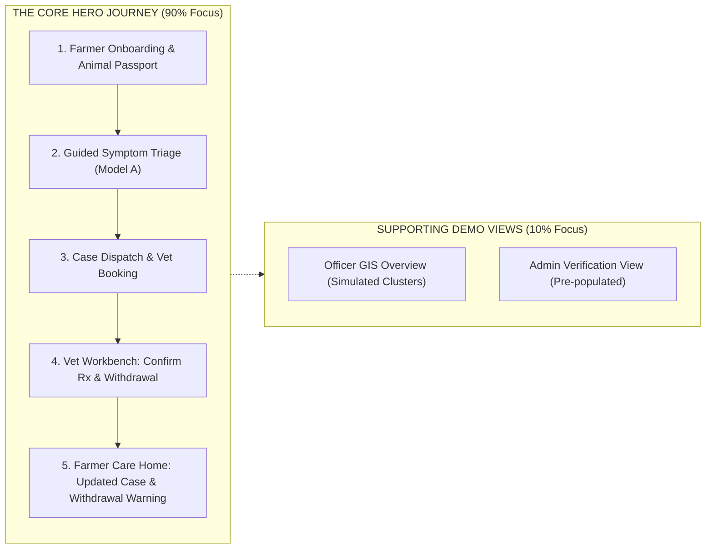
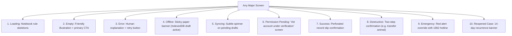

# 🐄 PashuSachet (पशूसचेत) — Frontend Design Specification & Execution Plan
## “The Village Animal-Care Notebook” (गावची पशु-नोंदवही)

> **Design Paradigm:** A warm, grounded, field-ready digital care register—moving away from sterile SaaS dashboards and AI templates.  
> **Brand Subtitle:** PashuSachet — पशु आरोग्य साथी  
> **Scope Strategy:** Radical focus on **1 polished, end-to-end Hero Flow** (Farmer Triage ➔ Vet Verification ➔ Food Safety Feedback Loop) rather than 4 half-finished portals.  
> **Rule:** Specification & Execution Blueprint only — **no implementation code until approved.**

---

## 0. Core Positioning & Participatory Value Architecture

> **The Problem with Typical Apps:** They build a redundant, parallel animal registry (competing with Bharat Pashudhan) or broad macro-outbreak forecasts (duplicating ICAR-NIVEDI NADRES).  
> **Seva First's True Value:** It is the **missing last-mile participatory layer** connecting fragmented farmer observations into real-time, village-level early warning signals and closed-loop field action.

```
+---------------------------------------------------------------------------------------------------+
|                                  THE 90-SECOND LAST-MILE PROMISE                                  |
|                                                                                                   |
|  "Every farmer and para-vet in rural Maharashtra can report a concern in under 90 seconds        |
|  (voice or simple form, even offline), receive an immediate safe-next-step + urgency score,       |
|  trigger local verification and referral, and contribute to district-level intelligence —        |
|  without creating a parallel silo."                                                               |
+---------------------------------------------------------------------------------------------------+
```

### 🏛️ Differentiated Pillars (New Architecture of Value)

| Pillar | What It Does Differently | Why It Is Not a Copy |
| :--- | :--- | :--- |
| **1. Participatory Real-Time Sentinel** | Farmers + para-vets submit structured micro-reports (symptoms + photos + location + mortality). System creates a live village-level **“signal heat”** that is distinct from NADRES district forecasts. | **NADRES is top-down official + model-driven.** Seva First is **bottom-up, continuous, farmer-sourced signal generation** capturing syndromic spikes days before lab confirmation. |
| **2. Uncertainty-Aware Triage & Escalation Engine** | Rule + lightweight ML hybrid that outputs: **urgency tier, safe next action, confidence band**, and recommended escalation path (*self-monitor / para-vet visit / vet / sample kit / lab*). Explicit **abstention** when data is insufficient. | **Avoids “diagnosis” claims.** Focuses on **action routing**, not disease ranking. Enforces a vastly stronger clinical safety posture than typical uncalibrated symptom checkers. |
| **3. Closed-Loop Referral & Sample Tracker** | End-to-end tracking from report ➔ appointment / MVU dispatch ➔ clinical note ➔ sample collection ➔ lab status ➔ outcome. Visible to farmer, para-vet, and officer. | Existing systems (1962, E-Pashu, Bharat Pashudhan) handle pieces; **none close the full loop** with farmer visibility, sample chain-of-custody, and lab hand-off. |
| **4. Federated Contribution Layer** | Every verified case can (with farmer consent) be de-identified and pushed to NADRES / state surveillance pipelines. Animal identity links to existing **Pashu Aadhaar** when available instead of creating a competing registry. | **Explicitly strengthens national systems instead of competing with them.** Avoids redundant data silos and respects existing government investments. |
| **5. Offline-First + Voice + Community Verification** | Full offline queue, voice reporting in Marathi (and Hindi/English), community/para-vet confirmation of serious reports before high-urgency escalation. | Goes beyond current WhatsApp chatbots and basic offline forms. Designed ground-up for **real rural Maharashtra constraints** (low literacy, intermittent networks). |

---


## 1. Scope Realism: The SIH / Demo "Golden Thread"

Trying to build 4 full production portals (Farmer, Vet, Officer, Admin), a spatial GIS engine, rules configurator, and offline synchronization simultaneously is a multi-month effort that risks producing 4 broken dashboards. 

For the live prototype and competition demo, we implement **One Polished End-to-End Loop** with high craft, accompanied by lightweight demo views for the supporting roles:



---

## 2. Color System & Verified WCAG Contrast

The color system uses grounded, natural tones tested against the **Notebook Paper canvas (`#F6F0E4`)** to achieve **WCAG AA** compliance (minimum 4.5:1 for body text, 3:1 for large headings and UI components).

```
┌────────────────────────────────────────────────────────────────────────┐
│  Field Ink        Turmeric         Notebook Paper   Deep Terracotta    │
│  #243B32          #E4A72D          #F6F0E4          #8D3F28 (Text)     │
│  (Brand/Nav)      (Primary Action) (Main Canvas)    #B9654B (Fill only)│
├────────────────────────────────────────────────────────────────────────┤
│  Clean White      Deep Sage        Dark Urgent Red                     │
│  #FFFFFF          #4A544C (Text)   #B91C1C (Text/Badge)                │
│  (Record Slips)   (Subtitles)      (Emergency Alerts)                  │
└────────────────────────────────────────────────────────────────────────┘
```

### Verified Contrast Matrix (Against Notebook Paper `#F6F0E4`):

| Color Name | Hex Code | Primary Usage | Contrast Ratio | WCAG Compliance |
| :--- | :--- | :--- | :--- | :--- |
| **Field Ink** | `#243B32` | Headings, brand logo, navigation text | **8.4 : 1** | **Passes AAA** (Normal & Large Text) |
| **Deep Sage** | `#4A544C` | Secondary timestamps, helper text, labels | **5.4 : 1** | **Passes AA** (Normal Text) |
| **Deep Terracotta** | `#8D3F28` | Text notes, tag identifiers, warnings | **5.1 : 1** | **Passes AA** (Normal Text) |
| **Dark Urgent Red** | `#B91C1C` | Emergency triage banner, vital alerts | **5.3 : 1** | **Passes AA** (Normal Text) |
| **Turmeric** | `#E4A72D` | Primary action button fill | — | Used as **background fill** |
| **Field Ink on Turmeric**| `#243B32` on `#E4A72D`| Text on primary buttons | **5.6 : 1** | **Passes AA** (Normal Text) |

> ⚠️ **Contrast Rules:**
> * Decorative Terracotta (`#B9654B`) is restricted to **border strokes and subtle background fills only**; all text uses **Deep Terracotta (`#8D3F28`)**.
> * Slate Sage is darkened to **Deep Sage (`#4A544C`)** so secondary text never washes out in sunlight.
> * Claims of "WCAG AAA for headers" are dropped; the platform targets verified **WCAG AA (4.5:1 normal text, 3:1 components)**.

---

## 3. Brand Identity & Icon Discipline (Zero Emojis)

### 3.1 Strict Icon System (Lucide SVG Only)
Emojis (🐄, 🟢, 🟡, 🔴) render unpredictably across low-end Android OS versions and violate our prohibition against color-only signaling. 

* **Rule:** All icons must be **accessible, monochrome SVG line icons** (Lucide Icons, 2px stroke, 20×20px or 24×24px).
* **Status Signaling:** Never rely on a colored dot alone. Always pair an icon with explicit text and distinct border styling:
  * `Completed`: `<CheckCircle2 size={16} />` + Text: **Completed** (Green border, green tint)
  * `Due Soon`: `<Clock size={16} />` + Text: **Due in 3 Days** (Amber border, amber tint)
  * `Overdue / Urgent`: `<AlertTriangle size={16} />` + Text: **Overdue** (Red border, red tint)

```
[Icon: Lucide CheckCircle2]  Completed (12 Aug 2026)
[Icon: Lucide Clock]         Due Soon (Booster in 4 days)
[Icon: Lucide AlertTriangle] Urgent Action Required
```

### 3.2 Logo & Regulatory Disclaimer
* **Logo Mark:** 24×24px SVG combining a rounded ear-tag silhouette with an internal leaf/check incision.
* **Wordmark:** `PashuSachet` accompanied by Marathi subtext: **पशु आरोग्य साथी**.
* **Clinical Verification Stamp:**  
  * Replaced regulatory-sounding text with clear, honest demo wording:  
    `[✓ CLINICALLY VERIFIED RECORD - DEMO]` or `[✓ LICENSED VET EXAMINATION]`.
  * **Explicit Regulatory Disclaimer:** *"PashuSachet is an academic and clinical decision-support prototype. No official affiliation with the Maharashtra State Veterinary Council (MSVC) or Department of Animal Husbandry is claimed."*

---

## 4. Dual-Script Typography

* **English & Numbers:** **Manrope** (semi-bold 600 for headings, regular 400 for numbers and tag IDs).
* **Marathi & Hindi:** **Noto Sans Devanagari** (500 medium for body text to maintain clear conjunct rendering).
* **Typography Hierarchy:**
  * Screen Title: 24px / 1.3 line-height (Manrope Bold / Noto Sans Bold)
  * Section Header: 18px / 1.4 line-height (Semi-bold)
  * Body Text: 16px / 1.6 line-height (Ensures readability in rural light)
  * Helper / Metadata: 14px / 1.5 line-height (Deep Sage `#4A544C`)

---

## 5. The Scoped Hero Experience (Screen-by-Screen)

### 5.1 Screen 1: Welcome & Language Gate
* Large rural photograph (natural morning light, Indian farmer with indigenous Gir cow).
* Immediate 3-way language selector pills: `[मराठी (Marathi)]` | `[हिन्दी (Hindi)]` | `[English]`.
* Value proposition: *"Care for every animal, one step at a time."*
* Single primary Turmeric button: `[Enter Mobile Number to Begin]`.
* Quick link: `[Demo Tour: Explore as Vet or Officer]`.

### 5.2 Screen 2: Farmer Home — “Today’s Care” (आजची काळजी)
* **Top Bar:** Greeting (`नमस्कार, राम`), Village (`संगमनेर`), active sync pill (`Synced`).
* **Emergency Override Bar:** Red outline box with `<PhoneCall size={18} />` link to **1962 Toll-Free Helpline**.
* **Hero Action:** Large paper slip card:
  * Title: *"Need advice for an animal?"*
  * Subtext: *"Tell us what symptoms you noticed in 2 minutes."*
  * CTA Button: `[Start a Health Check →]`
* **Today's Care Tasks (Notebook Rules):**
  * `<Clock />` **Vaccination Due:** Gauri (Gir Cow) • FMD Booster due in 3 days.
  * `<AlertTriangle />` **Active Milk Withholding:** Gauri • 38 hours remaining (Do not sell milk).
* **My Animals (Horizontal Carousel):** Portrait cards showing Tag badge (`PS-MH-2026-08149`), breed, and health status pill.

### 5.3 Screen 3: Animal Passport (Pashu Aadhar)
* Header styled like a brass-grommeted cattle ear tag: `PS-MH-2026-08149` (Optional INAPH: `120098451230`).
* Large photo portrait + basic vitals: Gir Cow, Female, 3.5 Years, In Milk (12L/day).
* **Four Clear Tabs:**
  1. `Timeline`: Chronological dated notebook entries of all past symptoms, visits, and treatments.
  2. `Vaccinations`: Official perforated slip showing completed vs. upcoming doses with batch numbers.
  3. `Treatments & Food Safety`: Active medications, vet notes, and live milk withholding countdown timer.
  4. `Transfer`: Transfer animal to another farmer with confirmation code.

### 5.4 Screen 4: Guided Conversational Triage (Model A)
One focused question per step with visible progress (`Step 2 of 4`):
1. **Choose Animal:** Select Gauri from herd.
2. **What Symptoms Did You Notice?** (Touch-friendly 48px cards with Lucide icons, no emojis):
   * `<UtensilsCrossed />` Off Feed / Not Eating
   * `<Thermometer />` High Fever (>103°F)
   * `<CircleDot />` Skin Nodules or Lumps
   * `<Droplet />` Mouth Blisters / Excessive Drool
   * `<Activity />` Lameness / Foot Sores
   * `<Wind />` Heavy Breathing / Coughing
   * `<Milk />` Swollen Udder / Milk Drop
3. **Onset & Vitals:** Temperature input slider + duration (e.g. 2 days ago).
4. **Emergency Red Flag Gate:** Automated check for fatal signs (severe bloat, continuous convulsions, sudden bleeding).  
   * *If checked:* Modal interrupts immediately: **"EMERGENCY: Call 1962 or your nearest veterinary hospital immediately. Do not wait for model output."**
5. **Screening Result:**
   * Urgency Banner: `URGENT: Veterinary Inspection Recommended`
   * Indicative Condition: Lumpy Skin Disease *(Calibrated decision-support screening; not a confirmed diagnosis)*.
   * Interim Safe First Aid: Isolate animal in shaded pen, apply herbal fly repellent, offer cool drinking water. **Do not give unprescribed human medicines.**
   * Direct Action: `[Book Local Government Dispensary Now]` (Generates Case `#HC-4012`).

### 5.5 Screen 5: Vet Triage Workbench (The Closed Loop)
* Demonstrates the veterinarian receiving and acting on the farmer's case:
* **Triage Inbox:** Case `#HC-4012` appears at top with `URGENT` badge and symptom summary.
* **Examination & Clinical Action Form:**
  * Vet documents findings: *"Multiple 2-3cm firm cutaneous nodules observed on neck and flank. Rectal temp 103.8°F."*
  * Confirmed Diagnosis: `Suspected Lumpy Skin Disease (Secondary Bacterial Prophylaxis)`.
  * Prescribed Treatment: Supportive antipyretic + antiseptic wound spray.
  * **Vet-Confirmed Withdrawal Period:** Vet checks: `[x] Milk Withholding Required` ➔ Enters `72 Hours` ➔ Selects source: `Drug Package Label (Flunixin Meglumine)`.
  * Action: `[Sign & Complete Case]` with circular stamp: `[✓ LICENSED VET EXAMINATION - DEMO]`.

### 5.6 Screen 6: Feedback to Farmer (Food Safety Banner)
* Returning to the Farmer Home instantly reflects the doctor's completed visit:
  * Case `#HC-4012` transitions to `Resolved`.
  * Top of Home displays high-visibility alert:  
    `⚠️ FOOD SAFETY WARNING: DO NOT CONSUME OR SELL MILK from Gauri until 7 Nov 2026, 11:00 AM (52 hours remaining)`.

---

## 6. Supporting Demo Views (Single-Screen Implementations)

### 6.1 Livestock Officer GIS Overview (Simulated)
* Clean Maharashtra district map (Ahmednagar, Pune, Satara) with 3-tier toggles:
  * Tier 1 (Farmer Signals), Tier 2 (Vet Diagnoses), Tier 3 (Confirmed Outbreaks).
* Cluster detail panel with active cases and one-click `[Acknowledge Alert]` logger.

### 6.2 Administrator Demo View
* Pre-populated verification queue showing Dr. Kute's veterinary license ready for `[Approve]` action.
* Demo audit trail showing recent case actions with timestamps and actor IDs.

---

## 7. All Ten Render States Handled



---

## 8. Technical Architecture & Offline Storage Strategy

```
src/
├── app/
│   ├── App.tsx                     # Top-level shell & mode switcher
│   └── providers/
│       ├── StoreProvider.tsx       # Reactive state store
│       └── LocaleProvider.tsx      # Marathi / Hindi / English dictionaries
├── components/
│   ├── ui/                         # TagPill, RecordSlip, ExamStamp, Button (Turmeric)
│   ├── icons/                      # Lucide SVG icon wrappers (zero emojis)
│   └── shell/                      # Header, Mobile Bottom Nav, Emergency Bar
├── features/
│   ├── farmer/                     # Today's Care home, passport, screening, food safety
│   ├── vet/                        # Triage inbox, exam form, withdrawal input
│   ├── officer/                    # 3-tier GIS map viewer & alert acknowledgment
│   └── admin/                      # License verification list & audit viewer
├── services/
│   ├── idbStorage.ts               # IndexedDB wrapper for queued drafts & offline photos
│   └── triageEngine.ts             # Calibrated Model A screening logic
└── styles/
    ├── tokens.css                  # Verified colors (Ink, Turmeric, Sage #4A544C, Paper)
    └── notebook.css                # Perforated slips, tag pills, stamps, ruling lines
```

### Storage Discipline:
* **IndexedDB:** Stores queued case submissions, offline symptom drafts, and photo blobs.
* **localStorage:** Strictly limited to lightweight user preferences (selected language `mr`/`hi`/`en`, active demo mode).

---

## 9. Revised Step-by-Step Build Order (Scoped for Quality)

1. **Design Tokens & Icons:** `tokens.css` with verified AA contrast hex values and Lucide SVG icon wrappers (zero emojis).
2. **App Shell & Role Selector:** Clean header, mobile bottom nav (Farmer), and demo mode toggle.
3. **Pashu Aadhar Herd Registry:** Animal list, passport card, tag pills, and demographic details.
4. **Conversational Screening Flow:** 4-step triage assistant, red flag check with 1962 interrupt, and decision-support card.
5. **Vet Workbench & Exam Form:** Urgency-sorted triage inbox, clinical findings form, confirmed diagnosis, and vet-entered withdrawal days.
6. **Food Safety Withdrawal Loop:** Live milk/meat withholding countdown banner on farmer home.
7. **Supporting Demo Views:** Single-screen Officer GIS cluster viewer and Admin verification view.
8. **Polish & Verification:** Verify all 10 states, check contrast in browser dev tools, and deploy live to Vercel.

---

> 📌 **Execution Status:** Updated and saved as [`FRONTEND_DESIGN_SPEC.md`](file:///g:/Chetan/pashuSachet/FRONTEND_DESIGN_SPEC.md).  
> **No code implementation has been started.**


---

## 9. The 90-Second Participatory Report Flow Specification

### 9.1 Voice-First & Simple-Mode Intake
* **Primary Target Audience:** Smallholder farmers in Ahmednagar, Solapur, and Pune regions with low text literacy or operating in rustic cattle sheds with wet/gloved hands.
* **Input Options:**
  1. **Marathi Voice Record Button:** Large 64px tap-to-speak button (`"येथे बोला"` / *"Speak symptoms here"*). Captures 10–20s audio clip, stores locally in IndexedDB if offline.
  2. **4–6 Tap Micro-Form (Fallback):**
     - *Step 1: Animal Tag / Pashu Aadhaar* (Auto-select from herd or manual 12-digit ear tag input).
     - *Step 2: Species Selection* (Cattle, Buffalo, Goat, Sheep, Poultry).
     - *Step 3: Primary Visual Sign* (High Fever, Skin Nodules, Mouth/Foot Blisters, Udder Swelling, Respiratory Distress, Hemorrhage).
     - *Step 4: Onset Duration* (<24h, 1–3 days, >3 days).
     - *Step 5: Herd Mortality Flag* (Yes/No — immediate red-flag circuit breaker trigger).
     - *Step 6: Optional Camera Capture* (1 photo of lesion/eye/udder, compressed to <300KB on device).

### 9.2 The Safe-Next-Step & Urgency Card
* **Zero Diagnosis Claims:** The card never outputs *"Your cow has Foot and Mouth Disease (88%)"*.
* **Action-Oriented Output:**
  ```
  +-----------------------------------------------------------------------------------+
  | ⚠️ URGENCY: HIGH (ACTION REQUIRED WITHIN 12 HOURS)                                |
  | Safe Immediate Steps:                                                             |
  | 1. Isolate animal immediately in a dry, shaded pen away from milk shed.           |
  | 2. Wash lesions with clean potassium permanganate solution (1:1000).              |
  | 3. Offer fresh drinking water with electrolytes; halt hard grain concentrates.    |
  |                                                                                   |
  | Recommended Escalation:                                                           |
  | [ Request Doorstep Para-Vet Verification ]  [ Call 1962 Mobile Veterinary Unit ]  |
  +-----------------------------------------------------------------------------------+
  ```
* **Abstention State:** If symptoms are ambiguous (e.g., only "off-feed" without temperature or duration), the card displays:  
  *“Observations are insufficient for automated risk assessment. Please record body temperature or request a para-vet visit for physical checkup.”*

---

## 10. Village Signal Map (Not Macro District Forecasts)

### 10.1 Micro-Spatial Signal Heat
* Rather than duplicating *ICAR-NIVEDI NADRES* broad monthly district forecasts, PashuSachet provides **real-time village and block-level signal heat**.
* Clusters emerge organically when multiple farmers in the same gram panchayat report syndromic signs (e.g. 4 fever + mouth blister reports in Sangamner village within 48 hours).

### 10.2 Privacy Protection: Small-Count Suppression ($k$-Anonymity)
* **Social Risk:** If an individual farmer is publicly pinpointed on an outbreak map, local dairy cooperatives may refuse milk collection, causing severe economic harm.
* **Suppression Rule:** If a village has fewer than 3 active syndromic reports, the pin is generalized to the **Gram Panchayat / Block Centroid** and labeled as an anonymous signal cluster:  
  `"Ahmednagar Block 4: Syndromic Signal Cluster (3 verified reports) — Official investigation recommended."`

---

## 11. Closed-Loop Referral & Sample Tracking Specification

The lifecycle tracking replaces fragmented 1962 / local clinic hand-offs with an end-to-end audit card:

| Step # | Event Stage | Responsible Actor | Visible State in App |
| :--- | :--- | :--- | :--- |
| **S1** | **Report Filed** | Farmer / Para-Vet | `REPORTED (Urgency: High)` |
| **S2** | **Field Verification** | Local Para-Vet | `PARA_VET_VERIFIED (Vitals Checked)` |
| **S3** | **Referral / MVU** | Government Vet / 1962 | `MVU_DISPATCHED (ETA: 2 Hours)` |
| **S4** | **Exam & Prescription** | MSVC Veterinarian | `UNDER_TREATMENT (Withholding Clock Active)` |
| **S5** | **Sample Kit Hand-off** | Attending Vet / Para-Vet | `SAMPLE_COLLECTED (Sample #MH-SMP-8921)` |
| **S6** | **Lab Processing** | Regional Disease Diagnostic Lab | `IN_LAB_TESTING (ELISA / PCR Pending)` |
| **S7** | **Confirmed Outcome** | Lab Officer & Vet | `LAB_CONFIRMED (Bovine Ephemeral Fever)` |
| **S8** | **National Uplink** | System (Farmer Consent) | `DE_IDENTIFIED_EXPORT_TO_NADRES` |

---

## 12. Consent-Driven Data Contribution Specification

Every verified case includes an explicit, DPDP-compliant consent toggle for the livestock owner:
* **Option A (Private Care Only):** Report visible only to the attending veterinarian and local dispensary.
* **Option B (Local Public Health Warning):** Report contributes to anonymized village signal heat for neighboring farmers.
* **Option C (State & National Surveillance):** Case de-identified (GPS truncated to block centroid, owner name redacted) and streamed to NADRES V2 and Bharat Pashudhan surveillance pipelines.


---

## 13. Gram Signal System (GSS): Farmer & Government UI Specifications

### 13.1 Farmer-Facing Touchpoints & Trust Architecture
1. **Instant Acknowledgment & Status Tracker Card:**
   - Immediately upon submitting a 90-second report (or sending a missed call / voice note), the app displays:
     ```
     ┌──────────────────────────────────────────────────────────────────┐
     │  ✓ अहवाल नोंदवला गेला (Report #MH-REP-9102 Logged)               │
     │  स्थिती: स्थानिक पशुसखी / पॅरा-व्हेट यांच्याकडे तपासणीसाठी पाठवले │
     │  नियुक्त सेवक: श्री. गणेश काळे (मो. 98220 XXXXX)                │
     │  अंदाजे तपासणी वेळ: 4 तासांच्या आत (ETA: Within 4 Hours)          │
     └──────────────────────────────────────────────────────────────────┘
     ```
2. **Immediate Plain-Language Action Card (Marathi Primary):**
   - Direct bulleted directives:
     - *काय करावे (What to do now):* Isolate animal, provide clean electrolyte water, clean stall.
     - *कशावर लक्ष ठेवावे (What to watch for):* Breathing rate, udder hardness, rectal temperature.
     - *1962 कधी बोलवावे (When to escalate to 1962):* Inability to stand, bleeding, sudden convulsion.
3. **Proxy Reporting Toggle:**
   - Checkbox: *"मी शेजारी किंवा कुटुंबियांच्या वतीने नोंदवत आहे"* *(“I am reporting on behalf of a neighbour or family member”)*.
   - Captures owner name and village location while recording the reporter's phone for SMS updates.
4. **Community Sentinel Recognition Badge:**
   - When a farmer's timely report prevents a localized outbreak, their profile displays:
     `🏅 ग्राम जागरूक पशुपालक (Village Vigilant Livestock Keeper - Sangamner)`
   - Linked to village Gram Sabha commendation.

---

### 13.2 Government & Officer-Facing Touchpoints (Live Village & Block Signal Board)
1. **Live Village & Block Signal Board:**
   - Displays **verified signals only** (filtered through the Local Sentinel / Para-Vet network).
   - Metrics bar:
     - *Mean Response Time:* e.g. `2.8 Hours` (Signal ➔ Verification).
     - *Verification Rate:* e.g. `94.2%`.
     - *Sample Closure Rate:* e.g. `89.5%` (Specimen collected ➔ Lab result delivered).
2. **End-to-End Sample & Lab Tracker:**
   - Linear progress card:
     `Sample Collected (Serum/Swab) ➔ MVU Hand-off ➔ RDDL Lab Testing (ELISA) ➔ Confirmed Diagnosis ➔ Farmer Notified`.
3. **One Health Flagging:**
   - High-visibility banner for suspected zoonoses (e.g. Anthrax, Rabies, Brucellosis, Glanders):
     `⚠️ ONE HEALTH ALERT: Potential Zoonotic Pathogen — Joint Public Health Notification Dispatched.`
4. **Automated Farmer Feedback Loop Trigger:**
   - When the veterinarian marks a case `RESOLVED` or `SAMPLE_CONFIRMED`, the system automatically sends a concluding SMS / voice note to the farmer, closing the psychological loop.


---

## 14. Frontend Architecture for the Six Unclosed Gaps

### 14.1 The 4–5 Question 60–90 Second Micro-Intake
The user interface is engineered to eliminate unnecessary cognitive load. The entire reporting workflow is limited to **5 essential questions**:
1. **Species:** 5 large tap tiles (*Cattle, Buffalo, Goat, Sheep, Poultry*).
2. **Main Signs Observed:** Multi-select visual chips (*Fever, Mouth/Foot Blisters, Udder Swelling, Respiratory Distress, Diarrhea, Hemorrhage, Sudden Collapse*).
3. **Number Affected / Dead:** Two integer stepper controls (*Affected: [ - 1 + ] | Dead: [ - 0 + ]*).
4. **Location:** Auto-populated from device GPS / village centroid, with a spoken village name fallback.
5. **Optional Voice Audio:** 15-second Marathi voice recorder button (`"बोलून सांगा"`).

---

### 14.2 Low-Digital Inclusion Hierarchy UI & Multi-Channel Feeder
To ensure 100% smallholder inclusion, the application interfaces with four non-smartphone feeder channels:
1. **Missed-Call Trigger:** Displayed prominently on village posters and animal shed walls:  
   `"आजारी जनावरासाठी मिस कॉल द्या: 1800-XXX-XXXX"` *(“Give a missed call for sick livestock”)*.  
   System initiates automated callback with interactive Marathi voice menu.
2. **USSD Menu Flow (`*992#` Simulation):** Text-based interactive prompt functional on 2G feature phones without data packages:
   ```
   [1] गाय/म्हैस (Cattle/Buffalo)
   [2] शेळी/मेंढी (Goat/Sheep)
   [3] कोंबडी (Poultry)
    निवडा: _
   ```
3. **Voice IVR:** Audio playback providing automated, warm vernacular prompts.
4. **WhatsApp Voice Intake:** Ingests forwarded voice notes and converts them to structured micro-reports via speech-to-text.

---

### 14.3 Closed-Loop Sample Tracker UI Card
When a verified case is tagged as requiring diagnostic laboratory confirmation, the UI renders the dedicated **Sample Lifecycle Widget**:
```
┌────────────────────────────────────────────────────────────────────────────────────────┐
│  🧪 रोगनिदान नमुना तपासणी (Diagnostic Sample Tracker #SMP-MH-9412)                     │
│  नमुना प्रकार: रक्त / सीरम (Serum) • संकलन तारीख: 04 नोव्हेंबर 2026                   │
├────────────────────────────────────────────────────────────────────────────────────────┤
│  [✓] नमुना संकलित (Sample Collected by Para-Vet Ganesh K.)                            │
│  [✓] प्रयोगशाळेकडे रवाना (In Transit to Regional Disease Diagnostic Lab, Pune)        │
│  [●] प्रयोगशाळेत चाचणी सुरू (Testing In Progress: RT-PCR & ELISA)                     │
│  [ ] अंतिम निकाल व उपचार कृती (Pending Result & Action Plan)                           │
├────────────────────────────────────────────────────────────────────────────────────────┤
│  स्थिती: शेतकरी, पॅरा-व्हेट आणि तालुका अधिकाऱ्यांना थेट SMS द्वारे निकाल दिला जाईल.   │
└────────────────────────────────────────────────────────────────────────────────────────┘
```

---

### 14.4 Live Village & Block Signal Board (Observation Board)
Located in the Officer / LDO console, this is strictly an **operational observation board**, NOT a speculative forecasting map:
* **Real-Time Counters:**
  - *Active Signals (Last 7 Days):* e.g. `24`
  - *Mortality Reports:* e.g. `2`
  - *Sample-Pending Cases:* e.g. `5`
  - *Mean Verification Time:* e.g. `3.2 Hours`
* **Observation Feed Table:** Shows village name, species, verified syndromic cluster, urgency badge, and assigned para-vet.
* **Privacy Suppression Safeguard:** If a village has $<3$ signals, individual coordinates are hidden; the UI aggregates the warning to the **Block Centroid** to prevent milk procurement boycotts.

---

### 14.5 Verification & Trust Queue for Para-Vets
The frontline para-vet interface displays incoming raw signals in an **Unverified Triage Inbox**:
* Each card provides:
  - Reporter Name & Village
  - Reported signs & animal count
  - One-tap quick actions:
    1. `✓ Confirm Signal (सत्यता पडताळणी)`
    2. `🌡️ Add Vitals (तापमान व निरीक्षण जोडा)`
    3. `🧪 Request Sample Kit (नमुना किट बोलवा)`
    4. `✗ Dismiss as Routine (किरकोळ लक्षण)`


---

## 15. Frontend Solutions to the 8 Core Deficiencies

### 15.1 Designing for Non-Smartphone Primacy (Missed-Call & USSD)
* The landing page and print posters prominently display the **Toll-Free Missed-Call & USSD Channel** ahead of web form buttons:
  ```
  ┌──────────────────────────────────────────────────────────────────┐
  │  📞 आजारी जनावरासाठी थेट मिस कॉल द्या: 1800-889-1962             │
  │  (दोन रिंगनंतर फोन कट होईल; 60 सेकंदात मराठीत फोन येईल)          │
  │  किंवा साधा फोन असेल तर डायल करा: *992# (विनामूल्य USSD)        │
  └──────────────────────────────────────────────────────────────────┘
  ```
* Web app form is relegated to a clean secondary option labeled: *“प्रगत शेतकरी व पॅरा-व्हेट यांच्यासाठी वेब फॉर्म”* *(“Web Form for Progressive Farmers & Para-Vets”)*.

### 15.2 The Immediate Farmer Benefit Card (Why Report Early?)
Every submitted report instantly generates a **3-part tangible farmer benefit card**:
1. **Immediate Practical Action:** 3 plain Marathi bullet points on feeding, isolation, and safe compresses.
2. **Dedicated Worker Assignment:** Displays photo/name and mobile number of the local para-vet with guaranteed response SLA (*“4 तासांच्या आत भेट”*).
3. **Food Safety Protection:** Highlights the milk withdrawal countdown so the farmer avoids milk cooperative contamination fines.

### 15.3 The 30-Second Para-Vet Verification Gate
To prevent field worker burnout and ensure high data integrity:
* Para-vet receives a clean, single-screen verification card:
  - Big green button: `✓ खात्री झाली (Confirm Valid Signal - 1 Tap)`
  - Big red button: `✗ किरकोळ लक्षण / रद्द (Mark Non-Significant - 1 Tap)`
  - Audio mic button: `🎙️ 10-सेकंद आवाज नोंद (10s Voice Observation)`
  - Checkbox: `🧪 नमुना तपासणी आवश्यक (Diagnostic Sample Kit Needed)`
* Average interaction time: **22 seconds**.

### 15.4 The Central Sample ➔ Lab ➔ Action Component
Replaces fragmented lab slips with an interactive, colored status pill bar:
* **Stage 1 (Amber):** `नमुना संकलित (Sample Collected #SMP-9102)`
* **Stage 2 (Blue):** `RDDL पुणे प्रयोगशाळेकडे रवाना (In Transit to Lab)`
* **Stage 3 (Purple):** `चाचणी सुरू: ELISA / RT-PCR (Lab Testing Active)`
* **Stage 4 (Green):** `निकाल प्राप्त: Bovine Viral Diarrhea (Lab Confirmed)`
* **Stage 5 (Dark Green):** `उपचार पूर्ण व केस बंद (Action Taken & Closed)`

### 15.5 Automated 1962 Emergency Accelerator
* When symptoms match life-threatening conditions (acute bloat, continuous convulsions, sudden bleeding), the UI does not ask the farmer to fill forms:
* It generates an **Immediate 1962 MVU Request**:
  `"🚨 1962 आपत्कालीन रुग्णवाहिका पावती तयार झाली (Dispatch Ticket #MVU-MH-8821 Generated). Live tracking SMS sent to your phone."`
* Pre-populates GPS and clinical signs directly into the driver’s mobile terminal.

### 15.6 Action-Oriented Decision Board for Officers
* The Officer Console suppresses passive aesthetic maps and opens directly to:  
  **"Cases Requiring Your Decision Today"**:
  1. *3 Uninspected Village Clusters (Sangamner Block)* ➔ `[ Dispatch MVU ]`
  2. *2 Awaiting Lab Sample Approval* ➔ `[ Approve RDDL Dispatch ]`
  3. *1 Zoonotic Suspect (Anthrax Flag)* ➔ `[ Enforce Ring Quarantine ]`


### 15.7 Focused 5–10 Village Pilot Telemetry View
* An administrative validation screen embedded in the Officer / Admin console tracking the live telemetry of the 5–10 village proof-of-value pilot:
  - *Channel Distribution:* Real-time chart of Missed-Call vs. USSD vs. Web intake.
  - *Turnaround Velocity:* Average elapsed hours from signal to para-vet physical verification.
  - *Sample Closure Rate:* Percentage of sample cases reaching confirmed lab outcome and closed treatment.
  - *Farmer Retention:* Repeat reporting rate during seasonal disease spikes.
