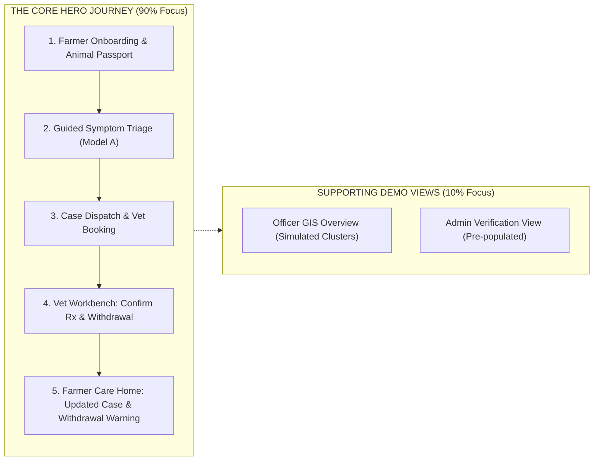
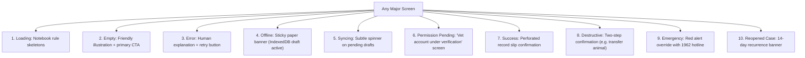

# 🐄 PashuSachet (पशूसचेत) — Frontend Design Specification & Execution Plan
## “The Village Animal-Care Notebook” (गावची पशु-नोंदवही)

> **Design Paradigm:** A warm, grounded, field-ready digital care register—moving away from sterile SaaS dashboards and AI templates.  
> **Brand Subtitle:** PashuSachet — पशु आरोग्य साथी  
> **Scope Strategy:** Radical focus on **1 polished, end-to-end Hero Flow** (Farmer Triage ➔ Vet Verification ➔ Food Safety Feedback Loop) rather than 4 half-finished portals.  
> **Rule:** Specification & Execution Blueprint only — **no implementation code until approved.**

---

## 1. Scope Realism: The SIH / Demo "Golden Thread"

Trying to build 4 full production portals (Farmer, Vet, Officer, Admin), a spatial GIS engine, rules configurator, and offline synchronization simultaneously is a multi-month effort that risks producing 4 broken dashboards. 

For the live prototype and competition demo, we implement **One Polished End-to-End Loop** with high craft, accompanied by lightweight demo views for the supporting roles:



---

## 2. Color System & Verified WCAG Contrast

The color system uses grounded, natural tones tested against the **Notebook Paper canvas (`#F6F0E4`)** to achieve **WCAG AA** compliance (minimum 4.5:1 for body text, 3:1 for large headings and UI components).

```
┌────────────────────────────────────────────────────────────────────────┐
│  Field Ink        Turmeric         Notebook Paper   Deep Terracotta    │
│  #243B32          #E4A72D          #F6F0E4          #8D3F28 (Text)     │
│  (Brand/Nav)      (Primary Action) (Main Canvas)    #B9654B (Fill only)│
├────────────────────────────────────────────────────────────────────────┤
│  Clean White      Deep Sage        Dark Urgent Red                     │
│  #FFFFFF          #4A544C (Text)   #B91C1C (Text/Badge)                │
│  (Record Slips)   (Subtitles)      (Emergency Alerts)                  │
└────────────────────────────────────────────────────────────────────────┘
```

### Verified Contrast Matrix (Against Notebook Paper `#F6F0E4`):

| Color Name | Hex Code | Primary Usage | Contrast Ratio | WCAG Compliance |
| :--- | :--- | :--- | :--- | :--- |
| **Field Ink** | `#243B32` | Headings, brand logo, navigation text | **8.4 : 1** | **Passes AAA** (Normal & Large Text) |
| **Deep Sage** | `#4A544C` | Secondary timestamps, helper text, labels | **5.4 : 1** | **Passes AA** (Normal Text) |
| **Deep Terracotta** | `#8D3F28` | Text notes, tag identifiers, warnings | **5.1 : 1** | **Passes AA** (Normal Text) |
| **Dark Urgent Red** | `#B91C1C` | Emergency triage banner, vital alerts | **5.3 : 1** | **Passes AA** (Normal Text) |
| **Turmeric** | `#E4A72D` | Primary action button fill | — | Used as **background fill** |
| **Field Ink on Turmeric**| `#243B32` on `#E4A72D`| Text on primary buttons | **5.6 : 1** | **Passes AA** (Normal Text) |

> ⚠️ **Contrast Rules:**
> * Decorative Terracotta (`#B9654B`) is restricted to **border strokes and subtle background fills only**; all text uses **Deep Terracotta (`#8D3F28`)**.
> * Slate Sage is darkened to **Deep Sage (`#4A544C`)** so secondary text never washes out in sunlight.
> * Claims of "WCAG AAA for headers" are dropped; the platform targets verified **WCAG AA (4.5:1 normal text, 3:1 components)**.

---

## 3. Brand Identity & Icon Discipline (Zero Emojis)

### 3.1 Strict Icon System (Lucide SVG Only)
Emojis (🐄, 🟢, 🟡, 🔴) render unpredictably across low-end Android OS versions and violate our prohibition against color-only signaling. 

* **Rule:** All icons must be **accessible, monochrome SVG line icons** (Lucide Icons, 2px stroke, 20×20px or 24×24px).
* **Status Signaling:** Never rely on a colored dot alone. Always pair an icon with explicit text and distinct border styling:
  * `Completed`: `<CheckCircle2 size={16} />` + Text: **Completed** (Green border, green tint)
  * `Due Soon`: `<Clock size={16} />` + Text: **Due in 3 Days** (Amber border, amber tint)
  * `Overdue / Urgent`: `<AlertTriangle size={16} />` + Text: **Overdue** (Red border, red tint)

```
[Icon: Lucide CheckCircle2]  Completed (12 Aug 2026)
[Icon: Lucide Clock]         Due Soon (Booster in 4 days)
[Icon: Lucide AlertTriangle] Urgent Action Required
```

### 3.2 Logo & Regulatory Disclaimer
* **Logo Mark:** 24×24px SVG combining a rounded ear-tag silhouette with an internal leaf/check incision.
* **Wordmark:** `PashuSachet` accompanied by Marathi subtext: **पशु आरोग्य साथी**.
* **Clinical Verification Stamp:**  
  * Replaced regulatory-sounding text with clear, honest demo wording:  
    `[✓ CLINICALLY VERIFIED RECORD - DEMO]` or `[✓ LICENSED VET EXAMINATION]`.
  * **Explicit Regulatory Disclaimer:** *"PashuSachet is an academic and clinical decision-support prototype. No official affiliation with the Maharashtra State Veterinary Council (MSVC) or Department of Animal Husbandry is claimed."*

---

## 4. Dual-Script Typography

* **English & Numbers:** **Manrope** (semi-bold 600 for headings, regular 400 for numbers and tag IDs).
* **Marathi & Hindi:** **Noto Sans Devanagari** (500 medium for body text to maintain clear conjunct rendering).
* **Typography Hierarchy:**
  * Screen Title: 24px / 1.3 line-height (Manrope Bold / Noto Sans Bold)
  * Section Header: 18px / 1.4 line-height (Semi-bold)
  * Body Text: 16px / 1.6 line-height (Ensures readability in rural light)
  * Helper / Metadata: 14px / 1.5 line-height (Deep Sage `#4A544C`)

---

## 5. The Scoped Hero Experience (Screen-by-Screen)

### 5.1 Screen 1: Welcome & Language Gate
* Large rural photograph (natural morning light, Indian farmer with indigenous Gir cow).
* Immediate 3-way language selector pills: `[मराठी (Marathi)]` | `[हिन्दी (Hindi)]` | `[English]`.
* Value proposition: *"Care for every animal, one step at a time."*
* Single primary Turmeric button: `[Enter Mobile Number to Begin]`.
* Quick link: `[Demo Tour: Explore as Vet or Officer]`.

### 5.2 Screen 2: Farmer Home — “Today’s Care” (आजची काळजी)
* **Top Bar:** Greeting (`नमस्कार, राम`), Village (`संगमनेर`), active sync pill (`Synced`).
* **Emergency Override Bar:** Red outline box with `<PhoneCall size={18} />` link to **1962 Toll-Free Helpline**.
* **Hero Action:** Large paper slip card:
  * Title: *"Need advice for an animal?"*
  * Subtext: *"Tell us what symptoms you noticed in 2 minutes."*
  * CTA Button: `[Start a Health Check →]`
* **Today's Care Tasks (Notebook Rules):**
  * `<Clock />` **Vaccination Due:** Gauri (Gir Cow) • FMD Booster due in 3 days.
  * `<AlertTriangle />` **Active Milk Withholding:** Gauri • 38 hours remaining (Do not sell milk).
* **My Animals (Horizontal Carousel):** Portrait cards showing Tag badge (`PS-MH-2026-08149`), breed, and health status pill.

### 5.3 Screen 3: Animal Passport (Pashu Aadhar)
* Header styled like a brass-grommeted cattle ear tag: `PS-MH-2026-08149` (Optional INAPH: `120098451230`).
* Large photo portrait + basic vitals: Gir Cow, Female, 3.5 Years, In Milk (12L/day).
* **Four Clear Tabs:**
  1. `Timeline`: Chronological dated notebook entries of all past symptoms, visits, and treatments.
  2. `Vaccinations`: Official perforated slip showing completed vs. upcoming doses with batch numbers.
  3. `Treatments & Food Safety`: Active medications, vet notes, and live milk withholding countdown timer.
  4. `Transfer`: Transfer animal to another farmer with confirmation code.

### 5.4 Screen 4: Guided Conversational Triage (Model A)
One focused question per step with visible progress (`Step 2 of 4`):
1. **Choose Animal:** Select Gauri from herd.
2. **What Symptoms Did You Notice?** (Touch-friendly 48px cards with Lucide icons, no emojis):
   * `<UtensilsCrossed />` Off Feed / Not Eating
   * `<Thermometer />` High Fever (>103°F)
   * `<CircleDot />` Skin Nodules or Lumps
   * `<Droplet />` Mouth Blisters / Excessive Drool
   * `<Activity />` Lameness / Foot Sores
   * `<Wind />` Heavy Breathing / Coughing
   * `<Milk />` Swollen Udder / Milk Drop
3. **Onset & Vitals:** Temperature input slider + duration (e.g. 2 days ago).
4. **Emergency Red Flag Gate:** Automated check for fatal signs (severe bloat, continuous convulsions, sudden bleeding).  
   * *If checked:* Modal interrupts immediately: **"EMERGENCY: Call 1962 or your nearest veterinary hospital immediately. Do not wait for model output."**
5. **Screening Result:**
   * Urgency Banner: `URGENT: Veterinary Inspection Recommended`
   * Indicative Condition: Lumpy Skin Disease *(Calibrated decision-support screening; not a confirmed diagnosis)*.
   * Interim Safe First Aid: Isolate animal in shaded pen, apply herbal fly repellent, offer cool drinking water. **Do not give unprescribed human medicines.**
   * Direct Action: `[Book Local Government Dispensary Now]` (Generates Case `#HC-4012`).

### 5.5 Screen 5: Vet Triage Workbench (The Closed Loop)
* Demonstrates the veterinarian receiving and acting on the farmer's case:
* **Triage Inbox:** Case `#HC-4012` appears at top with `URGENT` badge and symptom summary.
* **Examination & Clinical Action Form:**
  * Vet documents findings: *"Multiple 2-3cm firm cutaneous nodules observed on neck and flank. Rectal temp 103.8°F."*
  * Confirmed Diagnosis: `Suspected Lumpy Skin Disease (Secondary Bacterial Prophylaxis)`.
  * Prescribed Treatment: Supportive antipyretic + antiseptic wound spray.
  * **Vet-Confirmed Withdrawal Period:** Vet checks: `[x] Milk Withholding Required` ➔ Enters `72 Hours` ➔ Selects source: `Drug Package Label (Flunixin Meglumine)`.
  * Action: `[Sign & Complete Case]` with circular stamp: `[✓ LICENSED VET EXAMINATION - DEMO]`.

### 5.6 Screen 6: Feedback to Farmer (Food Safety Banner)
* Returning to the Farmer Home instantly reflects the doctor's completed visit:
  * Case `#HC-4012` transitions to `Resolved`.
  * Top of Home displays high-visibility alert:  
    `⚠️ FOOD SAFETY WARNING: DO NOT CONSUME OR SELL MILK from Gauri until 7 Nov 2026, 11:00 AM (52 hours remaining)`.

---

## 6. Supporting Demo Views (Single-Screen Implementations)

### 6.1 Livestock Officer GIS Overview (Simulated)
* Clean Maharashtra district map (Ahmednagar, Pune, Satara) with 3-tier toggles:
  * Tier 1 (Farmer Signals), Tier 2 (Vet Diagnoses), Tier 3 (Confirmed Outbreaks).
* Cluster detail panel with active cases and one-click `[Acknowledge Alert]` logger.

### 6.2 Administrator Demo View
* Pre-populated verification queue showing Dr. Kute's veterinary license ready for `[Approve]` action.
* Demo audit trail showing recent case actions with timestamps and actor IDs.

---

## 7. All Ten Render States Handled



---

## 8. Technical Architecture & Offline Storage Strategy

```
src/
├── app/
│   ├── App.tsx                     # Top-level shell & mode switcher
│   └── providers/
│       ├── StoreProvider.tsx       # Reactive state store
│       └── LocaleProvider.tsx      # Marathi / Hindi / English dictionaries
├── components/
│   ├── ui/                         # TagPill, RecordSlip, ExamStamp, Button (Turmeric)
│   ├── icons/                      # Lucide SVG icon wrappers (zero emojis)
│   └── shell/                      # Header, Mobile Bottom Nav, Emergency Bar
├── features/
│   ├── farmer/                     # Today's Care home, passport, screening, food safety
│   ├── vet/                        # Triage inbox, exam form, withdrawal input
│   ├── officer/                    # 3-tier GIS map viewer & alert acknowledgment
│   └── admin/                      # License verification list & audit viewer
├── services/
│   ├── idbStorage.ts               # IndexedDB wrapper for queued drafts & offline photos
│   └── triageEngine.ts             # Calibrated Model A screening logic
└── styles/
    ├── tokens.css                  # Verified colors (Ink, Turmeric, Sage #4A544C, Paper)
    └── notebook.css                # Perforated slips, tag pills, stamps, ruling lines
```

### Storage Discipline:
* **IndexedDB:** Stores queued case submissions, offline symptom drafts, and photo blobs.
* **localStorage:** Strictly limited to lightweight user preferences (selected language `mr`/`hi`/`en`, active demo mode).

---

## 9. Revised Step-by-Step Build Order (Scoped for Quality)

1. **Design Tokens & Icons:** `tokens.css` with verified AA contrast hex values and Lucide SVG icon wrappers (zero emojis).
2. **App Shell & Role Selector:** Clean header, mobile bottom nav (Farmer), and demo mode toggle.
3. **Pashu Aadhar Herd Registry:** Animal list, passport card, tag pills, and demographic details.
4. **Conversational Screening Flow:** 4-step triage assistant, red flag check with 1962 interrupt, and decision-support card.
5. **Vet Workbench & Exam Form:** Urgency-sorted triage inbox, clinical findings form, confirmed diagnosis, and vet-entered withdrawal days.
6. **Food Safety Withdrawal Loop:** Live milk/meat withholding countdown banner on farmer home.
7. **Supporting Demo Views:** Single-screen Officer GIS cluster viewer and Admin verification view.
8. **Polish & Verification:** Verify all 10 states, check contrast in browser dev tools, and deploy live to Vercel.

---

> 📌 **Execution Status:** Updated and saved as [`FRONTEND_DESIGN_SPEC.md`](file:///g:/Chetan/pashuSachet/FRONTEND_DESIGN_SPEC.md).  
> **No code implementation has been started.**
