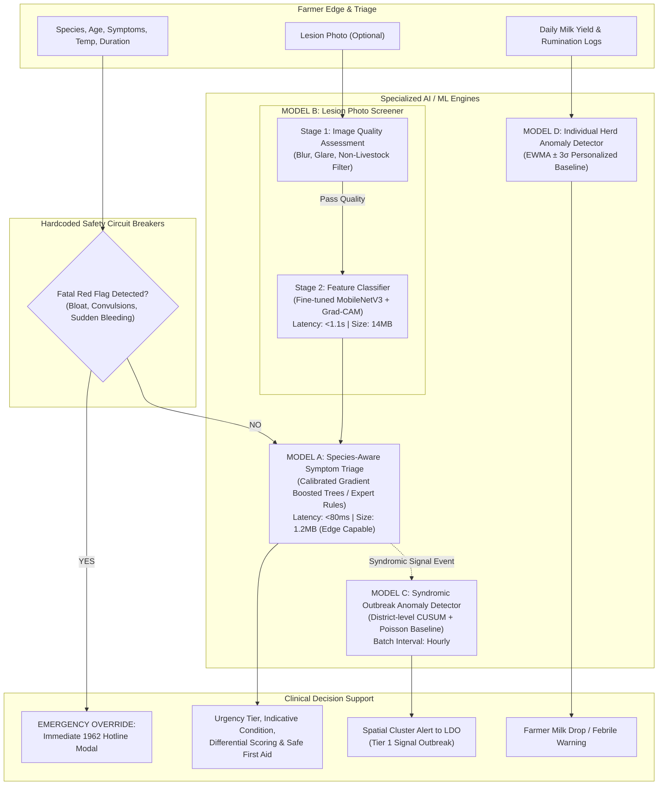
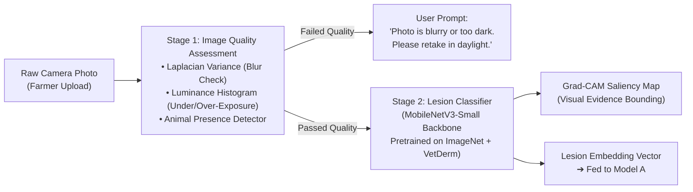
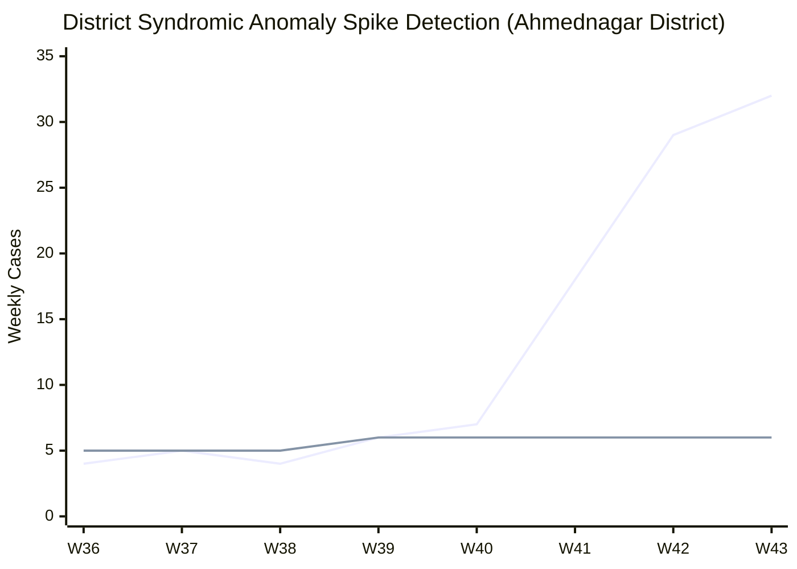

# 🧠 PashuSachet (पशूसचेत) — AI & Machine Learning System Architecture

> **Document Type:** Machine Learning & Clinical Decision Support Engineering Plan  
> **Standard Compliance:** Follows `ml-best-practices` (Chronological splits, calibration metrics, safety circuits, explainability)  
> **Associated Specs:** [`FRONTEND_DESIGN_SPEC.md`](file:///g:/Chetan/pashuSachet/FRONTEND_DESIGN_SPEC.md) | [`BACKEND_ARCHITECTURE_PLAN.md`](file:///g:/Chetan/pashuSachet/BACKEND_ARCHITECTURE_PLAN.md) | [`plans.md`](file:///g:/Chetan/pashuSachet/plans.md)  
> **Clinical Role:** **Decision-Support Triage Screener** — strictly non-prescriptive, safe first-aid only, doctor-in-the-loop.

---

## 1. Machine Learning Multi-Model Topology

PashuSachet deploys three specialized, right-sized machine learning pipelines rather than a single monolithic model:



---

## 2. Model A: Species-Aware Clinical Triage Engine

### 2.1 Purpose & Role
Model A acts as a rapid, calibrated decision-support tool. It computes the probability distribution over candidate diseases based on species, breed, age group, reported symptoms, temperature, and onset duration, and assigns one of four clinical urgency tiers:
* `CRITICAL`: Immediate life-threat (automatic veterinary ambulance dispatch).
* `URGENT`: Rapidly progressing infectious disease (inspection within 6–12 hours).
* `MODERATE`: Non-emergency sub-acute illness (inspection within 24–48 hours).
* `ROUTINE`: Nutritional, deworming, or preventive inquiry.

### 2.2 Model Architecture, Unified Rule Engine & Confidence Bands
Rather than an uninterpretable deep neural network, Model A utilizes an **ensemble of Calibrated Decision Trees (LightGBM)** combined with a deterministic **ICAR-NIVEDI Clinical Rule Matrix**:

```
Feature Vector X ∈ ℝ^28:
├── Categorical: [Species (5), Breed (12), AgeGroup (4), LactationStatus (4)] (One-Hot Encoded)
├── Binary Symptoms: [OffFeed, HighFever, Nodules, Blisters, Lameness, Dyspnea, MastitisSwelling, ...] (14)
└── Numerical: [RectalTemperature_F, OnsetDuration_Days, LocalDistrictSeasonRisk] (3)
```

#### Shared Single Source of Truth (`triage_rules_v1.json`):
To prevent drift between frontend offline screening and backend triage, both consume an identical versioned rule file (`triage_rules_v1.json`). Every generated case records `rules_version` (e.g. `v1.0.0`).

#### Clinical Confidence Bands (Zero False Precision):
To avoid misleading pseudo-accuracy (such as claiming `confidence: 0.88`), Model A reports calibrated qualitative likelihood bands:
* **`Likely`:** High symptom concordance with characteristic cardinal pathognomonic signs (e.g., cutaneous nodules + fever $>103^\circ\text{F}$ in cattle $\implies$ Likely Lumpy Skin Disease).
* **`Possible`:** Non-specific presenting signs consistent with multiple differential etiologies.
* **`Less Likely`:** Rare presentation or atypical species/age occurrence.

### 2.3 Evaluation Protocol & Metrics
Per `ml-best-practices`, the dataset is partitioned via a **stratified district-chronological split** (training on 2021–2024 historical outbreak records; validating on 2025–2026 data):

| Metric | Target Minimum | Clinical Rationale |
| :--- | :--- | :--- |
| **Sensitivity (Recall) on Notifiable Diseases** | **≥ 98.5%** | Under no circumstance should a case of Foot & Mouth Disease (FMD) or Lumpy Skin Disease (LSD) be missed (false negative). |
| **Specificity** | **≥ 90.0%** | Minimizes false panics and excessive overburdening of rural dispensaries. |
| **Brier Score (Calibration)** | **≤ 0.08** | Verifies that confidence percentages reflect true clinical probabilities. |
| **Macro F1-Score** | **≥ 0.91** | Balances performance across rare and common diseases. |
| **Inference Latency** | **< 100 ms** | Ensures instantaneous interactive feedback on low-cost Android phones. |

### 2.4 Offline Edge Fallback
Model A rules are compiled into a tiny **JSON decision table (1.2 MB)** stored directly in the browser's IndexedDB. If the farmer has zero cellular connectivity in remote pasture, the PWA executes local deterministic screening and displays safe first-aid guidelines immediately.

---

## 3. Model B: Lesion Photo Pre-Screening & Quality Filter

### 3.1 Pipeline Stages
Farmers frequently capture blurry, dark, or off-target photos in rustic cattle sheds. Model B utilizes a two-stage computer vision architecture:



### 3.2 Stage 1: Quality Rejection Filters
1. **Blur Detection:** Compute the variance of the Laplacian operator:
   $$\text{Var}(\nabla^2 I) < 100 \implies \text{REJECT (Blurry)}$$
2. **Exposure Check:** Verify mean pixel luminance $L \in [40, 220]$ on a 0–255 scale.
3. **Livestock Subject Verification:** Lightweight MobileNet-SSD bounding box verifying that livestock skin, muzzle, or hoof occupies $\ge 35\%$ of the frame.

### 3.3 Stage 2: Lesion Classification
* **Backbone:** MobileNetV3-Small (optimized for mobile CPU inference; 14 MB weights).
* **Classes Detected:**
  1. `Cutaneous Nodules` (Characteristic of Lumpy Skin Disease / Pseudocowpox)
  2. `Epithelial Vesicles / Erosions` (Characteristic of Foot & Mouth Disease)
  3. `Localized Udder Inflammation` (Characteristic of Clinical Mastitis)
  4. `Normal Skin / Benign Tick Bites`
* **Explainability (Grad-CAM):** Generates a localized heatmap overlay showing the veterinarian exactly which skin patch triggered the lesion classification.

---

## 4. Model C: Outbreak Anomaly Detector & Spatial Early Warning

### 4.1 Objective
Model C monitors syndromic triage events aggregated at the Taluka and District level to detect statistical anomalies before laboratory confirmation.

### 4.2 Algorithm: Seasonal CUSUM & Poisson Regression
For each district $d$ and disease syndrome $s$ at week $t$:
1. **Historical Baseline Calculation:**
   $$\mu_{d,s,t} = \text{Rolling 3-year median for calendar week } t \text{ (from ICAR-NIVEDI records)}$$
2. **Cumulative Sum (CUSUM) Formulation:**
   $$S_t = \max\left(0, S_{t-1} + (C_t - (\mu_t + k \cdot \sigma_t))\right)$$
   Where:
   * $C_t$ is the observed case count in the current window.
   * $k = 0.5$ (allowance parameter).
   * $\sigma_t$ is the historical standard deviation.
3. **Threshold Breach (Anomaly Trigger):**
   $$S_t > h \cdot \sigma_t \quad (h = 4.0) \implies \text{TRIGGER TIER 1 SIGNAL OUTBREAK ALERT}$$


*(Blue line: Observed syndromic cases; Green line: Seasonal expected baseline. Week 41 breaches the CUSUM threshold and triggers an automatic alert to the Livestock Development Officer).*

### 4.3 Three-Tier Outbreak Confidence Progression
* **Tier 1 (Signal Alert):** Statistical anomaly triggered by Model C based on farmer triage volume. Marked yellow on the LDO GIS map.
* **Tier 2 (Clinical Alert):** Licensed veterinarians physically confirm $\ge 3$ matching clinical diagnoses in a 10 km radius.
* **Tier 3 (Confirmed Outbreak):** Regional Disease Diagnostic Laboratory (RDDL) enters positive ELISA/PCR assay results. Automatically unlocks ring-vaccination dispatch and state reporting.

---

## 5. Model D: Individual Herd Anomaly Detector (Sensor/Vitals)

### 5.1 Objective
Detects sub-clinical illness in individual dairy animals (cows/buffaloes) by monitoring daily milk yield variations and body temperatures.

### 5.2 Algorithm: Exponentially Weighted Moving Average (EWMA)
For animal $i$ on day $t$:
$$\bar{Y}_t = \alpha Y_t + (1 - \alpha) \bar{Y}_{t-1} \quad (\alpha = 0.3)$$
$$UCL = \bar{Y}_t + 3 \sigma_{\text{historical}}, \quad LCL = \bar{Y}_t - 3 \sigma_{\text{historical}}$$

* **Alert Condition:** If daily milk yield drops below $LCL$ for two consecutive milkings ($>25\%$ sudden drop) or rectal temperature exceeds $103.5^\circ\text{F}$:
  * Generates an in-app card: *"Notice: Gauri showed a 3.2L milk drop today. Check udder for swelling or initiate health check."*

---

## 6. Safety Circuit Breakers & Clinical Governance

```
                    ┌───────────────────────────────┐
                    │ Farmer Initiates Health Check │
                    └───────────────┬───────────────┘
                                    │
                                    ▼
                     /─────────────────────────────\
                    <   Severe Bloat, Inability to  >
                    <   Breathe, or Convulsions?    >
                     \─────────────────────────────/
                                    │
                       YES          │          NO
           ┌────────────────────────┴──────────────────────┐
           ▼                                               ▼
┌─────────────────────────────────┐        ┌─────────────────────────────────┐
│     CRITICAL CIRCUIT BREAKER    │        │       RUN MODEL A TRIAGE        │
│ • Bypass ML inference entirely  │        │ • Calibrated decision support   │
│ • Full-screen Emergency Modal   │        │ • Urgency rating assigned       │
│ • Direct 1-tap call to 1962     │        │ • Safe first aid guidance       │
│ • Immediate SMS dispatch to vet │        │ • Option to book dispensary     │
└─────────────────────────────────┘        └─────────────────────────────────┘
```

### Safety Rules Enforced:
1. **Zero Automated Prescriptions:** The system NEVER prescribes specific antibiotic dosages or prescription pharmaceuticals directly to the farmer. Only verified first-aid actions (isolation, shade, hydration, antiseptic wash) are surfaced.
2. **Doctor-in-the-Loop:** All formal diagnoses and drug withholding schedules must be confirmed and signed by a licensed veterinarian.
3. **Explicit Disclaimer Stamp:** Every screening output explicitly displays:  
   *"Preliminary AI decision-support screening based on ICAR-NIVEDI protocols. Not a substitute for physical veterinary diagnosis."*

---

## 7. Model Monitoring, Drift & Continuous Learning

| Monitoring Vector | Metric / Tool | Alert Threshold | Remediation Plan |
| :--- | :--- | :--- | :--- |
| **Data Drift** | Kolmogorov-Smirnov test on symptom distributions. | $p < 0.01$ | Re-fit feature encoders; check for novel local disease emergence. |
| **Concept Drift** | Vet Confirmation Ratio (Rate at which vets agree with Model A's top condition). | Agreement $< 82\%$ | Retrain decision tree ensembles with newly confirmed clinical cases. |
| **Prediction Latency** | P95 inference latency on API Gateway. | $> 250\text{ ms}$ | Scale horizontal worker replicas; optimize ONNX runtime runtime threads. |

---

> 📌 **Engineering Status:** This specification sets the complete mathematical and clinical baseline for PashuSachet AI.

