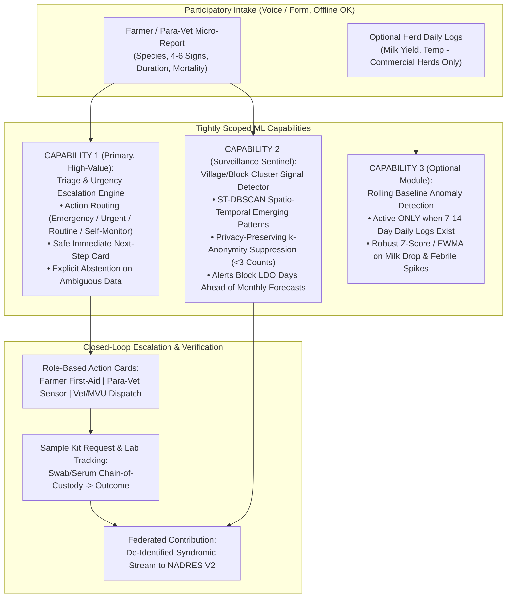
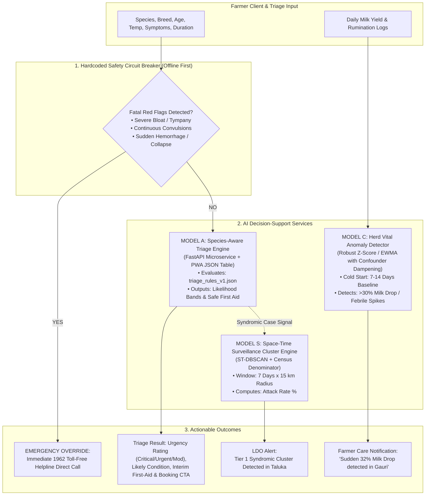
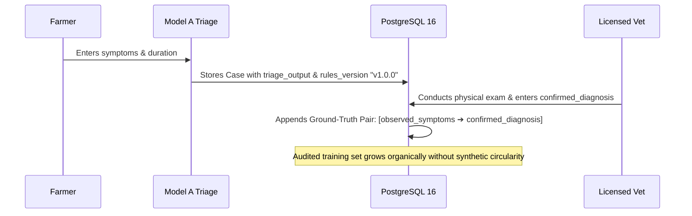

# 🧠 PashuSachet (पशूसचेत) — AI & Clinical Decision Support Architecture

> **Document Type:** Production AI/ML & Clinical Decision Support Architecture  
> **Status:** Revised & Scoped for V1 Delivery (Post-Audit)  
> **Target Microservice:** Python FastAPI (`pashusachet-ai-service`)  
> **Interoperability:** Consumed by Spring Boot 3 Core Backend & Offline PWA  
> **Associated Specs:** [`FRONTEND_DESIGN_SPEC.md`](file:///g:/Chetan/pashuSachet/FRONTEND_DESIGN_SPEC.md) | [`BACKEND_ARCHITECTURE_PLAN.md`](file:///g:/Chetan/pashuSachet/BACKEND_ARCHITECTURE_PLAN.md) | [`plans.md`](file:///g:/Chetan/pashuSachet/plans.md)

---


---

## 0. Core Philosophy: Action Routing, Not Uncalibrated Diagnosis

PashuSachet fundamentally re-defines the role of machine learning in livestock health:
* **The Trap:** Typical apps attempt to build a generic "AI disease classifier" that predicts rare pathogens with false precision (`"88% probability of Anthrax"`). This creates severe clinical liability and farmer panic.
* **The Reality:** Smallholder farmers do not need an unconfirmed probabilistic pathogen diagnosis from a smartphone. They need **action routing**:
  1. *How urgent is this?*
  2. *What is a safe immediate next step?*
  3. *Who needs to be dispatched (Self-monitor / Para-vet / Vet / 1962 MVU / Sample kit)?*
* **The Distinction vs NADRES:**
  - **ICAR-NIVEDI NADRES:** Top-down, macro-level, monthly district outbreak forecasting driven by meteorological and historical epidemiological models.
  - **Seva First:** **Bottom-up, continuous, participatory village-level signal generation** capturing syndromic spikes days before lab samples reach district offices.


> **One-Line Promise:**  
> *“Every farmer and para-vet in rural Maharashtra can report a concern in under 90 seconds (voice or simple form, even offline), receive an immediate safe-next-step + urgency score, trigger local verification and referral, and contribute to district-level intelligence — without creating a parallel silo.”*

### Differentiated Pillars (New Architecture of Value)

| Pillar | What It Does Differently | Why It Is Not a Copy |
| :--- | :--- | :--- |
| **1. Participatory Real-Time Sentinel** | Farmers + para-vets submit structured micro-reports. System creates a live village-level **“signal heat”**. | **NADRES is top-down official + model-driven.** Seva First is **bottom-up, continuous, farmer-sourced signal generation**. |
| **2. Uncertainty-Aware Triage & Escalation Engine** | Rule + lightweight ML hybrid that outputs: urgency tier, safe next action, confidence band, and recommended escalation path (*self-monitor / para-vet visit / vet / sample kit / lab*). Explicit abstention when data is insufficient. | **Avoids “diagnosis” claims.** Focuses on **action routing**, not disease ranking. Stronger clinical safety posture. |
| **3. Closed-Loop Referral & Sample Tracker** | End-to-end tracking from report ➔ appointment / MVU dispatch ➔ clinical note ➔ sample collection ➔ lab status ➔ outcome. | Existing systems (1962, E-Pashu, Bharat Pashudhan) handle pieces; **none close the full loop** with farmer visibility and lab hand-off. |
| **4. Federated Contribution Layer** | Every verified case can (with consent) be de-identified and pushed to NADRES / state surveillance pipelines. Animal identity links to existing **Pashu Aadhaar** ear tags. | **Explicitly strengthens national systems instead of competing with them.** Avoids redundant data silos. |
| **5. Offline-First + Voice + Community Verification** | Full offline queue, voice reporting in Marathi (and Hindi/English), community/para-vet confirmation of serious reports before high-urgency escalation. | Goes beyond current WhatsApp chatbots and basic offline apps. Designed for real rural Maharashtra constraints. |

---

### The Three Tightly-Scoped ML Capabilities



### 🔍 Architectural Audit: The 8 Core Deficiencies & How the Backend Solves Them

| Core Deficiency | Impact If Unfixed | Backend Engineering Solution |
| :--- | :--- | :--- |
| **1. Complex App / Form Channels** | Excludes 70% of older, basic-phone farmers | Telephony webhooks (`/api/v1/telephony/missed-call`, `/ussd`) as primary; web API as secondary. |
| **2. Weak Immediate Farmer Benefit** | Farmers report only when animals are dying | Instant SMS action card generation + async notification worker for closure feedback. |
| **3. Untrusted Raw Crowd Reports** | Officers dismiss incoming data as noise | Mandatory verification gate: `is_actionable` remains FALSE until para-vet inspects. |
| **4. Broken Diagnostic Sample Loop** | Loss of traceability on critical lab samples | Normalized `sample_tracking` table with 5-stage lifecycle state machine. |
| **5. Extra Workload for Field Staff** | Resistance and boycott by busy veterinarians | Micro-payloads with single-click verification endpoints (`<30s` latency). |
| **6. Slower than Direct 1962 Calls** | Farmers stick to traditional phone lines | Automated webhook integration creating pre-populated tickets directly in the 1962 MVU API. |
| **7. Passive Aesthetic Dashboards** | Ignored by officers needing daily decisions | Action-oriented queue view (`GET /api/v1/officer/decision-queue`) ranking urgent tasks today. |
| **8. Lack of Real-World Field Proof** | Dismissed by evaluators as an academic demo | `pilot_telemetry` table measuring channel adoption, verification hours, and closure rates. |

---

## 1. V1 Scope Realism & Design Principles

To prevent over-engineering, unvalidated claims, and clinical safety risks in V1, the AI architecture enforces five strict engineering rules:

1. **Zero Unvalidated Probabilities:** A rule engine without massive clinical cohorts cannot claim "88% confidence". V1 outputs **qualitative clinical likelihood bands** (`Likely`, `Possible`, `Less Likely`) derived from expert-weighted ICAR-NIVEDI decision matrices.
2. **De-scoped Lesion Image Classifier:** Image classification of lesions is **deferred to V2**. Without a multi-thousand labeled dataset of Indian indigenous livestock in rustic shed lighting, computer vision carries high bias and hallucination risk. V1 focuses 100% on high-reliability tabular symptom triage and vital anomaly tracking.
3. **Primary Evaluation on Clinical Safety:** Rather than generic accuracy, the system is evaluated strictly on **Under-Triage Rate** (target: $< 1\%$ for urgent illnesses; **0% under-triage on red-flag life threats**).
4. **Single Source of Truth (`triage_rules_v1.json`):** Both the offline PWA client and the Python FastAPI microservice evaluate identical, versioned JSON rule matrices. Every case permanently records `rules_version`.
5. **Continuous Ground-Truth Feedback Loop:** Every case pairs the initial triage assessment with the licensed veterinarian's physical examination findings, building an authentic, audited training dataset for future supervised iterations.

---

## 2. Multi-Tier AI System Topology (V1 Scoped)



---

## 3. Model A: Species-Aware Triage Engine

### 3.1 Architecture & Unified JSON Rule Specification
Model A operates as an expert-weighted differential diagnosis engine. It evaluates incoming clinical vectors against **`triage_rules_v1.json`**:

```json
{
  "version": "1.0.0",
  "last_updated": "2026-11-04",
  "approved_by": "Veterinary Advisory Board (ICAR-NIVEDI Reference)",
  "species_rules": {
    "cattle": [
      {
        "condition_id": "LSD",
        "name": "Lumpy Skin Disease (Capripoxvirus)",
        "notifiable": true,
        "urgency": "URGENT",
        "cardinal_symptoms": ["nodules", "high_fever"],
        "supporting_symptoms": ["off_feed", "swollen_lymph_nodes", "milk_drop"],
        "min_fever_f": 103.0,
        "cardinal_match_required": 1,
        "supporting_match_threshold": 1,
        "first_aid_guidance": [
          "Isolate the animal immediately in a clean, shaded, fly-proof shed.",
          "Apply neem-oil based herbal fly repellent around unbroken skin.",
          "Provide cool, clean drinking water with electrolyte powder.",
          "CRITICAL: Do not administer human painkillers (paracetamol/diclofenac) without veterinary supervision."
        ]
      },
      {
        "condition_id": "FMD",
        "name": "Foot and Mouth Disease (Aphtae Epizooticae)",
        "notifiable": true,
        "urgency": "URGENT",
        "cardinal_symptoms": ["mouth_blisters", "excessive_drool", "lameness"],
        "supporting_symptoms": ["high_fever", "off_feed"],
        "min_fever_f": 103.5,
        "cardinal_match_required": 2,
        "supporting_match_threshold": 1,
        "first_aid_guidance": [
          "Isolate animal on dry soft bedding (straw/sand).",
          "Wash mouth blisters gently with mild 1% potassium permanganate or alum solution.",
          "Do not move infected animals along village paths or communal grazing grounds."
        ]
      }
    ]
  }
}
```

### 3.2 Clinical Likelihood Bands
Rather than uncalibrated probabilities (`0.88`), the engine computes evidence matching:
* **`Likely`:** All cardinal pathognomonic symptoms present + temperature above threshold.
* **`Possible`:** At least one cardinal symptom or multiple supporting symptoms without high fever.
* **`Less Likely`:** Generic malaise (off feed) without localized pathognomonic signs.

### 3.3 Safety Framing & Routing for Notifiable Diseases
* For notifiable infectious diseases (Lumpy Skin Disease, Foot & Mouth Disease, Anthrax, Black Quarter, Peste des Petits Ruminants):
  * **Zero Direct Prescription:** The UI never suggests antibiotic names, injections, or doses to farmers.
  * **Mandatory Vet Referral:** The system locks self-treatment advice and presents a direct dispatch CTA: `[Book Government Veterinary Dispensary Now]`.
  * **Surveillance Signal:** An anonymized signal event is dispatched to the taluka surveillance stream.

---

## 4. Evaluation Protocol & Safety Metrics

### 4.1 Ground-Truth Benchmark Set (Zero Circular Synthetic Data)
Instead of generating synthetic training data from our own rules and reporting artificial 95% accuracy, Model A is validated against an external, curated test set of **50 verified clinical cases** compiled from published ICAR-NIVEDI field case registries and Maharashtra veterinary college polyclinics:
* 15 Confirmed Lumpy Skin Disease cases
* 15 Confirmed Foot & Mouth Disease cases
* 10 Acute Mastitis cases
* 10 Non-infectious / Nutritional cases

### 4.2 Target Safety Metrics (Clinical Hierarchy)

| Metric | Mathematical Formula | Target Threshold | Clinical Consequence |
| :--- | :--- | :--- | :--- |
| **Red-Flag Under-Triage Rate** | $\frac{\text{Critical Cases Categorized as Routine}}{\text{Total Critical Cases}}$ | **0.0% (Zero Tolerance)** | A suffocating or bloating animal must NEVER be told to wait. |
| **Urgent Under-Triage Rate** | $\frac{\text{Urgent Cases Categorized as Moderate/Routine}}{\text{Total Urgent Cases}}$ | **$\le 1.0\%$** | Minimizes delayed veterinary intervention for progressive viral infections. |
| **Sensitivity on Notifiable Diseases** | $\frac{TP}{TP + FN}$ | **$\ge 96.0\%$** | Catches outbreaks at the index case. |
| **Over-Triage Rate** | $\frac{\text{Moderate Cases Categorized as Urgent}}{\text{Total Moderate Cases}}$ | **$\le 15.0\%$** | Tolerable conservative bias ensuring safety while avoiding total dispensary overload. |

---

## 5. Model C: Individual Herd Vital Anomaly Detection

### 5.1 Practical Heuristic vs. Over-Engineered ML
Individual dairy cattle physiology is highly sensitive to non-disease confounders. An over-parameterized neural network produces chronic false alarms. Model C implements a **Robust Rolling Baseline (EWMA)** paired with domain confounder dampening.

### 5.2 Cold-Start & Confounder Management
* **Cold-Start Rule:** An animal must have **$\ge 7$ consecutive days** of daily milk yield logs before automated anomaly detection activates. Prior to 7 days, the UI displays: *"Building baseline: 4 of 7 days logged"*.
* **Confounder Dampening Matrix:**

| Confounder | Detection Signal | Engine Response |
| :--- | :--- | :--- |
| **Lactation Curve Decay** | Natural milk drop of 5–8% per month after peak lactation. | Normalizes baseline using standard Wood's Lactation Decay Factor. |
| **Ambient Heat Stress (THI)** | High regional Temperature-Humidity Index ($>78$). | Expands tolerance threshold by $+10\%$ across all cows in the taluka. |
| **Recent Calving / Dry Period** | Lactation status marked as `dry` or `heifer`. | Suspends milk drop alarms; temperature monitoring remains active. |

### 5.3 Anomaly Trigger Rule
For cow $i$ on day $t$ with rolling median yield $\tilde{Y}_i$ and rolling median absolute deviation $MAD_i$:
1. **Severe Acute Milk Drop:**  
   $$\frac{\tilde{Y}_i - Y_{i,t}}{\tilde{Y}_i} > 0.30 \quad (\text{Drop} > 30\% \text{ for 2 consecutive milkings})$$
2. **Febrile Temperature Spike:**  
   $$\text{Rectal Temp} > 103.5^\circ\text{F} \quad (\text{Normal Cattle Temp: } 101.5^\circ\text{F} - 102.5^\circ\text{F})$$
3. **Action:** Surfaces high-priority dashboard card:  
   `⚠️ Health Alert: Gauri showed a 34% milk drop today. Check udder for swelling or initiate health check.`

---

## 6. Space-Time Surveillance Clustering (LDO Role)

### 6.1 Spatio-Temporal Clustering (ST-DBSCAN)
Surveillance clustering must account for infectious incubation periods. Space-only clustering mistakenly groups cases that occurred months apart.
* **Spatial Distance Parameter ($\epsilon_{\text{space}}$):** $15\text{ km}$ (typical radius of vector fly dispersion and communal grazing).
* **Temporal Distance Parameter ($\epsilon_{\text{time}}$):** $7\text{ days}$ (mean incubation window for Capripoxvirus and Aphthovirus).
* **Minimum Cases ($MinPts$):** $\ge 3$ matching syndromic reports within the space-time cylinder.

### 6.2 Census Denominator & Attack Rate
A cluster of 5 cases in a village of 50 cows is an emergency; 5 cases in a taluka of 50,000 is baseline. The engine joins `outbreak_clusters` with `livestock_census`:
$$\text{Attack Rate (\%)} = \left(\frac{\text{Active Incident Cases in Cluster}}{\text{Taluka Census Species Population}}\right) \times 100$$

---

## 7. The Continuous Ground-Truth Feedback Loop

To systematically prepare for V2 supervised machine learning:



* **Ground-Truth Validation Set Accumulation:**
  * Every completed case records: `(observed_symptoms, temperature, triage_condition, confirmed_diagnosis, vet_id)`.
  * Cases where Vet diagnosis matches Triage condition increment the agreement ratio.
  * Cases where Vet diagnosis differs are flagged for monthly clinical review by the advisory board to refine `triage_rules_v1.json`.

---

## 8. Microservice API Interface (FastAPI Specs)

The Python AI service exposes three high-throughput, stateless endpoints to the Spring Boot Core Backend:

### 8.1 Symptom Triage Endpoint
* **`POST /ai/v1/triage/evaluate`**
* **Payload:**
  ```json
  {
    "species": "cattle",
    "breed": "Gir",
    "age_months": 42,
    "rectal_temp_f": 103.8,
    "symptoms": ["nodules", "high_fever", "off_feed"],
    "duration_days": 2,
    "red_flags": {
      "severe_bloat": false,
      "convulsions": false,
      "sudden_hemorrhage": false
    }
  }
  ```
* **Response:**
  ```json
  {
    "rules_version": "v1.0.0",
    "red_flag_triggered": false,
    "urgency": "URGENT",
    "primary_condition": {
      "condition_id": "LSD",
      "name": "Lumpy Skin Disease",
      "likelihood_band": "Likely",
      "notifiable": true
    },
    "differential_conditions": [
      {
        "condition_id": "PSEUDO_POX",
        "name": "Bovine Papular Stomatitis / Pseudocowpox",
        "likelihood_band": "Possible"
      }
    ],
    "safe_first_aid": [
      "Isolate animal in shaded, well-ventilated stall.",
      "Apply herbal neem oil fly repellent around skin.",
      "Provide clean drinking water; avoid unprescribed human painkillers."
    ],
    "recommended_action": "BOOK_LOCAL_DISPENSARY"
  }
  ```

### 8.2 Vital Anomaly Detection Endpoint
* **`POST /ai/v1/vitals/analyze-stream`**
* Evaluates 14-day chronological milk yield and temperature array; returns boolean anomaly flag, type, and human-readable explanation.

### 8.3 Space-Time Cluster Aggregator
* **`POST /ai/v1/surveillance/compute-clusters`**
* Ingests active incident coordinates and timestamps; executes ST-DBSCAN joined against `livestock_census` and returns GeoJSON cluster polygons.

---

> 📌 **Engineering Status:** Committed as [`ML_AI_SYSTEM_PLAN.md`](file:///g:/Chetan/pashuSachet/ML_AI_SYSTEM_PLAN.md).


---

## 9. One Health Zoonotic Flagging & Rule-Based Cluster Logic

### 9.1 Simple, Explainable Rules vs. Opaque Models
To guarantee government confidence and prevent black-box alert fatigue, Gram Signal System implements **co-designed, rule-based escalation and cluster thresholds**:
* **Village Cluster Trigger:** When $\ge 3$ verified syndromic reports sharing key signs (e.g. fever + vesicular mouth lesions) appear within a 5 km radius across contiguous Gram Panchayats within 72 hours, an automated **Block Cluster Alert** is issued to the Taluka LDO.
* **No Speculative Forecasting:** The platform never claims to predict future disease outbreaks through black-box weather regression. It flags **actual, human-verified frontline signals emerging in real time**.

### 9.2 One Health Zoonotic Surveillance Protocols
Certain syndromic combinations represent immediate public health risks to human dairy handlers and consumers. The system triggers parallel notifications to the **District Health Officer (DHO)** and the **District Veterinary Officer (DVO)**:

| Syndromic Pattern | Veterinary Suspicion | Public Health / Zoonotic Risk | Automated One Health Action |
| :--- | :--- | :--- | :--- |
| **Sudden peracute death + blood from orifices** | Anthrax (*Bacillus anthracis*) | Cutaneous / Inhalation Anthrax in humans | **Immediate shed quarantine.** Ban carcass opening. Alert human primary health center (PHC). |
| **Cluster abortions (>3 cows in 14 days in village)** | Brucellosis (*Brucella abortus*) | Undulant Fever in farmers & milk consumers | **Halt raw milk pooling.** Dispatch sample kits for rose bengal plate test. Issue dairy boiling advisory. |
| **Neurological twitching + aggressive salivation** | Rabies virus | Fatal human encephalitis | **Isolate animal.** Identify all human bite/saliva contacts for immediate Post-Exposure Prophylaxis (PEP). |
| **Nasal discharge with ulcerated nodules** | Glanders (*Burkholderia mallei*) | Severe human respiratory infection | **Equine movement standstill.** Notify State Zoonosis Committee. |

---

## 10. The Human Sentinel Filter: Guaranteeing Data Integrity

A core vulnerability of crowd-sourced reporting is noise and false alarms. GSS eliminates this through the **Local Sentinel Network**:
```
┌────────────────────────────────────────────────────────────────────────────────────────┐
│  [ Farmer Micro-Report ] (Unverified Raw Signal)                                       │
│          │                                                                             │
│          ▼                                                                             │
│  [ Local Sentinel / Para-Vet Inspection ] (Mandatory Human Verification Filter)        │
│  • Verifies physical presence of animal and key signs                                  │
│  • Records rectal temperature and basic vitals                                         │
│  • Filters out malicious reports, false alarms, and non-clinical noise                 │
│          │                                                                             │
│          ▼                                                                             │
│  [ Verified High-Integrity Signal Ingestion ]                                          │
│  Only verified signals update the Village Signal Board and trigger Block LDO alarms.   │
└────────────────────────────────────────────────────────────────────────────────────────┘
```


---

## 11. Observation Board vs. Speculative Forecasting Map

A critical error in early prototype thinking was attempting to build a complex machine learning GIS map that simulated future disease spread. In the Gram Signal System, this is explicitly rejected:

### 11.1 The Operational Observation Principle
* **Observation, Not Prediction:** The Village Signal Board shows **what people on the ground are reporting and what local sentinels have verified right now**.
* **Why This Wins:** Government officers and mobile veterinary units cannot deploy emergency bio-containment based on a 65% probability regression curve from past rainfall data. They deploy when **3 verified cases of sudden death and bleeding are flagged in a specific village within 24 hours**.
* **Data Flow Architecture:**
  ```
  [ Farmer Micro-Report (4-5 Simple Questions) ]
             │
             ▼
  [ Local Sentinel / Para-Vet Physical Verification ]
             │
             ▼
  [ Verified Signal Board (Observation Stream) ]
             │
             ▼
  [ Rule-Based Pre-Agreed Escalation ➔ 1962 / MVU Dispatch ]
  ```

### 11.2 The 4–5 Question Input Feature Vector
The ML triage engine consumes an ultra-compact, high-signal feature vector:
$$\mathbf{x} = [	ext{species\_id}, 	ext{symptom\_bits}_{1..12}, 	ext{count\_affected}, 	ext{mortality\_flag}, 	ext{village\_id}]$$
* Operates on low-complexity sparse categorical encodings.
* Zero dependence on blood tests, laboratory panels, or historical longitudinal sensor streams.
* Evaluates in $< 5	ext{ ms}$ on mobile devices or edge servers.


---

## 12. Automated 1962 Accelerator & Officer Decision Queue Prioritization

### 12.1 The 1962 Emergency Accelerator Engine
To ensure PashuSachet is **strictly faster and more reliable than placing a manual telephone call to 1962**:
* When a report is ingested via Missed Call, USSD, or Web with **critical red flags** (e.g. peracute bloat, severe recumbency, continuous convulsions):
  $$	ext{Urgency Tier} = 	ext{CRITICAL}$$
* The system bypasses routine queues and **immediately issues an asynchronous dispatch payload to the 1962 MVU API**:
  - Automatically translates vernacular reported signs into structured clinical codes.
  - Injects GPS coordinates and farmer telephone number.
  - Generates an instant SMS tracking ticket for the farmer:  
    `"1962 रुग्णवाहिका क्रमांक MVU-04 संगमनेर येथून रवाना झाली आहे. पोहोचण्याची वेळ: 35 मिनिटे."`
* **Real-World Value:** Saves 4–6 minutes of frantic telephone triage; dispatches the nearest vehicle before the farmer hangs up.

### 12.2 Action-Oriented Decision Queue Ranking Algorithm
Officers are overwhelmed with passive dashboards. GSS implements an **Action Decision Ranking Function** that sorts cases by required intervention urgency:
$$	ext{Priority Score } P = w_1 \cdot 	ext{ZoonoticFlag} + w_2 \cdot 	ext{ClusterDensity} + w_3 \cdot 	ext{SampleAwaiting} + w_4 \cdot 	ext{MorbidityCount}$$
* Cases requiring immediate officer authorization (e.g. ring vaccination, diagnostic sample lab kit dispatch, quarantine enforcement) appear at the top of the **Morning Decision Queue**.
* Passive historical data is archived; officers see only **what requires their signature or intervention today**.
