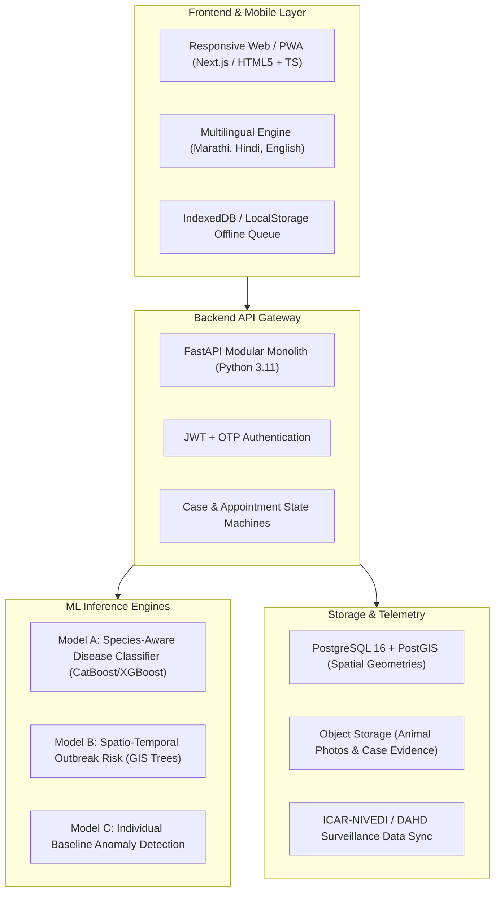

# 🐄 PashuSachet (पशूसचेत / Seva First)
## End-to-End Technical Specification, Architecture & Implementation Roadmap

> **Reference Blueprint:** *Seva First: A multilingual, AI-assisted livestock-health and veterinary-service platform for rural Maharashtra*  
> **Repository:** `https://github.com/chetanbhagore/PashuSachet`  
> **Live Demo:** `https://pashu-sachet.vercel.app` | `https://chetanbhagore.github.io/PashuSachet/`

---


---

## 0. Originality & Positioning: The Missing Participatory Layer

**PashuSachet (Seva First) is not another disease-forecasting or animal-registry platform.** It is the missing **last-mile participatory layer** connecting fragmented farmer observations into structured, real-time, village-level early warning signals and closed-loop action — while feeding cleaned data upward into existing national systems (**NADRES V2** and **Bharat Pashudhan / NDLM**).

> **One-Line Promise:**  
> *“Every farmer and para-vet in rural Maharashtra can report a concern in under 90 seconds (voice or simple form, even offline), receive an immediate safe-next-step + urgency score, trigger local verification and referral, and contribute to district-level intelligence — without creating a parallel silo.”*

---

## The Six Unclosed Operational Gaps Solved by Gram Signal System (GSS)

1. **Proactive, Continuous Village-Level Signal Generation:** Low-effort, always-available intake for signs, unusual patterns, and mortality (under 60–90 seconds via Missed call, USSD, Marathi voice IVR, WhatsApp voice).
2. **Very Low Digital Inclusion:** Prioritizes basic non-smartphone feature phones (*Missed call ➔ Marathi IVR callback ➔ USSD menu ➔ WhatsApp voice ➔ Offline Web App*). No smartphone, internet, or typing required for the basic report.
3. **Closed-Loop Sample ➔ Lab ➔ Result ➔ Action Tracking:** Transparent tracking for every case needing lab confirmation (*Sample Needed ➔ Collected + ID ➔ Dispatched to RDDL ➔ Lab Testing ➔ Result Linked ➔ Final Action Taken*). Visible to farmer, para-vet, and officer.
4. **Live Village / Block Operational Visibility:** Live “Village Signal Board” showing real-time verified ground observations (not speculative forecasting), with small-count privacy suppression ($<3$).
5. **Verification and Trust Layer:** Fast local verification step by trained village sentinels / para-vets (*Unverified ➔ Local Physical/Voice Check ➔ Verified Signal*), turning noisy crowd data into trusted actionable signals.
6. **Measurable Coordinated Response at Local Level:** Co-designed escalation rules (village vs block vs 1962 MVU), explicit ownership at each step, and automated lifecycle timestamp tracking (*Signal ➔ Verified ➔ Action ➔ Sample/Result ➔ Closed*).

### Linkage to Existing National Systems (Feeder & Enhancer)
* **1962 / MVUs:** Automatically notifies or creates a service request when escalation rules are triggered.
* **Bharat Pashudhan (NDLM):** Links to existing 12-digit Pashu Aadhaar ear tags without creating a parallel registry.
* **ICAR-NIVEDI NADRES:** Contributes cleaned, consented, de-identified verified signals as a continuous ground-truth field data feed.

### Core Success Metrics (Tied Directly to Gaps)
1. **Proactive Signal Volume:** Number of early, non-treatment-seeking signals per village per month.
2. **Digital Inclusion Ratio:** % of reports received through non-smartphone channels (Target: $>60\%$).
3. **Verification Speed:** Average turnaround time from signal to para-vet verification (Target: $<4$ hours).
4. **Sample Closure Rate:** % of sample cases reaching confirmed result and action taken (Target: $>90\%$).
5. **Officer Board Engagement:** Daily active officer usage of the Village Signal Board.
6. **Time to First Action:** Average elapsed time from verified signal to first official intervention (Target: $<12$ hours).

---

---

## Critical Real-World Flaws & How PashuSachet Solves Them

| Core Deficiency | Impact If Unfixed | PashuSachet Engineering Fix |
| :--- | :--- | :--- |
| **1. Complex App / Form Channels** | Excludes 70% of older, basic-phone farmers | Missed-Call + USSD + Marathi IVR as **primary**; smartphone web as secondary. |
| **2. Weak Immediate Farmer Benefit** | Farmers report only when animals are dying | Instant plain-Marathi action card + live status SMS + case-closure feedback message. |
| **3. Untrusted Raw Crowd Reports** | Officers dismiss incoming data as noise | Mandatory 30-second local para-vet verification gate before signals become actionable. |
| **4. Broken Diagnostic Sample Loop** | Loss of traceability on critical lab samples | Central 5-stage tracker: *Sample Needed ➔ Collected + ID ➔ Lab ➔ Result ➔ Action*. |
| **5. Extra Workload for Field Staff** | Resistance and boycott by busy veterinarians | Every field action $<30$–40 seconds; one-tap buttons, voice notes, eliminates phone tag. |
| **6. Slower than Direct 1962 Calls** | Farmers stick to traditional phone lines | System auto-injects critical tickets directly into 1962 MVU API with pre-populated GPS. |
| **7. Passive Aesthetic Dashboards** | Ignored by officers needing daily decisions | Action-oriented queue sorting cases by *“Decisions Required Today”* with simple filters. |
| **8. Lack of Real-World Field Proof** | Dismissed by evaluators as an academic demo | Immediate 5–10 village pilot measuring missed-call usage, verification time, and sample closure. |

---

## 1. Executive Summary & Core Value Proposition

PashuSachet bridges rural livestock owners, para-vets, veterinarians, and government surveillance teams through:
1. **Participatory Real-Time Sentinel:** Structured 90-second micro-reports (voice or 4-tap form) creating live village-level signal heat (bottom-up continuous generation vs NADRES top-down forecasts).
2. **Uncertainty-Aware Triage & Escalation:** Action routing (urgency tier, safe next step, recommended escalation path) with explicit abstention when data is ambiguous (no fake diagnosis claims).
3. **Closed-Loop Referral & Sample Tracker:** Transparent chain-of-custody tracking from report ➔ para-vet verification ➔ 1962 MVU dispatch ➔ clinical exam & sample kit ➔ lab status ➔ outcome.
4. **Federated Contribution Layer:** Direct linkage to 12-digit Pashu Aadhaar ear tags; consent-driven de-identified export pipelines feeding into ICAR-NIVEDI NADRES V2.
5. **Offline-First + Voice + Community Verification:** Designed for rustic shed constraints with Marathi-first voice recording, full offline IndexedDB sync, and para-vet verification.
6. **Privacy-Preserving Village Signals:** Micro-spatial heat maps with small-count suppression ($k$-anonymity $<3$) to protect smallholder farmers from milk cooperative boycotts.

---

## 2. Stakeholders & User Flows

```mermaid
flowchart TD
    subgraph FarmerFlow["1. Farmer / Livestock Keeper"]
        F1["Sign in via Mobile OTP / Voice"] --> F2["Select / Register Animal (Pashu Aadhar)"]
        F2 --> F3["Report Symptoms (Photo + Audio + Triage Form)"]
        F3 --> F4["Model A: Instant Decision Support & First Aid"]
        F4 --> F5["Request Verified Vet Appointment / Helpline 1962"]
        F5 --> F6["Receive Vaccination & Follow-up Reminders"]
    end

    subgraph VetFlow["2. Veterinarian / Clinic"]
        V1["Sign in & Credentials Verification"] --> V2["View Triage Queue & Clinical Urgency"]
        V2 --> V3["Accept / Reschedule Appointment"]
        V3 --> V4["Examine Animal & Enter Verified Diagnosis / Rx"]
        V4 --> V5["Update Animal Clinical Timeline & Close Case"]
    end

    subgraph OfficerFlow["3. Livestock Development Officer (LDO)"]
        O1["Officer GIS Dashboard"] --> O2["District / Taluka Disease Outbreak Map (Model B)"]
        O2 --> O3["Cluster Flagging & Vaccination Drive Dispatch"]
        O3 --> O4["Aggregated Surveillance Feeds (ICAR-NIVEDI Aligned)"]
    end
```



### Detailed User Journeys

#### A. Farmer Journey
1. **Onboarding:** Language selection (Marathi default) ➔ Mobile OTP authentication ➔ Farm profile creation (Village, Taluka, District).
2. **Animal Registration:** Ear tag number (12-digit), species (Cow, Buffalo, Goat, Sheep, Poultry), breed, age, purpose, photo.
3. **Symptom Reporting:** Guided 3-step checklist (fever, lesions, lameness, milk drop, breathing) + photo upload.
4. **AI Triage Result:** Color-coded urgency banner (`CRITICAL`, `URGENT`, `MODERATE`), probability matches, differential rule-outs, vet-approved emergency first aid steps.
5. **Veterinary Referral:** Direct link to local Government Dispensary or Mobile Clinic with one-tap calling or doorstep request.

#### B. Veterinarian Journey
1. **Triage Inbox:** View incoming requests filtered by urgency score and distance.
2. **Case Review:** Access animal health history, past vaccinations, and farmer-reported symptoms.
3. **Clinical Action:** Document clinical diagnosis, prescribed treatment, and schedule 7-day follow-up.

#### C. Livestock Officer (LDO) Journey
1. **Surveillance Heatmap:** Filter by disease (LSD, FMD, BQ, PPR, Anthrax) and time horizon (7/14/30 days).
2. **Outbreak Thresholds:** Automated alerts when taluka incident counts cross historical baselines.
3. **Ring Vaccination Planning:** Target high-risk village radii for mobile vaccination teams.

---

## 3. System Architecture & Tech Stack



### Recommended Technology Stack
* **Frontend:** Next.js / React with TailwindCSS (or high-performance vanilla TS/HTML5 for maximum rural mobile speed).
* **Backend:** FastAPI (Python) for async performance and direct interoperability with ML libraries.
* **Database:** PostgreSQL 16 with **PostGIS** extension for geo-spatial queries (distance, district polygons, clusters).
* **ML / Data:** scikit-learn, XGBoost, CatBoost, GeoPandas, NumPy.
* **Mapping:** Leaflet.js / MapLibre GL for district/taluka boundary rendering.
* **Deployments:** Vercel (Frontend), Render / Fly.io / AWS EC2 (Backend API & PostgreSQL), Supabase (Postgres + PostGIS).

---

## 4. API Inventory & REST Specification

### 4.1 Authentication & Profile
| Method | Endpoint | Description |
| :--- | :--- | :--- |
| `POST` | `/api/v1/auth/send-otp` | Request 6-digit OTP for mobile number |
| `POST` | `/api/v1/auth/verify-otp` | Verify OTP and return session JWT |
| `GET` | `/api/v1/users/me` | Current authenticated user profile |
| `PATCH` | `/api/v1/users/me` | Update language preference, location |

### 4.2 Animal Registry (Pashu Aadhar)
| Method | Endpoint | Description |
| :--- | :--- | :--- |
| `GET` | `/api/v1/animals` | List farmer's registered herd |
| `POST` | `/api/v1/animals` | Register new livestock with ear tag |
| `GET` | `/api/v1/animals/{id}` | Detailed health passport & history |
| `PATCH` | `/api/v1/animals/{id}` | Update animal details or status |

### 4.3 Clinical Cases & AI Symptom Screening (Model A)
| Method | Endpoint | Description |
| :--- | :--- | :--- |
| `POST` | `/api/v1/ml/disease-screening` | Run Model A triage on structured symptoms |
| `POST` | `/api/v1/cases` | Submit formal clinical case for vet review |
| `GET` | `/api/v1/cases/{id}` | Case status, triage score & notes |
| `PATCH` | `/api/v1/cases/{id}/status` | Transition case lifecycle state |

### 4.4 Veterinary Directory & Appointments
| Method | Endpoint | Description |
| :--- | :--- | :--- |
| `GET` | `/api/v1/veterinarians` | Search nearby verified dispensaries by lat/lon |
| `POST` | `/api/v1/appointments` | Request doorstep field visit or clinic slot |
| `PATCH` | `/api/v1/appointments/{id}` | Accept, reschedule, or complete visit |

### 4.5 Disease Surveillance & GIS (Model B)
| Method | Endpoint | Description |
| :--- | :--- | :--- |
| `GET` | `/api/v1/surveillance/outbreaks` | District/Taluka risk scores & active clusters |
| `POST` | `/api/v1/ml/outbreak-risk` | Compute 30-day forecasted disease probability |
| `GET` | `/api/v1/surveillance/summary` | Statewide epidemiological KPI metrics |

---

## 5. Machine Learning Modules Detailed Design

### Model A: Species-Aware Disease Screening
* **Inputs:** Species (`cattle`, `buffalo`, `goat`, `sheep`, `poultry`), breed, age in months, sex, lactation stage, temperature (°F), symptom vector (nodules, mouth vesicles, hoof lesions, cough, nasal discharge, diarrhea, milk drop, rumination stop).
* **Target:** Top-3 ranked plausible conditions + Calibrated Confidence Score.
* **Safety Gate:** If confidence < 50% or inputs fall outside verified species range, trigger **Abstention Flag** and advise physical inspection.

### Model B: Spatio-Temporal Outbreak Risk
* **Inputs:** Historical outbreak counts (lag 1, 3, 6 months), livestock census density, rainfall, humidity, seasonal index.
* **Output:** District/Taluka 30-day risk percentage (Low `<40%`, Moderate `40-70%`, High `>70%`).

### Model C: Animal Baseline Anomaly Detection
* **Inputs:** Rolling 14-day vital readings (daily milk yield in liters, temperature, feeding activity).
* **Method:** Rolling robust Z-scores & Isolation Forest to flag early sub-clinical onset before physical lesions appear.

---

## 6. Database Canonical Schema (PostgreSQL + PostGIS)

```sql
-- Users & Roles
CREATE TABLE users (
    id UUID PRIMARY KEY DEFAULT gen_random_uuid(),
    phone VARCHAR(15) UNIQUE NOT NULL,
    full_name VARCHAR(100),
    role VARCHAR(20) NOT NULL CHECK (role IN ('farmer', 'veterinarian', 'officer', 'admin')),
    preferred_language VARCHAR(5) DEFAULT 'mr',
    district VARCHAR(50),
    taluka VARCHAR(50),
    village VARCHAR(100),
    location GEOMETRY(Point, 4326),
    created_at TIMESTAMP WITH TIME ZONE DEFAULT NOW()
);

-- Animal Health Passport (Pashu Aadhar)
CREATE TABLE animals (
    id UUID PRIMARY KEY DEFAULT gen_random_uuid(),
    owner_id UUID REFERENCES users(id) ON DELETE CASCADE,
    tag_number VARCHAR(30) UNIQUE,
    name VARCHAR(50),
    species VARCHAR(30) NOT NULL,
    breed VARCHAR(50),
    dob DATE,
    sex VARCHAR(10),
    is_active BOOLEAN DEFAULT TRUE,
    created_at TIMESTAMP WITH TIME ZONE DEFAULT NOW()
);

-- Clinical Cases & Symptom Triage
CREATE TABLE health_cases (
    id UUID PRIMARY KEY DEFAULT gen_random_uuid(),
    animal_id UUID REFERENCES animals(id) ON DELETE CASCADE,
    farmer_id UUID REFERENCES users(id),
    symptoms JSONB NOT NULL,
    temperature_f NUMERIC(4, 1),
    onset_days INTEGER,
    predicted_disease VARCHAR(100),
    confidence_score NUMERIC(4, 2),
    triage_urgency VARCHAR(20) CHECK (triage_urgency IN ('CRITICAL', 'URGENT', 'MODERATE')),
    status VARCHAR(30) DEFAULT 'Submitted',
    created_at TIMESTAMP WITH TIME ZONE DEFAULT NOW()
);

-- Verified Diagnoses & Clinical Outcomes
CREATE TABLE clinical_records (
    id UUID PRIMARY KEY DEFAULT gen_random_uuid(),
    case_id UUID REFERENCES health_cases(id),
    vet_id UUID REFERENCES users(id),
    confirmed_diagnosis VARCHAR(100) NOT NULL,
    treatment_notes TEXT,
    medication_prescribed JSONB,
    followup_date DATE,
    completed_at TIMESTAMP WITH TIME ZONE DEFAULT NOW()
);

-- Outbreak Surveillance & Telemetry
CREATE TABLE outbreak_records (
    id UUID PRIMARY KEY DEFAULT gen_random_uuid(),
    district VARCHAR(50) NOT NULL,
    taluka VARCHAR(50),
    disease_name VARCHAR(100) NOT NULL,
    affected_count INTEGER DEFAULT 0,
    death_count INTEGER DEFAULT 0,
    risk_score NUMERIC(4, 2),
    reported_date DATE NOT NULL,
    location GEOMETRY(Point, 4326)
);
```

---

## 7. Multi-Part Implementation Roadmap

### 🎯 Part 1: Project Setup & Team Workflows (Days 1–2)
- Configure GitHub Repository settings, branching rules (`main`, `dev`, feature branches).
- Add teammates as collaborators with write access.
- Setup pre-commit linting, formatting, and issue tracking boards.

### 🎯 Part 2: Database & Backend Foundation (Days 3–5)
- Initialize FastAPI project scaffolding (`app/api`, `app/models`, `app/services`, `app/core`).
- Setup PostgreSQL + PostGIS container and SQLAlchemy/Alembic migrations.
- Implement OTP simulation and JWT authentication for all 4 roles.

### 🎯 Part 3: Core Service Workflows & Registry (Days 6–8)
- Animal CRUD API (Pashu Aadhar generation, profile editing).
- Vaccination schedule generator based on species rules (FMD, LSD, PPR, BQ).
- Verified Veterinarian Directory with spatial proximity search (PostGIS `ST_DWithin`).

### 🎯 Part 4: Machine Learning Inference Integration (Days 9–11)
- Model A: Calibrated rule-based + ML classifier pipeline with triage boundaries.
- Model B: District risk aggregation using ICAR-NIVEDI / DAHD surveillance records.
- Integration tests ensuring strict clinical disclaimers and emergency helpline routing.

### 🎯 Part 5: Full Frontend & Mobile UI (Days 12–14)
- Responsive farmer dashboard with full Marathi / Hindi / English language dictionary.
- Interactive Symptom Checker with touch-friendly symptom selector chips.
- Interactive District GIS heatmap with Leaflet/GeoJSON polygons.
- Vet Consultation Booking flow with WhatsApp/SMS notification triggers.

### 🎯 Part 6: End-to-End Testing & Production Deployment (Days 15–17)
- Automated Pytest suite for API endpoints and ML boundaries.
- Vercel Frontend + Render/Railway Backend continuous deployment.
- Field testing with rural connectivity simulation (offline draft queue).

---

## 8. Collaboration Guide for Your Team

### How to Clone & Run Locally
```bash
# 1. Clone the private repository
git clone https://github.com/chetanbhagore/PashuSachet.git
cd PashuSachet

# 2. Open static prototype directly
start index.html

# 3. For backend development (Python 3.11+)
python -m venv venv
venv\Scripts\activate
pip install fastapi uvicorn sqlalchemy psycopg2-binary
```

### Git Branching Conventions
* `main`: Stable, production-ready code (automatically deployed to Vercel).
* `develop`: Active integration branch.
* `feature/<feature-name>`: Individual teammate branches (e.g., `feature/auth-api`, `feature/gis-map`).

