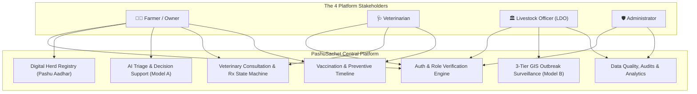
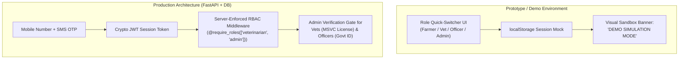
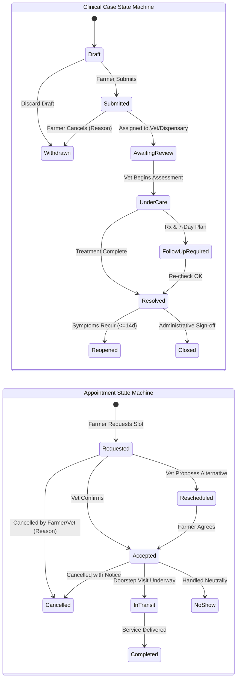
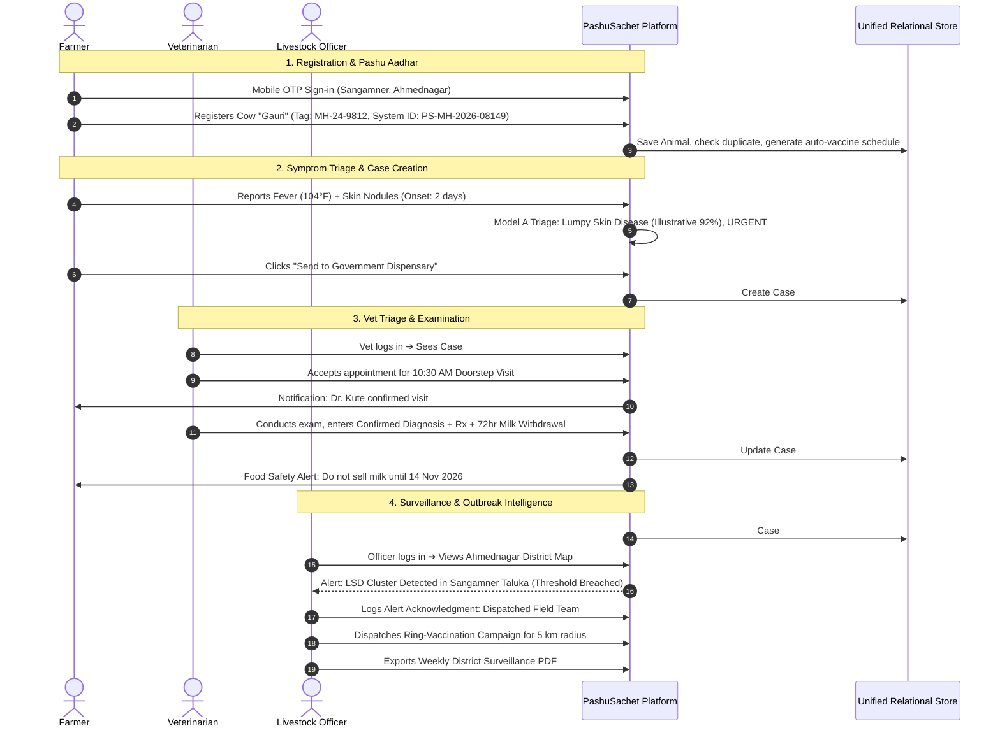

# 🐄 PashuSachet (पशूसचेत / Seva First)
## End-to-End Master Product Specification, Role Architecture & Implementation Blueprint

> **System Vision:** A complete, production-grade digital livestock-health and veterinary-service platform connecting Farmers, Veterinarians, Livestock Development Officers (LDOs), and Administrators across rural Maharashtra.  
> **Lifecycle Coverage:** Registration ➔ Login ➔ Animal Registration (Pashu Aadhar) ➔ Disease Detection ➔ Veterinary Consultation ➔ Treatment & Withdrawal Tracking ➔ Vaccination ➔ Outbreak Surveillance ➔ Administrative Audits.  
> **Repository:** `chetanbhagore/PashuSachet` | **Live Web App:** `https://pashu-sachet.vercel.app`

---

## 1. Executive Summary & Core Value Proposition

PashuSachet bridges rural livestock owners, field veterinarians, and government livestock development officers (LDOs) to reduce avoidable livestock mortality, safeguard rural livelihoods, and strengthen One Health disease surveillance.



---

## 2. Critical Corrections & Architectural Refinements

Based on operational review and rigorous engineering standards, the following critical refinements are established as core platform rules:

### 2.1 Authentication & Role Security (Separating Prototype from Production)



1. **Client-Side Prototype Rule:** In the client-side prototype, role-switching is provided for demonstration and UI review only, clearly labelled with an active mode indicator. Local state modifications in the browser never represent real security authorization.
2. **Server-Enforced RBAC:** In the production backend, all privileged endpoints (`/vet/*`, `/officer/*`, `/admin/*`) are strictly guarded by cryptographic JWT claims and server-side session checks. Changing client-side state cannot escalate privileges.
3. **Verification Pipeline:**
   * **Farmer:** Self-registration open upon mobile OTP confirmation.
   * **Veterinarian:** Mandatory submission of Maharashtra State Veterinary Council (MSVC) registration number, clinic address, and photo proof. Account remains in `Pending Verification` status until vetted by an Administrator.
   * **Livestock Officer:** Mandatory submission of official government employee ID, department designation, and administrative taluka/district jurisdiction.

---

### 2.2 Clinical Screening Truthfulness & AI Boundaries (Model A)
1. **Decision Support, NOT Confirmed Diagnosis:** The system generates preliminary decision-support possibilities. It never claims to provide a conclusive diagnosis.
2. **Labelling Illustrative Demo Scores:** All probability scores in demonstration environments are clearly labelled:  
   `[ILLUSTRATIVE SCREENING DECISION SUPPORT - REQUIRES PHYSICAL VET EXAMINATION]`.
3. **Calibrated Confidence & Abstention:**
   * Model outputs confidence scores only when supported by real, validated clinical data.
   * **Explicit Abstention:** If symptom presentation is ambiguous, contradictory, or belongs to an unsupported species/class, the engine returns `ABSTAIN: Insufficient Evidence for Automated Triage` and prompts physical consultation immediately.
4. **Immediate Emergency Override:** If acute danger signs are detected (respiratory collapse, continuous convulsions, sudden bloat, severe hemorrhage), the app immediately displays the emergency helpline **1962** banner and safe immediate restraint instructions without waiting for model calculation.
5. **No Automatic Medication/Dosage:** The platform strictly prohibits automatic generation of antibiotic or drug dosages. Prescriptions are only legally issued by licensed veterinarians.

---

### 2.3 Animal Identity & Pashu Aadhar
1. **System-Generated ID vs. Official Ear Tag:**
   * Every registered animal receives a system-generated unique ID (e.g., `PS-MH-2026-08149`).
   * An optional field is provided for the official 12-digit **Bharat Pashudhan (INAPH)** polyurethane ear tag.
   * The platform clearly communicates that `PS-` IDs are digital health passport numbers within PashuSachet and do not replace official government identification unless explicitly linked and verified.
2. **Duplicate Detection:** Automatic fuzzy matching on tag number, species, breed, village, and distinctive physical marks to alert farmers and vets of potential double-registration.
3. **Ownership Transfer:** Animals can be transferred to another registered farmer via mobile number confirmation, preserving the animal's continuous medical history, past diagnoses, and vaccination timeline.

---

### 2.4 Separate State Machines: Clinical Cases vs. Appointments

Clinical cases and veterinary appointments are governed by two distinct, asynchronous state machines:



* **Independent Coupling:** A case can be `Under Care` while an appointment is `Completed` (and a subsequent follow-up appointment is `Requested`).
* **Cancellation Audit:** Both cancellations and withdrawals require structured reason codes (e.g. `Animal Recovered`, `Visited Private Clinic`, `Farmer Unavailable`, `Emergency Rescheduled`).
* **Reopening Window:** Resolved cases can be reopened within 14 days if the same symptoms recur, maintaining clinical continuity.

---

### 2.5 Three-Tier Outbreak Surveillance & Data Provenance (Model B)

Farmer-reported symptoms must never be mistaken for verified disease outbreaks. The platform enforces a strict three-tier epidemiological classification:

| Tier | Status | Verification Authority | Inclusion in Public Outbreak Maps |
| :--- | :--- | :--- | :--- |
| **Tier 1: Signal** | `Suspected / Farmer-Reported` | Automated symptom screening & self-reports | Displayed only as an unverified heat signal on Officer dashboards; **hidden from public maps** to avoid panic or milk market stigmatization. |
| **Tier 2: Clinical** | `Vet-Examined Case` | Licensed Veterinary Practitioner / Dispensary | Triggers internal alert to Taluka LDO; included in taluka cluster monitoring. |
| **Tier 3: Confirmed** | `Lab / Officially-Confirmed` | District Disease Investigation Section (DIS / ELISA / PCR) | Official outbreak event; triggers ring-vaccination dispatch and official farmer advisories. |

**Provenance Metadata Stored with Every Record:**
* Reporting source (`Farmer Mobile App`, `Dispensary Visit`, `Govt Surveillance Feed`).
* Timestamp and temporal lag.
* Geographic resolution (`Village GPS`, `Taluka Polygon`, `District Centroid`).
* Laboratory confirmation status and testing method.

---

## 3. Ten Essential Features (Incorporated)

### 1. 🔄 Animal Ownership Transfer Workflow
* Farmer A initiates transfer by entering the buyer's mobile number or PashuSachet Farmer ID.
* Farmer B receives an in-app prompt and SMS notification to review animal passport and accept/decline.
* Upon acceptance, ownership is reassigned while preserving complete historical vaccination records, past illnesses, and clinical logs.

### 2. 🔍 Duplicate Animal Detection Engine
* Validates 12-digit Bharat Pashudhan tag against database records.
* For untagged animals, runs fuzzy cross-matching on `[Species + Breed + Village + Color/Markings + Sex]`.
* Prompts user with "Is this your animal?" if an existing matching profile is identified in the same household or village.

### 3. ↩️ Case Cancellation & Reopening Rules
* Farmers can cancel pending cases with a documented reason before clinical review begins.
* Cases marked `Resolved` include a "Reopen Case" button active for 14 days if symptoms recur or treatment fails.
* Vet is notified immediately if a closed case is reopened.

### 4. 📅 Appointment Cancellation & No-Show Tracking
* Either party can cancel with at least 2 hours notice and mandatory reason selection.
* If a farmer or doctor cannot attend, the status transitions to `No-Show`.
* No-shows are recorded neutrally for logistical optimization without penalizing rural farmers.

### 5. 🥛 Food Safety & Medication Withdrawal Tracking (One Health)
* When a veterinarian prescribes antibiotics, anthelmintics, or NSAIDs, the system calculates the mandatory **Milk Withdrawal Period** and **Meat Withholding Period**.
* Displays a prominent banner on the Farmer Dashboard:  
  `⚠️ DO NOT CONSUME OR SELL MILK from this cow until: 14 Nov 2026 (72 hours remaining)`.
* Directly combats Antimicrobial Resistance (AMR) and protects consumer health.

### 6. 🚨 Disease Outbreak Alert Acknowledgment by LDOs
* When Model B flags an unusual disease cluster in a taluka, an alert is dispatched to the assigned Livestock Development Officer.
* The LDO must log an acknowledgment action:
  * `[Acknowledged - Monitoring]`
  * `[Dispatched Field Investigation Team]`
  * `[False Alarm - Controlled Incident]`
* Prevents alerts from being lost and records officer response time for state monitoring.

### 7. 🛡️ Data Privacy, Export & Account Deletion (DPDP Act Compliance)
* Full compliance with the Digital Personal Data Protection (DPDP) Act.
* "Export My Health Records": One-click download of all registered animal profiles, clinical cases, and vaccine history in a standard PDF / JSON format.
* "Request Account Deletion": Option to anonymize personal data and deactivate account while preserving de-identified epidemiological records for state public health.

### 8. 🔔 Rural Notification Preferences
* Multi-channel delivery: **In-App Alerts**, **SMS (English/Marathi)**, **WhatsApp Notifications**, or **Automated Voice Call (IVR)**.
* Farmers can toggle preferred channels to accommodate varying mobile connectivity and feature-phone use.

### 9. 📜 Immutable Audit Trail
* Every clinical record edit, diagnosis update, prescription entry, and ownership change generates an immutable log entry:  
  `[Actor ID, Role, Action, Target Entity, Timestamp, Old Value, New Value, IP/Device]`.
* Viewable by Administrators and authorized Veterinary Supervisors.

### 10. 📶 Accessibility & Low-Bandwidth Architecture
* **Rural Performance Budget:** Initial page payload under 120 KB; zero heavy client-side build dependencies for instant loading on 2G/3G networks.
* **Touch Targets & Typography:** Minimum 44x44px touch targets, high-contrast text ratios (WCAG AAA compliant), and native Devanagari typography.
* **Offline Draft Queue:** Allows farmers to complete symptom forms and register animals with zero network connectivity; drafts are stored in `IndexedDB` / `localStorage` and automatically sync upon reconnection.

---

## 4. Screen-by-Screen Navigation Architecture

```
PashuSachet Platform
│
├── 🌐 Global Top Bar: Brand Identity | Language Toggle (मराठी/हिन्दी/EN) | Mode Indicator | Emergency 1962 Badge
│
├── 👨‍🌾 1. FARMER PORTAL
│   ├── /farmer/dashboard               # Overview, health alerts, upcoming vaccines, offline draft alerts
│   ├── /farmer/animals                 # Herd inventory, "+ Register Animal" modal
│   │   ├── /farmer/animals/:id         # Pashu Aadhar card, health passport, clinical history, transfer
│   │   └── /farmer/animals/transfer    # Ownership transfer initiation and acceptance
│   ├── /farmer/symptom-checker         # Guided 3-step triage, photo/vitals input, red flag check
│   │   ├── /farmer/screening/result    # Urgency banner, condition match, withdrawal warning, safe first-aid
│   │   └── /farmer/screening/submit    # Dispatch case to verified local dispensary
│   ├── /farmer/appointments            # Active & past requests, booking modal, cancel/reschedule
│   ├── /farmer/vaccinations            # Herd vaccine calendar, due alerts, download certificates
│   ├── /farmer/food-safety             # Active milk/meat withdrawal tracking countdown
│   ├── /farmer/alerts                  # Local taluka disease advisories & seasonal prevention tips
│   └── /farmer/profile                 # Village, taluka, notification preferences, data export & deletion
│
├── 🩺 2. VETERINARIAN PORTAL
│   ├── /vet/dashboard                  # Today's visits, urgent triage queue, unread farmer messages
│   ├── /vet/cases                      # Urgency-sorted case inbox (Critical -> Urgent -> Moderate)
│   │   ├── /vet/cases/:id              # Symptom breakdown, photo review, animal history, exam form
│   │   └── /vet/cases/:id/diagnose     # Confirmed diagnosis, Rx, withdrawal period, follow-up scheduler
│   ├── /vet/appointments               # Calendar view, accept / reschedule / cancel / complete visits
│   ├── /vet/vaccination-logs           # Administer vaccines, batch number, manufacturer, booster date
│   └── /vet/clinic-profile             # License verification, service radius, consulting hours
│
├── 🏛️ 3. LIVESTOCK OFFICER (LDO) PORTAL
│   ├── /ldo/dashboard                  # Surveillance overview, active clusters, district KPI cards
│   ├── /ldo/gis-map                    # Interactive Maharashtra map, 3-tier disease filter, heatmap layers
│   ├── /ldo/clusters                   # Cluster detail cards, attack rate, ring-vaccination perimeter
│   ├── /ldo/alerts                     # Incoming outbreak signals, acknowledgment action logger
│   ├── /ldo/campaigns                  # Vaccination campaign planner, team dispatch tracker
│   └── /ldo/reports                    # Generate district surveillance bulletins (PDF/CSV)
│
└── 🛡️ 4. ADMINISTRATOR PORTAL
    ├── /admin/dashboard                # System health, active users, data ingestion status
    ├── /admin/verifications            # Vet & Officer credential review (Approve/Reject)
    ├── /admin/disease-rules            # Model A triage rules & vaccination calendar config
    ├── /admin/data-quality             # Missing fields, duplicate tags, stale records monitor
    └── /admin/audit-logs               # Immutable log of clinical modifications & access
```

---

## 5. End-to-End User Journeys



---

## 6. Current Codebase Audit & Gap Analysis

| Area | Current Implementation (`index.html` + `app.js`) | Gap / What Needs to Be Built |
| :--- | :--- | :--- |
| **Authentication & Roles** | Role explanation in blueprint tabs; no real role separation. | **Build:** Dedicated 4-role switcher with sandbox status banner, role-specific navigations, and simulated OTP sign-in. |
| **Farmer Dashboard** | Static sections on a single long scrolling page. | **Build:** Modular Farmer Dashboard with active case badges, vaccine alerts, food safety withdrawal tracker, and quick action cards. |
| **Pashu Aadhar Registry** | Basic cards for 3 mock animals in `localStorage`. | **Build:** Full Animal Profile modal/view, clinical timeline, duplicate detection check, ownership transfer modal, and status change (`Active`/`Sold`/`Deceased`). |
| **Symptom Screening (Model A)** | Interactive rule-based evaluator with triage banner. | **Enhance:** Add photo upload preview, temperature slider, duration selector, clear disclaimer labelling, and explicit "Create Formal Case for Vet" workflow. |
| **Veterinarian Portal** | Vet directory with "Request Visit" modal only. | **Build:** Dedicated **Vet Triage Inbox** showing cases submitted by farmers, with interactive "Enter Diagnosis & Rx", medication withdrawal period calculator, and "Complete Visit" workflow. |
| **Officer GIS Dashboard** | Static district risk selector and summary box. | **Build:** Full **Officer Surveillance View** with 3-tier disease filter, outbreak alert acknowledgment logger, ring-vaccination dispatch simulator, and report export. |
| **Admin Portal** | Architecture tab with static text. | **Build:** Interactive **Admin Console** with Pending Vet Verification queue, Disease Rules manager, Data Quality dashboard, and Audit Log viewer. |
| **Data Interoperability** | Disconnected mock data in variables. | **Build:** Unified client-side state store (`PashuStore`) simulating full database tables with relational foreign keys. |

---

## 7. The Three-Phase Build Priority

### 🚀 Phase 1: Core Working Product (Immediate Focus)
1. **Unified Application Shell & Role Switcher:**
   - Seamless top navigation allowing instant switching between:
     - 👨‍🌾 **Farmer Portal**
     - 🩺 **Veterinarian Portal**
     - 🏛️ **Livestock Officer (LDO) Portal**
     - 🛡️ **Administrator Portal**
   - Active language toggle across all roles (मराठी, हिन्दी, English).
2. **Farmer Herd & Pashu Aadhar Management:**
   - Animal registry with ear tag input, system ID generator, duplicate warning, ownership transfer, and vaccine countdowns.
3. **Model A Symptom Screening & Case Dispatch:**
   - Guided symptom reporting form with red-flag urgent care prompts and clear non-prescriptive disclaimers.
   - Clinical result card with probability score, uncertainty rating, and "Dispatch Case to Vet" action.
4. **Veterinarian Triage Inbox & Case Resolution:**
   - Inbox listing cases created by farmers sorted by urgency (`CRITICAL`, `URGENT`, `MODERATE`).
   - Clinical examination form allowing veterinarians to document confirmed diagnosis, prescribed treatment, medication withdrawal period, and follow-up date.
5. **Vaccination & Food Safety Tracker:**
   - Interactive species-specific vaccination calendar (FMD, LSD, BQ, HS, PPR, Deworming).
   - Real-time milk/meat withdrawal period countdown on farmer dashboard.

### 🌐 Phase 2: Connected Services & Surveillance
1. **Officer GIS Heatmap & Alert Acknowledgment:**
   - District and taluka risk maps driven by 3-tier case classification.
   - Alert acknowledgment workflow (`Acknowledged`, `Field Team Dispatched`).
   - Ring-vaccination campaign creator with team assignment simulator.
2. **Verified Vet Directory & Geo-Radius Filtering:**
   - Search by taluka, species specialization, and emergency availability.
3. **Admin Verification & Governance Console:**
   - Review and verify veterinary credentials and officer jurisdictions.
   - Inspect immutable audit trails and review platform data quality metrics.
4. **Offline Queue & Local Storage:**
   - Client-side offline cache ensuring zero data loss during rural connectivity drops.

### 🧠 Phase 3: Validated Intelligence & Production Backend
1. **Python FastAPI Backend Scaffolding:**
   - PostgreSQL 16 + PostGIS database migrations with SQLAlchemy models.
2. **Trained ML Classifiers:**
   - Model A (CatBoost/XGBoost on verified clinical labels), Model B (spatio-temporal spatstat model), Model C (rolling anomaly isolation forest).
3. **Automated WhatsApp / SMS Gateway Integration:**
   - Twilio / Government SMS gateway integration for appointment alerts and outbreak bulletins.

---

## 8. Testing & Verification Checklist

- [ ] **Role Isolation:** Each of the 4 roles displays its dedicated views and navigation.
- [ ] **Data Continuity:** Creating a case in the Farmer portal immediately appears in the Veterinarian triage inbox.
- [ ] **Closed Clinical Loop:** Vet diagnosis updates the animal's permanent Pashu Aadhar health timeline and sets the milk withdrawal banner.
- [ ] **Surveillance Sync:** Resolved contagious cases increment the Livestock Officer's Tier-2 cluster signal.
- [ ] **Ownership Transfer:** Initiating and accepting a transfer correctly reassigns the animal while retaining all clinical history.
- [ ] **Language Consistency:** Switching language preserves form state and updates all clinical labels accurately.
- [ ] **Clinical Safety:** No automated drug dosages generated; emergency 1962 helpline always accessible.
