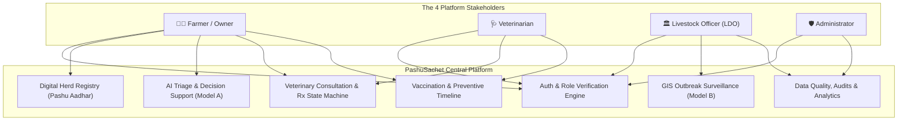
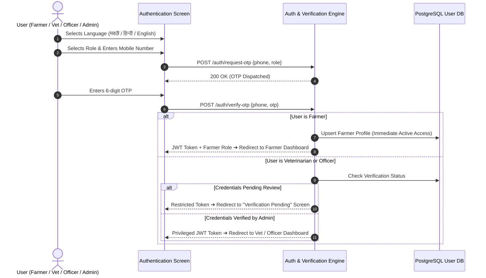
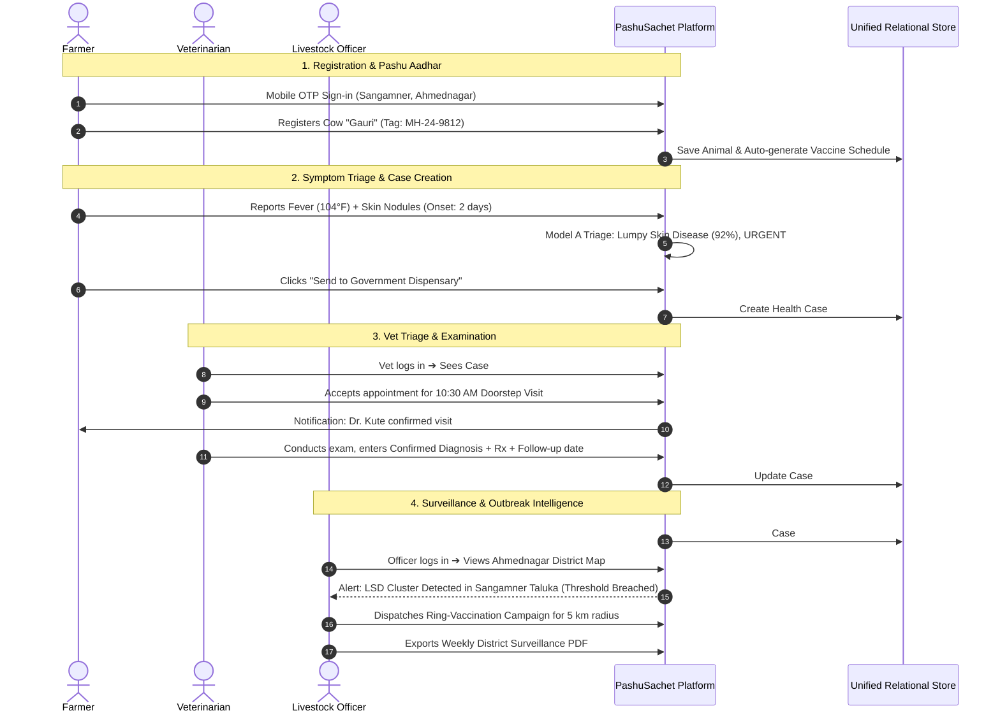

# 🐄 PashuSachet (पशूसचेत / Seva First)
## End-to-End Master Product Specification, Role Architecture & Implementation Blueprint

> **System Vision:** A complete, production-grade digital livestock-health and veterinary-service platform connecting Farmers, Veterinarians, Livestock Development Officers (LDOs), and Administrators across rural Maharashtra.  
> **Lifecycle Coverage:** Registration ➔ Login ➔ Animal Registration (Pashu Aadhar) ➔ Disease Detection ➔ Veterinary Consultation ➔ Treatment Tracking ➔ Vaccination ➔ Outbreak Surveillance ➔ Administrative Governance.  
> **Repository:** `chetanbhagore/PashuSachet` | **Live Web App:** `https://pashu-sachet.vercel.app`

---

## 1. Complete Feature Map & Role Matrix



### Detailed Breakdown by Role

#### 1. 👨‍🌾 Farmer / Livestock Owner
* **Authentication & Onboarding:** Language selection (Marathi, Hindi, English), mobile OTP sign-in, location setting (Village, Taluka, District, GPS pin), data-sharing consent.
* **Dashboard:** Active health cases & status cards, upcoming vaccinations with countdowns, local disease outbreak advisories, emergency helpline (1962) one-tap dialer, offline saved drafts banner.
* **My Animals (Pashu Aadhar):** Digital herd passport, unique 12-digit ear tag, photo, breed, age, purpose (dairy/meat/breeding), status flags (`Active`, `Sold`, `Transferred`, `Deceased`).
* **Symptom Screening (Model A):** Guided species-specific questionnaire, image/audio symptom upload, red-flag override (bloat, severe bleeding, downer cow), calibrated condition matches, safe first-aid steps, case submission.
* **Vet Appointments:** Verified local vet discovery by radius, appointment scheduling (Doorstep field visit, Clinic visit, Tele-triage), status tracking (`Requested` ➔ `Confirmed` ➔ `In-Progress` ➔ `Completed`), doctor rating.
* **Vaccination & Prevention:** Due/Overdue/Completed timeline, batch verification, downloadable digital vaccine card, local vaccination camp alerts.

#### 2. 🩺 Veterinarian / Clinic
* **Professional Profile:** Registration number (Maharashtra State Veterinary Council), degrees, clinic address, designated service talukas, emergency availability toggle.
* **Triage Inbox:** Urgency-sorted queue (`CRITICAL` ➔ `URGENT` ➔ `MODERATE`), farmer-reported symptoms, uploaded lesion photos, animal clinical history.
* **Examination & Case Management:** Accept / reschedule / decline appointment requests with reason, document physical exam findings.
* **Clinical Records & Rx:** Formal confirmed diagnosis, prescribed medications, dosage and withdrawal period notes, automated 7-day follow-up scheduling, referral to Taluka Polyclinic.
* **Vaccination Administration:** Log administered vaccines with batch number, manufacturer, and booster date.

#### 3. 🏛️ Livestock Development Officer (LDO)
* **Surveillance Dashboard:** Maharashtra district/taluka GIS heatmap, filterable by disease (LSD, FMD, BQ, HS, PPR, Anthrax), time horizon (7/14/30/90 days), and livestock species.
* **Outbreak Alerts & Cluster Analytics:** Automatic trigger when taluka cases exceed historical standard deviations, cluster details (affected herds, mortality rate, attack rate).
* **Vaccination Campaign Management:** Plan ring-vaccination perimeter around active clusters, assign mobile veterinary teams, track village-level vaccination coverage %.
* **Surveillance Reports:** Export aggregate PDF/CSV surveillance bulletins for district collectorate and DAHD; privacy-preserving data aggregation (no individual farm stigmatization).

#### 4. 🛡️ Administrator
* **User Management & Role Verification:** Manual and automated verification of Veterinarian council licenses and Livestock Officer government credentials before privileged portal access.
* **Disease Rules & Vaccine Schedule Engine:** Configure and update species-specific vaccination calendars, seasonal outbreak weights, and clinical rule matrices.
* **Data Quality & Audit Logs:** Monitor missing clinical fields, duplicate tag numbers, stale data feeds, and complete audit trail of clinical modifications.
* **System Health & Analytics:** Track user adoption, case resolution turnaround times, referral completion rates, and platform uptime.

---

## 2. Authentication, Onboarding & Security



### Access Control & Consent Policy
1. **Farmer Self-Registration:** Open access upon mobile OTP confirmation.
2. **Veterinarian Verification Gate:** Requires uploading MSVC registration certificate and clinic location; access to patient clinical records locked until approved by Administrator.
3. **Officer Jurisdiction Gate:** Requires official government department ID and assigned district/taluka boundary mapping.
4. **Data Consent Agreement:** Granular opt-in for location coordinates, photo uploads for AI screening, and anonymized surveillance aggregation.

---

## 3. Screen-by-Screen Navigation Architecture

```
PashuSachet App
│
├── 🌐 Global Header: Brand Logo | Language Switcher (मराठी/हिन्दी/EN) | Role Switcher | Emergency 1962 Badge
│
├── 👨‍🌾 1. FARMER PORTAL
│   ├── /farmer/dashboard               # Overview, health alerts, upcoming vaccines, quick actions
│   ├── /farmer/animals                 # Herd list, "+ Register Animal" modal
│   │   └── /farmer/animals/:id         # Pashu Aadhar card, health passport, clinical history timeline
│   ├── /farmer/symptom-checker         # 3-Step species & symptom form, photo/vitals input
│   │   ├── /farmer/screening/result    # Urgency banner, condition match, safe first-aid steps
│   │   └── /farmer/screening/submit    # Submit formal case to local dispensary
│   ├── /farmer/appointments            # Active & past appointments, request doorstep/clinic visit
│   ├── /farmer/vaccinations            # Herd vaccination schedule, due alerts, download certificate
│   ├── /farmer/alerts                  # Local taluka disease alerts & seasonal advisories
│   └── /farmer/profile                 # Village, taluka, milk cooperative, consent settings
│
├── 🩺 2. VETERINARIAN PORTAL
│   ├── /vet/dashboard                  # Triage queue, pending visits, today's schedule
│   ├── /vet/cases                      # Urgency-sorted case inbox (Critical -> Urgent -> Moderate)
│   │   └── /vet/cases/:id              # Symptom breakdown, photo review, animal history, exam form
│   │       └── /vet/cases/:id/diagnose # Confirmed diagnosis, treatment, Rx notes, follow-up date
│   ├── /vet/appointments               # Calendar view, accept / reschedule / complete visits
│   ├── /vet/vaccination-logs           # Administer vaccines, record batch number & date
│   └── /vet/clinic-profile             # License verification, service radius, consulting hours
│
├── 🏛️ 3. LIVESTOCK OFFICER (LDO) PORTAL
│   ├── /ldo/dashboard                  # Surveillance overview, active clusters, district KPI cards
│   ├── /ldo/gis-map                    # Interactive Maharashtra map, disease filters, heatmap layers
│   ├── /ldo/clusters                   # Cluster detail cards, attack rate, ring-vaccination perimeter
│   ├── /ldo/campaigns                  # Vaccination campaign planner, team dispatch tracker
│   └── /ldo/reports                    # Generate district surveillance bulletins (PDF/CSV)
│
└── 🛡️ 4. ADMINISTRATOR PORTAL
    ├── /admin/dashboard                # System health, active users, data ingestion status
    ├── /admin/verifications            # Vet & Officer credential review (Approve/Reject)
    ├── /admin/disease-rules            # Model A triage rules & vaccination calendar config
    ├── /admin/data-quality             # Missing fields, duplicate tags, stale records monitor
    └── /admin/audit-logs               # Immutable log of clinical modifications & access
```

---

## 4. Current State Audit (Existing Repo vs. Target Platform)

| Area | In Current Static App (`index.html` + `app.js`) | Gap / What Needs to Be Built |
| :--- | :--- | :--- |
| **Authentication & Roles** | Simple role explanation in blueprint tabs; no real login session. | **Build:** Real role-switcher and simulated OTP auth system storing user session, permissions, and active role in `localStorage` / state. |
| **Farmer Dashboard** | Static sections on a single long scrolling page. | **Build:** Dedicated modular Farmer Dashboard with active case badges, vaccine alerts, and quick action cards. |
| **Pashu Aadhar Registry** | Basic cards for 3 mock animals in `localStorage`. | **Build:** Full Animal Profile modal/view, clinical timeline, status change (`Active`/`Sold`/`Deceased`), and downloadable Health Passport. |
| **Symptom Screening (Model A)** | Interactive rule-based evaluator with triage banner. | **Enhance:** Add photo upload preview, temperature slider, duration selector, and explicit "Create Formal Case for Vet" workflow. |
| **Veterinarian Portal** | Vet directory with "Request Visit" modal only. | **Build:** Dedicated **Vet Triage Inbox** showing cases submitted by farmers, with interactive "Enter Diagnosis & Rx" and "Complete Visit" workflow. |
| **Officer GIS Dashboard** | Static district risk selector and summary box. | **Build:** Full **Officer Surveillance View** with disease cluster cards, ring-vaccination dispatch simulator, and report export. |
| **Admin Portal** | Architecture tab with static text. | **Build:** Interactive **Admin Console** with Pending Vet Verification queue, Disease Rules manager, and Audit Log viewer. |
| **Data Interoperability** | Disconnected mock data in variables. | **Build:** Unified unified client-side state store (`PashuStore`) simulating full database tables with relational foreign keys. |

---

## 5. End-to-End User Journeys (Technical Sequence)



---

## 6. The 3-Phase Build Priority

### 🚀 Phase 1: Core Working Product (Immediate Focus)
1. **Unified Application Shell & Role Switcher:**
   - Seamless top navigation allowing instant switching between:
     - 👨‍🌾 **Farmer Portal**
     - 🩺 **Veterinarian Portal**
     - 🏛️ **Livestock Officer (LDO) Portal**
     - 🛡️ **Administrator Portal**
   - Active language toggle across all roles (मराठी, हिन्दी, English).
2. **Farmer Herd & Pashu Aadhar Management:**
   - Animal registry with ear tag generator, species-aware forms, status badges, and vaccine countdowns.
3. **Model A Symptom Screening & Case Dispatch:**
   - Guided symptom reporting form with red-flag urgent care prompts.
   - Clinical result card with probability score, uncertainty rating, and "Dispatch Case to Vet" action.
4. **Veterinarian Triage Inbox & Case Resolution:**
   - Inbox listing cases created by farmers sorted by urgency (`CRITICAL`, `URGENT`, `MODERATE`).
   - Clinical examination form allowing veterinarians to document confirmed diagnosis, prescribed treatment, and follow-up date.
5. **Vaccination Tracker:**
   - Interactive species-specific vaccination calendar (FMD, LSD, BQ, HS, PPR, Deworming) with "Mark Completed" logging.

### 🌐 Phase 2: Connected Services & Surveillance
1. **Officer GIS Heatmap & Cluster Flagging:**
   - District and taluka risk maps driven by aggregated cases.
   - Ring-vaccination campaign creator with team assignment simulator.
2. **Verified Vet Directory & Geo-Radius Filtering:**
   - Search by taluka, species specialization, and emergency availability.
3. **Admin Verification & Governance Console:**
   - Verify veterinary credentials, inspect audit trails, and review platform data quality.
4. **Offline Queue & Local Storage:**
   - ServiceWorker / IndexedDB cache ensuring zero data loss during rural connectivity drops.

### 🧠 Phase 3: Validated Intelligence & Production Backend
1. **Python FastAPI Backend Scaffolding:**
   - PostgreSQL 16 + PostGIS database migrations with SQLAlchemy models.
2. **Trained ML Classifiers:**
   - Model A (CatBoost/XGBoost on verified clinical labels), Model B (spatio-temporal spatstat model), Model C (rolling anomaly isolation forest).
3. **Automated WhatsApp / SMS Gateway Integration:**
   - Twilio / Government SMS gateway integration for appointment alerts and outbreak bulletins.

---

## 7. Testing & Verification Checklist

- [ ] **Role Isolation:** Each of the 4 roles displays its dedicated views and navigation.
- [ ] **Data Continuity:** Creating a case in the Farmer portal immediately appears in the Veterinarian triage inbox.
- [ ] **Closed Clinical Loop:** Vet diagnosis updates the animal's permanent Pashu Aadhar health timeline.
- [ ] **Surveillance Sync:** Resolved contagious cases increment the Livestock Officer's district cluster count.
- [ ] **Language Consistency:** Switching language preserves form state and updates all clinical labels accurately.
- [ ] **Clinical Safety:** No automated drug dosages generated; emergency 1962 helpline always accessible.
