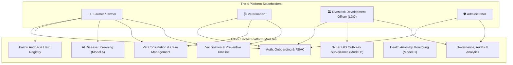
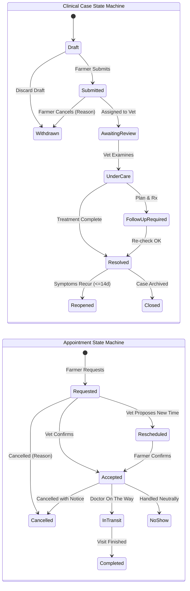

# 🐄 PashuSachet (पशूसचेत / Seva First)
## Complete End-to-End Livestock Health Platform Specification & Implementation Plan

> **System Vision:** A complete, production-grade digital livestock-health and veterinary-service platform connecting Farmers, Veterinarians, Livestock Development Officers (LDOs), and Administrators across rural Maharashtra.  
> **Lifecycle Coverage:** Registration ➔ Login ➔ Animal Registration (Pashu Aadhar) ➔ Disease Detection ➔ Veterinary Consultation ➔ Treatment Tracking ➔ Vaccination ➔ Outbreak Monitoring ➔ Reporting.  
> **Repository:** `chetanbhagore/PashuSachet` | **Live Web App:** `https://pashu-sachet.vercel.app`

---

## 1. Complete Feature Map



### Detailed Feature Breakdown by Stakeholder

#### 👨‍🌾 Farmer / Livestock Owner
* **Registration & Identity:** Multilingual onboarding, mobile OTP verification, farm location setup.
* **Animal Health & Passport:** Digital herd profile, health status, Pashu Aadhar card.
* **AI Symptom Screening:** Guided species-specific triage with red-flag detection and urgency scoring.
* **Veterinary Booking:** Radius-based discovery of verified dispensaries and mobile clinic doorstep booking.
* **Reminders & Food Safety:** Upcoming vaccination countdowns, deworming alerts, and medication milk/meat withdrawal warnings.
* **Health Records:** Lifelong timeline of clinical cases, diagnoses, treatments, and vaccination certificates.

#### 🩺 Veterinarian
* **Verified Profile:** Maharashtra State Veterinary Council (MSVC) credentials, clinic location, service radius.
* **Case Inbox:** Urgency-sorted queue (`CRITICAL` ➔ `URGENT` ➔ `MODERATE`), symptom inspection, lesion photos.
* **Clinical Documentation:** Physical exam recording, confirmed diagnosis, prescribed treatment, and milk/meat withholding period.
* **Treatment Tracking & Follow-up:** 7-day follow-up scheduler, case resolution, and referral to Taluka Polyclinic.
* **Vaccination Administration:** Log administered vaccines with batch number, manufacturer, and booster dates.

#### 🏛️ Livestock Development Officer (LDO)
* **Outbreak Surveillance Map:** District/taluka/village GIS heatmap with 3-tier case filtering.
* **Village Surveillance:** Monitor attack rates, case clusters, and threshold breach alerts.
* **Vaccination Campaigns:** Design ring-vaccination perimeters around active outbreaks, assign mobile teams.
* **Surveillance Reports:** Export anonymized aggregated PDF/CSV bulletins for state authorities (DAHD/ICAR-NIVEDI).

#### 🛡️ Administrator
* **User Management:** Verify and approve Veterinarian MSVC licenses and Officer government credentials.
* **System Configuration:** Configure disease triage rules, species symptom matrices, and regional vaccination schedules.
* **Data Quality & Audit Logs:** Monitor missing clinical fields, duplicate tag numbers, stale feeds, and review immutable audit trails.
* **Platform Analytics:** Track adoption metrics, case turnaround times, and vaccination coverage percentages.

---

## 2. Authentication and Onboarding

| Feature | Details & Specification |
| :--- | :--- |
| **Language Selection** | Marathi (मराठी), Hindi (हिन्दी), and English with instant dynamic switching and persistent preference. |
| **Registration** | Name, mobile number, 6-digit OTP verification, and role selection (`Farmer`, `Veterinarian`, `Officer`, `Admin`). |
| **Login** | Mobile OTP sign-in, secure cryptographic JWT session token, automatic session refresh, and explicit logout. |
| **Farmer Profile** | Village, taluka, district, optional farm GPS coordinates, milk cooperative affiliation, contact preferences. |
| **Vet Registration** | Veterinary degree qualifications (B.V.Sc / M.V.Sc), state council license (MSVC), clinic name, service area radius. |
| **Officer Registration** | Animal Husbandry Department ID, designation (LDO/ADVO/DVO), assigned jurisdiction (district/taluka). |
| **Account Recovery** | OTP-based account recovery and secure session renewal upon mobile device change. |
| **Role-Based Access** | Strictly segregated dashboards, interfaces, and API permissions for each role. |
| **Consent Management** | Granular user consent for health-record preservation, farm location, photo upload, and secondary surveillance use. |

> ⚠️ **Important Verification Rule:** Farmer self-registration is open upon OTP confirmation. Veterinarian and Livestock Officer accounts **require administrative verification** of professional credentials before accessing privileged clinical and surveillance features.

### Security Architecture: Prototype Sandbox vs. Production Backend
* **Client-Side Prototype Sandbox:** Features an interactive role-switcher with a clear banner: `[DEMO SIMULATION MODE]`. This allows evaluators to preview all 4 stakeholder views without a live SMS gateway.
* **Production Backend (FastAPI + PostgreSQL):** Server-side cryptographic JWT tokens with role claims. Server-enforced middleware (`@require_roles(['veterinarian', 'admin'])`) guarantees that client-side modifications can never escalate access privileges.

---

## 3. Farmer Dashboard

### Core Sections:
1. **My Animals:** Registered herd inventory, animal profile cards, live health status badges.
2. **Check Symptoms:** Guided AI-assisted screening and clinical urgency assessment.
3. **Vet Appointment:** Search verified doctors, request clinic visit or doorstep field consultation.
4. **Vaccination:** Species vaccination calendar, due dates, countdowns, and completion history.

### Additional Dashboard Sections:
* **Active Health Cases:** Track progress of submitted cases (`Submitted` ➔ `Under Care` ➔ `Follow-Up` ➔ `Resolved`).
* **Upcoming Vaccinations & Follow-Ups:** High-visibility banner for vaccines due within 14 days and scheduled vet re-checks.
* **Recent Animal Health History:** Quick chronological summary of recent treatments, vitals, and diagnoses.
* **Local Disease Alerts & Prevention Advisories:** Real-time taluka-level alerts (e.g. Lumpy Skin Disease warning in Ahmednagar) with seasonal prevention tips.
* **Emergency Veterinary Contact & Helpline 1962:** One-tap calling to the National Animal Disease Emergency Helpline (Toll-Free 1962) and assigned local dispensary.
* **Offline Saved Forms & Pending Submissions:** Visual indicator of drafts saved locally during network disconnection, with auto-sync when back online.
* **Food Safety & Medication Withdrawal Banner:** Prominent warning showing remaining milk and meat withholding hours following antibiotic administration.

---

## 4. Animal Registration — Pashu Aadhar

Every registered animal receives a comprehensive digital health passport.

### Registration Fields:
* **Unique Animal ID:** System-generated unique identifier (e.g. `PS-MH-2026-08149`).
* **Official Ear Tag Number (Optional):** 12-digit **Bharat Pashudhan (INAPH)** polyurethane RFID/barcode ear tag number.
* **Core Demographics:** Animal name, species (`Cattle`, `Buffalo`, `Goat`, `Sheep`, `Poultry`), breed (e.g. Gir, Murrah, Osmanabadi), sex, date of birth or estimated age.
* **Owner & Location:** Owner name, mobile number, village, taluka, district, and farm coordinates.
* **Visual Identification:** Photograph upload and distinctive markings (e.g. horn shape, coat patches).
* **Purpose:** Dairy, breeding, draught, meat, poultry layer/broiler, or backyard.
* **Existing Records:** Documented prior vaccinations, previous severe illnesses, and parity/calving count.

### Animal Profile Features:
* **Edit Details & Ownership:** Update non-identifying parameters or correct profile information.
* **Ownership Transfer Workflow:** Farmer A initiates transfer via buyer's mobile number; Farmer B reviews and accepts; the animal's continuous health history, past diagnoses, and vaccination timeline remain intact.
* **Duplicate Detection Engine:** Validates 12-digit official ear tag; runs fuzzy cross-matching on `[Species + Breed + Village + Markings + Sex]` to prevent duplicate profiles and skewed census data.
* **Status Updates:** Mark animal as `Active`, `Sold`, `Transferred`, `Deceased`, or `Inactive`.
* **Full Clinical Timeline:** Chronological timeline linking every symptom screening, vet diagnosis, treatment note, and vaccine.
* **Download & Share Health Passport:** Export clean digital PDF or shareable summary card for cattle markets, cooperatives, or insurance.

---

## 5. Disease Detection and Symptom Screening (Model A)

The screening system is a **guided decision-support workflow**, not an autonomous diagnosis or prescription engine.

### Screening Workflow:
1. **Select Animal:** Choose from registered herd to pull species, age, breed, lactation stage, and medical history.
2. **Report Symptoms:** Structured species-specific checklist (fever, skin nodules, oral vesicles, hoof lesions, lameness, cough, nasal discharge, diarrhea, appetite loss, milk drop).
3. **Add Evidence:** Optional symptom photo, voice note, rectal temperature (°F), and onset duration in days.
4. **Review Red Flags:** Automated check for critical emergencies (severe respiratory collapse, continuous convulsions, sudden bloat, severe bleeding, sudden flock mortality).
5. **Receive Result:** Urgency rating, possible conditions with uncertainty rating, symptoms triggering the assessment, and vet-approved first-aid actions.
6. **Create Case:** One-tap submission of report to verified local veterinary dispensary or direct connection to emergency helpline 1962.

### Result Screen Components:
* **Urgency Rating:** Color-coded triage badge (`CRITICAL`, `URGENT`, `MODERATE`, `ROUTINE`).
* **Possible Conditions:** Ranked condition possibilities with calibrated confidence percentages (clearly labelled as illustrative decision support in prototype).
* **Trigger Symptoms:** Plain-language explanation of which observed signs led to the assessment.
* **Safe, Vet-Approved Interim Guidance:** Immediate safe steps (isolation, clean water, shade, fly repellent; strict advice **NOT** to administer unprescribed human medicines).
* **Clear Clinical Disclaimer:** Explicit warning that screening is decision support and not a substitute for physical veterinary examination.
* **Referral Options & Reference Number:** Generated Case Reference ID (e.g. `#HC-4012`) with direct button to book a consultation.

> 🛡️ **Safety Rule:** Never generate automated drug prescriptions or medication dosages. Low-confidence or out-of-scope cases must explicitly output `ABSTAIN` and instruct the user to seek immediate physical veterinary attention.

---

## 6. Veterinary Consultation and Case Management

### Farmer Features:
* **Search Verified Doctors:** Filter accredited veterinarians and dispensaries by proximity, species specialization, and availability.
* **Request Consultation:** Call dispensary, book clinic visit, or request doorstep field visit with preferred date/time and problem notes.
* **Track Request Status:** Real-time progression: `Pending` ➔ `Accepted` ➔ `Rescheduled` ➔ `Completed`.
* **Reminders & Updates:** In-app and SMS reminders for scheduled visits and 7-day follow-up checks.
* **Service Feedback:** Rate consultation quality and report appointment issues.

### Veterinarian Features:
* **Verified Profile & Service Area:** Display degrees, MSVC registration, clinic timings, and service talukas.
* **Urgency-Sorted Case Inbox:** Incoming cases ranked by urgency (`CRITICAL` first), displaying symptom chips, photos, and vitals.
* **Review History:** Inspect past illnesses, previous treatments, and vaccination history before examination.
* **Manage Requests:** Accept visit, propose alternative time slot, or decline with structured reason code.
* **Examination & Confirmed Diagnosis:** Record physical clinical findings, body condition score, and final confirmed veterinary diagnosis.
* **Treatment & Medication Prescriptions:** Enter prescribed medications, dosage instructions, and calculate mandatory **milk/meat withdrawal periods**.
* **Follow-up & Case Closure:** Schedule re-check dates, mark cases `Resolved`, or refer complex cases to District Veterinary Polyclinic.

### Separate State Machines: Clinical Cases vs. Appointments



* **Independent Decoupling:** A clinical case remains `Under Care` across multiple sequential appointments.
* **Cancellation & Reopening:** Mandatory structured reason codes for cancellations; resolved cases can be reopened within 14 days if symptoms recur.

---

## 7. Vaccination and Preventive Care

1. **Species- & Region-Aware Schedules:** Pre-loaded schedules approved by Maharashtra Animal Husbandry authorities (FMD, LSD, BQ, HS, Anthrax, PPR, Enterotoxaemia, Ranikhet).
2. **Individual Animal Timeline:** Dedicated preventive history showing exact dates, dose counts, and boosters for each animal.
3. **Upcoming, Overdue & Completed Status:** Clear visual badges:
   * 🟢 `Completed` (with date and administering vet)
   * 🟡 `Due Soon` (countdown timer in days)
   * 🔴 `Overdue` (immediate alert to prevent infection)
4. **Dose Documentation:** Records vaccine brand, batch number, manufacturer, dosage route, and administering doctor.
5. **Multi-Channel Reminders:** Automated reminders via In-App notification, SMS, and WhatsApp.
6. **Deworming & Health-Check Timelines:** Scheduled alerts for 3-month anthelmintic rotation and breeding soundness checks.
7. **Vaccination Camp Announcements:** Broadcasts for free government village vaccination drives and ring-vaccination camps.
8. **Downloadable Vaccination Certificate:** Official PDF health and vaccination certificate with QR code verification.

---

## 8. Three Intelligent Health Modules

### 🔍 Model A: Disease Screening (Clinical Decision Support)
* **Function:** Species-aware symptom classifier ranking plausible disease categories from structured signs and animal context.
* **Inputs:** Species, breed, age in months, sex, production stage, temperature, appetite, lesions, lameness, diarrhea, duration.
* **Safety Controls:** Explicit abstention on out-of-distribution inputs; emergency red-flag bypass; non-prescriptive first aid only.

### 📡 Model B: Outbreak Risk Intelligence (Surveillance GIS)
* **Function:** Estimate future disease risk for an area and horizon using historical outbreaks, livestock census density, and environmental telemetry.
* **Three-Tier Classification:**
  1. `Tier 1: Suspected Signal` (Farmer self-reports; internal anomaly signal only, hidden from public).
  2. `Tier 2: Vet-Examined Case` (Clinically diagnosed by licensed doctor; triggers taluka cluster monitoring).
  3. `Tier 3: Lab-Confirmed Outbreak` (Diagnostic lab confirmation via ELISA/PCR; triggers public advisories).
* **Data Sources:** DAHD annual statistics, ICAR-NIVEDI NADRES monthly bulletins, regional weather indicators.

### 📊 Model C: Animal Anomaly Detection (Baseline Monitoring)
* **Function:** Flag physiological or behavioral deviations relative to an individual animal's baseline.
* **Inputs:** Daily milk yield records, body temperature readings, rumination cycles, feeding behavior.
* **Output:** Anomaly deviation score alerting farmer to early sub-clinical illness before visible lesions appear.

---

## 9. Livestock Officer Dashboard

1. **District, Taluka & Village Surveillance Map:** High-resolution GIS view with heatmap overlays and layer toggles.
2. **Granular Multi-Filters:** Filter by disease (LSD, FMD, BQ, HS, PPR), date range (7d/30d/90d), species, and severity.
3. **Segregated Case Metrics:** View suspected signals, vet-examined cases, confirmed outbreaks, and mortalities separately.
4. **Cluster Detection & Threshold Breaches:** Automated notification when taluka incident rates exceed statistical alert baselines.
5. **Outbreak Alert Acknowledgment:** Structured action logging for officers:
   * `[Acknowledged - Active Monitoring]`
   * `[Field Investigation Team Dispatched]`
   * `[False Alarm / Controlled Incident]`
6. **Ring Vaccination Planning:** Define 5 km / 10 km containment radii around confirmed outbreak points to halt transmission.
7. **Field Team Assignment:** Dispatch mobile veterinary clinics and monitor village vaccination coverage progress.
8. **Exportable Surveillance Reports:** Generate standardized PDF and CSV epidemiological bulletins for district authorities.
9. **Privacy-Preserving Aggregation:** Displays aggregated village/taluka totals without exposing private farm identities.

---

## 10. Supporting Platform Features

| Area | Feature Details |
| :--- | :--- |
| **Notifications** | OTP delivery, case updates, appointment confirmations, vaccine reminders, and outbreak alerts via In-App, SMS, WhatsApp, or IVR. |
| **Accessibility** | Large 44x44px touch targets, high contrast (WCAG AAA), clear Devanagari font rendering, icon-supported choices, audio voice-over ready. |
| **Offline Support** | ServiceWorker caching, IndexedDB / localStorage offline queue; save drafts and queue submissions with automatic reconnection sync. |
| **Privacy & DPDP Compliance** | Explicit consent capture, least-privilege role access, data minimization, "Export My Health Data" (JSON/PDF), and "Request Account Deletion". |
| **Help Center** | Curated veterinary FAQs, visual first-aid guides, animal husbandry best practices, and emergency helpline (1962) directory. |
| **Immutable Audit Trail** | Comprehensive ledger recording clinical edits, diagnosis updates, prescription entries, ownership transfers, and administrative actions. |
| **Analytics & KPIs** | Dashboards tracking platform adoption, disease resolution rates, average response time, vaccination coverage, and referral completion. |

---

## 11. Complete Navigation Structure (All 4 Portals)

```
PashuSachet Platform
│
├── 🌐 Global Top Bar: Brand Logo | Language Switcher (मराठी/हिन्दी/EN) | Mode Indicator | Emergency 1962 Badge
│
├── 👨‍🌾 1. FARMER PORTAL
│   ├── /farmer/dashboard               # Overview, active cases, upcoming vaccines, offline queue banner
│   ├── /farmer/animals                 # Herd inventory, "+ Register Animal" modal
│   │   ├── /farmer/animals/:id         # Pashu Aadhar card, health passport, clinical history timeline
│   │   └── /farmer/animals/transfer    # Ownership transfer initiation and acceptance
│   ├── /farmer/symptom-checker         # Guided 3-step triage, photo/vitals input, red flag check
│   │   ├── /farmer/screening/result    # Urgency banner, condition match, food safety withdrawal, first-aid
│   │   └── /farmer/screening/submit    # Dispatch case to verified local dispensary
│   ├── /farmer/appointments            # Active & past requests, booking modal, cancel/reschedule
│   ├── /farmer/vaccinations            # Herd vaccine calendar, due alerts, download certificate
│   ├── /farmer/food-safety             # Active milk/meat withdrawal tracking countdown
│   ├── /farmer/alerts                  # Local taluka disease advisories & seasonal prevention tips
│   └── /farmer/profile                 # Village, taluka, notification preferences, data export & deletion
│
├── 🩺 2. VETERINARIAN PORTAL
│   ├── /vet/dashboard                  # Triage queue, today's visits, urgent alerts
│   ├── /vet/cases                      # Urgency-sorted case inbox (Critical -> Urgent -> Moderate)
│   │   ├── /vet/cases/:id              # Symptom breakdown, photo review, animal history, exam form
│   │   └── /vet/cases/:id/diagnose     # Confirmed diagnosis, Rx, withdrawal period, follow-up scheduler
│   ├── /vet/appointments               # Calendar view, accept / reschedule / cancel / complete visits
│   ├── /vet/vaccination-logs           # Administer vaccines, record batch number & date
│   └── /vet/clinic-profile             # License verification, service radius, consulting hours
│
├── 🏛️ 3. LIVESTOCK OFFICER (LDO) PORTAL
│   ├── /ldo/dashboard                  # Surveillance overview, active clusters, district KPI cards
│   ├── /ldo/gis-map                    # Interactive Maharashtra map, 3-tier disease filter, heatmap layers
│   ├── /ldo/clusters                   # Cluster detail cards, attack rate, ring-vaccination perimeter
│   ├── /ldo/alerts                     # Incoming outbreak signals, acknowledgment action logger
│   ├── /ldo/campaigns                  # Vaccination campaign planner, team dispatch tracker
│   └── /ldo/reports                    # Generate district surveillance bulletins (PDF/CSV)
│
└── 🛡️ 4. ADMINISTRATOR PORTAL
    ├── /admin/dashboard                # System health, active users, data ingestion status
    ├── /admin/verifications            # Vet & Officer credential review (Approve/Reject)
    ├── /admin/disease-rules            # Model A triage rules & vaccination calendar config
    ├── /admin/data-quality             # Missing fields, duplicate tags, stale records monitor
    └── /admin/audit-logs               # Immutable log of clinical modifications & access
```

---

## 12. Build Priority

### 🚀 Phase 1 — Core Working Product (Immediate Focus)
* Role quick-switcher and simulated login sessions for all 4 roles.
* Farmer herd registry with Pashu Aadhar cards and duplicate detection check.
* Guided symptom reporting with red-flag detection and Model A triage results.
* Case dispatch from farmer to veterinarian triage inbox.
* Veterinarian case examination form (diagnosis, Rx notes, withdrawal calculation).
* Species-aware vaccination calendar and food safety withdrawal banner.

### 🌐 Phase 2 — Connected Services
* Verified veterinary directory with geo-distance filtering.
* Three-tier GIS surveillance map with district/taluka cluster markers.
* Outbreak alert acknowledgment workflow for Livestock Officers.
* Ownership transfer workflow between farmers.
* Offline draft storage and auto-sync queue.

### 🧠 Phase 3 — Validated Intelligence
* Machine learning inference pipelines trained on validated clinical datasets.
* Outbreak temporal forecasting models with climate telemetry integration.
* Model C physiological anomaly detection engine.
* Automated WhatsApp / SMS gateway integration for rural farmers.

---

## 13. Current State Audit & Screen-by-Screen Implementation Plan

### Existing Features That Already Work:
* Single-page responsive layout deployed on GitHub Pages and Vercel.
* Multilingual dictionary engine (Marathi, Hindi, English).
* Basic rule-based symptom evaluation for cattle, buffalo, goat, sheep, and poultry.
* Mock animal cards stored in `localStorage`.
* Static district outbreak information cards and verified vet cards.

### Missing Screens & User Flows to Build:
1. **Interactive Role Switcher Header:** Toggle between Farmer, Vet, Officer, and Admin with active state indicators.
2. **Dedicated Farmer Dashboard:** Active cases tracker, vaccination countdown cards, milk withdrawal banner.
3. **Veterinarian Triage Inbox:** Dynamic list of cases submitted by farmers sorted by urgency score.
4. **Veterinarian Examination & Rx Modal:** Interactive form to input clinical findings, confirmed diagnosis, and medication withdrawal hours.
5. **Livestock Officer Surveillance Console:** 3-tier outbreak signal viewer, alert acknowledgment logger, and campaign dispatch simulator.
6. **Administrator Control Panel:** Pending vet license approvals, disease rule editor, and audit logs.
7. **Animal Ownership Transfer Modal:** Step-by-step transfer request and confirmation flow.

### Implementation Order:
1. **Unified Relational Store (`js/store.js` or enhanced `js/app.js`):** Unified reactive data store managing Users, Animals, Cases, Diagnoses, Appointments, Outbreaks, and Audits with foreign-key integrity in `localStorage`.
2. **Navigation & Role View Controller:** Switch active portal views seamlessly without page reload.
3. **Farmer Experience Enhancement:** Add Pashu Aadhar detail view, transfer modal, and food safety countdown.
4. **Veterinarian Portal Implementation:** Build Triage Inbox, Case Details, Diagnosis/Rx submission form.
5. **Livestock Officer & Admin Portals:** Build GIS signal monitor, alert acknowledgment, and license verification queue.
6. **End-to-End Verification & Vercel Deployment:** Verify complete journey across all 4 roles and push live.
