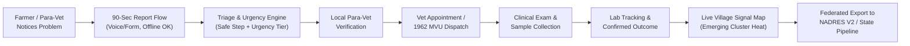
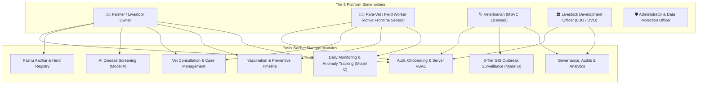
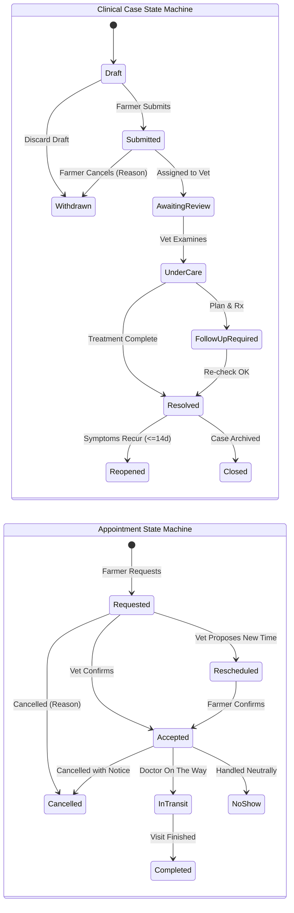
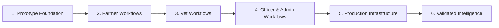

# 🐄 PashuSachet (पशूसचेत / Seva First)
## End-to-End Master Product Specification, Role Architecture & Implementation Blueprint

> **System Vision:** A complete, production-grade digital livestock-health and veterinary-service platform connecting Farmers, Veterinarians, Livestock Development Officers (LDOs), and Administrators across rural Maharashtra.  
> **Lifecycle Coverage:** Registration ➔ Login ➔ Animal Registration (Pashu Aadhar) ➔ Disease Detection ➔ Veterinary Consultation ➔ Treatment & Withdrawal Tracking ➔ Vaccination ➔ Outbreak Surveillance ➔ Reporting & Audits.  
> **Repository:** `chetanbhagore/PashuSachet` | **Live Web App:** `https://pashu-sachet.vercel.app`

### 📚 Complete Engineering Blueprint Suite:
* 🎨 **Frontend Design & UI Specification:** [`FRONTEND_DESIGN_SPEC.md`](file:///g:/Chetan/pashuSachet/FRONTEND_DESIGN_SPEC.md) — *“The Village Animal-Care Notebook” (WCAG AA, Lucide SVGs, Scoped Hero Loop).*
* ⚙️ **Backend Architecture & API Blueprint:** [`BACKEND_ARCHITECTURE_PLAN.md`](file:///g:/Chetan/pashuSachet/BACKEND_ARCHITECTURE_PLAN.md) — *Phase 1: Pure FastAPI (Python 3.11) for Project Deadline; Phase 2: Java Spring Boot 3 Core API for Personal Portfolio & Placement.*
* 🧠 **AI & Machine Learning System Architecture:** [`ML_AI_SYSTEM_PLAN.md`](file:///g:/Chetan/pashuSachet/ML_AI_SYSTEM_PLAN.md) — *V1 Scoped: Model A (Unified Triage Rules), Model C (Herd Vitals EWMA), Model S (Space-Time ST-DBSCAN), Red Flag Safety Circuits.*

---


---

## 0. New Core Positioning & Architecture of Value

### 🎯 What Makes It Original
**Seva First / PashuSachet is NOT only another disease-forecasting or animal-registry platform.**

It is the **missing last-mile participatory layer** that turns fragmented farmer observations into structured, real-time, village-level early warning signals and closed-loop action — while feeding cleaned data upward into existing national systems (**NADRES V2** and **Bharat Pashudhan / NDLM**).

> **One-Line Promise:**  
> *“Every farmer and para-vet in rural Maharashtra can report a concern in under 90 seconds (voice or simple form, even offline), receive an immediate safe-next-step + urgency score, trigger local verification and referral, and contribute to district-level intelligence — without creating a parallel silo.”*

### ⚡ Attack on Critical Problem-Statement Gaps
Existing government systems leave four major operational gaps open:
1. **Late / Incomplete Farmer-Initiated Reporting:** Farmers report disease when mortality has already occurred; existing portals lack accessible last-mile intake.
2. **Lack of Real-Time Village/Block Visibility:** Official forecasts operate at the district level monthly/quarterly; village-level clusters remain invisible until outbreaks explode.
3. **Fragmented Last-Mile Coordination & Referral Tracking:** Toll-free lines (1962), diagnostic labs, and field dispensaries operate in disconnected silos with zero visibility for the farmer.
4. **Poor Support for Low-Connectivity and Low-Literacy Users:** Traditional dashboards require typing in complex forms, failing in rustic cowsheds with intermittent 2G/3G connectivity.

---

### 🏛️ Differentiated Pillars (New Architecture of Value)

| Pillar | What It Does Differently | Why It Is Not a Copy |
| :--- | :--- | :--- |
| **1. Participatory Real-Time Sentinel** | Farmers + para-vets submit structured micro-reports (symptoms + photos + location + mortality). System creates a live village-level **“signal heat”** that is distinct from NADRES district forecasts. | **NADRES is top-down official + model-driven.** Seva First is **bottom-up, continuous, farmer-sourced signal generation** capturing syndromic spikes days before lab confirmation. |
| **2. Uncertainty-Aware Triage & Escalation Engine** | Rule + lightweight ML hybrid that outputs: **urgency tier, safe next action, confidence band**, and recommended escalation path (*self-monitor / para-vet visit / vet / sample kit / lab*). Explicit **abstention** when data is insufficient. | **Avoids “diagnosis” claims.** Focuses on **action routing**, not disease ranking. Enforces a vastly stronger clinical safety posture than typical uncalibrated symptom checkers. |
| **3. Closed-Loop Referral & Sample Tracker** | End-to-end tracking from report ➔ appointment / MVU dispatch ➔ clinical note ➔ sample collection ➔ lab status ➔ outcome. Visible to farmer, para-vet, and officer. | Existing systems (1962, E-Pashu, Bharat Pashudhan) handle pieces; **none close the full loop** with farmer visibility, sample chain-of-custody, and lab hand-off. |
| **4. Federated Contribution Layer** | Every verified case can (with farmer consent) be de-identified and pushed to NADRES / state surveillance pipelines. Animal identity links to existing **Pashu Aadhaar** when available instead of creating a competing registry. | **Explicitly strengthens national systems instead of competing with them.** Avoids redundant data silos and respects existing government investments. |
| **5. Offline-First + Voice + Community Verification** | Full offline queue, voice reporting in Marathi (and Hindi/English), community/para-vet confirmation of serious reports before high-urgency escalation. | Goes beyond current WhatsApp chatbots and basic offline forms. Designed ground-up for **real rural Maharashtra constraints** (low literacy, intermittent networks). |

---

### 🔄 Key Feature Changes for Originality

#### ❌ Removed / De-emphasized (To Avoid Looking Derivative)
* **Standalone Animal Registry:** Eliminated redundant herd databases that compete with *Bharat Pashudhan (NDLM)*. System now resolves existing 12-digit Pashu Aadhaar ear tags.
* **Broad District-Level Outbreak Forecasting:** De-emphasized redundant macro models that duplicate *ICAR-NIVEDI NADRES*.
* **Generic "AI Disease Classifier":** Removed uncalibrated probabilistic disease percentage rankings (`88% confidence`).
* **Heavy Reliance on Per-Animal Baselines:** Model C vital anomaly detection is kept strictly as an optional secondary module for commercial dairy herds, removing cold-start blockers for rural smallholders.

#### ✅ Strengthened / New Unique Elements
* **90-Second Report Flow:** Voice or 4–6 question structured form ➔ auto-location ➔ optional photo ➔ urgency score + safe next-step card in local language. Works 100% offline and syncs later.
* **Village Signal Map (Not District Risk Map):** Real-time aggregation of farmer/para-vet reports at village and block level, with mathematical suppression of small counts ($k$-anonymity) for farmer privacy. Officers see emerging signal clusters before official monthly reports update.
* **Escalation Score + Role-Based Action Cards:** Contextualized recommendations for farmer (*isolate, halt milk, first aid*), para-vet (*verify, take vitals, collect sample*), and veterinary officer (*dispatch MVU, issue prescription, enforce quarantine*).
* **Para-Vet Empowerment Module:** Dedicated lightweight mobile interface for field workers to verify reports, collect structured additional observations, and update case status—turning para-vets into active frontline sensors.
* **Consent-Driven Data Contribution:** Clear farmer choice: *Keep Private* / *Share with Local Dispensary* / *Contribute Anonymized to State & National Surveillance*. Immutable audit trail for every share.
* **Multilingual Voice-First + Simple Mode:** Marathi-primary voice intake with audio playback and simple tap interface for low-literacy livestock keepers.
* **Integration-First Design:** Direct bridge to 12-digit Pashu Aadhaar, automated de-identified export pipelines for NADRES V2, and integration hook for 1962 Mobile Veterinary Unit (MVU) dispatch.

---

### 📋 Revised Solution Overview


#### The 3 Tightly Scoped ML Capabilities:
1. **Triage & Urgency Model (Primary, High-Value):** Action routing and urgency grading (Emergency / Urgent / Routine / Self-Monitor) with explicit abstention when observations are ambiguous.
2. **Cluster Signal Detection:** Space-time spatio-temporal cluster detection (ST-DBSCAN) at village/block resolution with small-count privacy suppression.
3. **Optional Anomaly Support:** Rolling baseline (EWMA / robust z-score) for milk drop and febrile spikes, active only when continuous 7–14 day daily logs exist.

## 1. Complete Feature Map



### Detailed Feature Breakdown by Stakeholder

#### 👨‍🌾 Farmer / Livestock Owner
* **Registration & Identity:** Multilingual onboarding, mobile OTP verification, farm location setup.
* **Animal Health & Passport:** Digital herd inventory, health status cards, Pashu Aadhar cards.
* **AI Symptom Screening (Model A):** Guided species-specific triage with red-flag emergency detection and urgency scoring.
* **Vital & Health Monitoring (Model C):** Simple daily entry for milk yield, temperature, feeding, and rumination; automated anomaly alerts.
* **Veterinary Booking:** Radius-based discovery of verified dispensaries and mobile clinic doorstep booking.
* **Reminders & Food Safety:** Upcoming vaccination countdowns, deworming alerts, and vet-entered medication milk/meat withdrawal warnings.
* **Health Records:** Lifelong timeline of clinical cases, diagnoses, treatments, and downloadable vaccination certificates.

#### 🩺 Veterinarian
* **Verified Profile:** Maharashtra State Veterinary Council (MSVC) credentials, clinic location, designated service talukas.
* **Triage Inbox:** Urgency-sorted queue (`CRITICAL` ➔ `URGENT` ➔ `MODERATE`), symptom inspection, lesion photos, and animal baseline anomaly charts.
* **Clinical Documentation:** Physical exam recording, confirmed diagnosis, prescribed treatment, and veterinary-entered milk/meat withholding period.
* **Treatment Tracking & Follow-up:** 7-day follow-up scheduler, case resolution, 14-day case reopening review, and referral to Taluka Polyclinic.
* **Vaccination Administration:** Log administered vaccines with batch number, manufacturer, and booster dates.

#### 🏛️ Livestock Development Officer (LDO)
* **Outbreak Surveillance Map:** District/taluka/village GIS heatmap with 3-tier case filtering (Signal vs. Clinical vs. Confirmed).
* **Village Surveillance:** Monitor attack rates, case clusters, and automated threshold breach alerts.
* **Outbreak Alert Acknowledgment:** Structured action logging (`Acknowledged`, `Field Team Dispatched`, `False Alarm`).
* **Vaccination Campaigns:** Design ring-vaccination perimeters around active outbreaks, assign mobile teams.
* **Surveillance Reports:** Export anonymized aggregated PDF/CSV bulletins for state authorities (DAHD/ICAR-NIVEDI).

#### 🛡️ Administrator (Provisioned Privately)
* **User Management:** Verify and approve Veterinarian MSVC licenses and Officer government credentials.
* **System Configuration:** Manage disease triage rules, species symptom matrices, and regional vaccination schedules against validated clinical guidance.
* **Data Quality & Audit Logs:** Monitor missing clinical fields, duplicate tag numbers, stale feeds, and review audit trails.
* **Platform Analytics:** Track adoption metrics, case turnaround times, and vaccination coverage percentages.

---

## 2. Authentication and Onboarding

| Feature | Details & Specification |
| :--- | :--- |
| **Language Selection** | Marathi (मराठी), Hindi (हिन्दी), and English with instant dynamic switching and persistent preference. |
| **Registration** | Name, mobile number, 6-digit OTP verification, and role selection (`Farmer`, `Veterinarian`, `Officer`). **Admin accounts cannot be self-registered.** |
| **Admin Provisioning** | Admin accounts are provisioned out-of-band by existing super-administrators or secure environment bootstrapping; public signup is strictly prohibited. |
| **Login** | Mobile OTP sign-in, secure cryptographic JWT session token, automatic session refresh, and explicit logout. |
| **Farmer Profile** | Village, taluka, district, optional farm GPS coordinates, milk cooperative affiliation, contact preferences. |
| **Vet Registration** | Veterinary degree qualifications (B.V.Sc / M.V.Sc), state council license (MSVC), clinic name, service area radius. |
| **Officer Registration** | Animal Husbandry Department ID, designation (LDO/ADVO/DVO), assigned jurisdiction (district/taluka). |
| **Account Recovery** | OTP-based account recovery and secure session renewal upon mobile device change. |
| **Role-Based Access** | Strictly segregated dashboards, interfaces, and API permissions for each role. |
| **Consent Management** | Granular user consent for health-record preservation, farm location, photo upload, and secondary surveillance use. |

> ⚠️ **Verification Gates & Privilege Escalation Prevention:**
> * **Farmer:** Open self-registration upon mobile OTP confirmation.
> * **Veterinarian & Officer:** Registration creates a `Pending Verification` account. Privileged access to clinical and surveillance records remains locked until verified by an Administrator.
> * **Prototype Sandbox vs. Production:** The top-bar role-switcher is strictly a **Demo UI evaluation tool** badged `[DEMO SIMULATION MODE]`. In production, users only access roles cryptographically granted to their authenticated server session; client-side state manipulation cannot escalate privileges.

---

## 3. Farmer Dashboard

### Core Sections:
1. **My Animals:** Registered herd inventory, animal profile cards, live health status badges.
2. **Check Symptoms:** Guided AI-assisted screening and clinical urgency assessment.
3. **Animal Monitoring (Model C):** Quick-log tool for daily milk yield (Liters), body temperature, and rumination; live anomaly alert cards.
4. **Vet Appointment:** Search verified doctors, request clinic visit or doorstep field consultation.
5. **Vaccination:** Species vaccination calendar, due dates, countdowns, and completion history.

### Additional Dashboard Sections:
* **Active Health Cases:** Track progress of submitted cases (`Submitted` ➔ `Under Care` ➔ `Follow-Up` ➔ `Resolved`).
* **Food Safety & Medication Withdrawal Banner:** Clear warning showing remaining milk and meat withholding hours following vet-prescribed antibiotic administration.
* **Upcoming Vaccinations & Follow-Ups:** High-visibility banner for vaccines due within 14 days and scheduled vet re-checks.
* **Recent Animal Health History:** Chronological summary of recent treatments, vitals, and diagnoses.
* **Local Disease Alerts & Prevention Advisories:** Real-time taluka-level alerts (e.g. Lumpy Skin Disease warning in Ahmednagar) with seasonal prevention tips.
* **Emergency Veterinary Contact & Helpline 1962:** One-tap calling to the National Animal Disease Emergency Helpline (Toll-Free 1962) and assigned local dispensary.
* **Offline Saved Forms & Pending Submissions:** Visual indicator of drafts saved locally in IndexedDB during network disconnection, with auto-sync when back online.

---

## 4. Animal Identity & Pashu Aadhaar Linkage (Integration-First, Not a Competing Registry)

Every registered animal receives a comprehensive digital health passport.

### Registration Fields:
* **Unique Animal ID:** System-generated unique identifier (e.g. `PS-MH-2026-08149`). Clearly documented as an internal digital health passport ID, not a replacement for government identification.
* **Official Ear Tag Number (Optional):** 12-digit **Bharat Pashudhan (INAPH)** polyurethane RFID/barcode ear tag number.
* **Core Demographics:** Animal name, species (`Cattle`, `Buffalo`, `Goat`, `Sheep`, `Poultry`), breed (e.g. Gir, Murrah, Osmanabadi), sex, date of birth or estimated age.
* **Owner & Location:** Owner name, mobile number, village, taluka, district, and farm coordinates.
* **Visual Identification:** Photograph upload and distinctive markings (e.g. horn shape, coat patches).
* **Purpose:** Dairy, breeding, draught, meat, poultry layer/broiler, or backyard.
* **Existing Records:** Documented prior vaccinations, previous severe illnesses, and parity/calving count.

### Animal Profile Features:
* **Edit Details & Ownership:** Update non-identifying parameters or correct profile information.
* **Ownership Transfer Workflow:** Farmer A initiates transfer via buyer's mobile number; Farmer B reviews and accepts; the animal's continuous health history, past diagnoses, and vaccination timeline remain intact.
* **Duplicate Detection Engine:** Validates 12-digit official ear tag; runs fuzzy cross-matching on `[Species + Breed + Village + Markings + Sex]` to prevent duplicate profiles and skewed census data.
* **Status Updates:** Mark animal as `Active`, `Sold`, `Transferred`, `Deceased`, or `Inactive`.
* **Full Clinical Timeline:** Chronological timeline linking every symptom screening, vet diagnosis, treatment note, and vaccine.
* **Download & Share Health Passport:** Export clean digital PDF or shareable summary card for cattle markets, cooperatives, or insurance.

---

## 5. 90-Second Triage & Urgency Escalation Engine (Action Routing, Not Diagnosis)

The screening system is a **guided decision-support workflow**, not an autonomous diagnosis or prescription engine.

### Screening Workflow:
1. **Select Animal:** Choose from registered herd to pull species, age, breed, lactation stage, and medical history.
2. **Report Symptoms:** Structured species-specific checklist (fever, skin nodules, oral vesicles, hoof lesions, lameness, cough, nasal discharge, diarrhea, appetite loss, milk drop).
3. **Add Evidence:** Optional symptom photo, voice note, rectal temperature (°F), and onset duration in days.
4. **Review Red Flags:** Automated check for critical emergencies (severe respiratory collapse, continuous convulsions, sudden bloat, severe bleeding, sudden flock mortality).
5. **Receive Result:** Urgency rating, possible conditions with uncertainty rating, symptoms triggering the assessment, and vet-approved first-aid actions.
6. **Create Case:** One-tap submission of report to verified local veterinary dispensary or direct connection to emergency helpline 1962.

### Result Screen Components:
* **Urgency Rating:** Color-coded triage badge (`CRITICAL`, `URGENT`, `MODERATE`, `ROUTINE`).
* **Possible Conditions:** Ranked condition possibilities with calibrated confidence percentages. In prototype mode, results are explicitly badged: `[ILLUSTRATIVE SCREENING DECISION SUPPORT - REQUIRES PHYSICAL VET EXAMINATION]`.
* **Trigger Symptoms:** Plain-language explanation of which observed signs led to the assessment.
* **Safe, Vet-Approved Interim Guidance:** Immediate safe steps (isolation, clean water, shade, fly repellent; strict advice **NOT** to administer unprescribed human medicines).
* **Clear Clinical Disclaimer:** Explicit warning that screening is decision support and not a substitute for physical veterinary examination.
* **Referral Options & Reference Number:** Generated Case Reference ID (e.g. `#HC-4012`) with direct button to book a consultation.

> 🛡️ **Clinical Safety & Abstention Rule:** Never generate automated drug prescriptions or medication dosages. Low-confidence, contradictory, or out-of-scope cases must explicitly output `ABSTAIN` and instruct the user to seek immediate physical veterinary examination.

---

## 6. Closed-Loop Referral, MVU Dispatch & Sample Tracker

### Farmer Features:
* **Search Verified Doctors:** Filter accredited veterinarians and dispensaries by proximity, species specialization, and availability.
* **Request Consultation:** Call dispensary, book clinic visit, or request doorstep field visit with preferred date/time and problem notes.
* **Track Request Status:** Real-time progression: `Pending` ➔ `Accepted` ➔ `Rescheduled` ➔ `Completed`.
* **Reminders & Updates:** In-app and SMS reminders for scheduled visits and 7-day follow-up checks.
* **Appointment Cancellation & No-Show Tracking:** Cancel with reason codes; no-shows recorded neutrally for scheduling optimization.
* **Service Feedback:** Rate consultation quality and report appointment issues.

### Veterinarian Features:
* **Verified Profile & Service Area:** Display degrees, MSVC registration, clinic timings, and service talukas.
* **Urgency-Sorted Case Inbox:** Incoming cases ranked by urgency (`CRITICAL` first), displaying symptom chips, photos, vitals, and Model C anomaly baselines.
* **Review History:** Inspect past illnesses, previous treatments, and vaccination history before examination.
* **Manage Requests:** Accept visit, propose alternative time slot, or decline with structured reason code.
* **Examination & Confirmed Diagnosis:** Record physical clinical findings, body condition score, and final confirmed veterinary diagnosis.
* **Treatment & Medication Prescriptions:** Enter prescribed medications, dosage instructions, and **vet-confirmed milk/meat withdrawal periods**.
* **Follow-up & Case Closure:** Schedule re-check dates, mark cases `Resolved`, or refer complex cases to District Veterinary Polyclinic.
* **14-Day Reopening Review:** If a farmer reopens a resolved case within 14 days due to recurring symptoms, it highlights in the vet inbox as `Reopened Case`.

### Decoupled State Machines: Clinical Cases vs. Appointments



* **Independent Decoupling:** A clinical case remains `Under Care` across multiple sequential appointments.
* **Food Safety Withholding Rule:** The veterinarian explicitly inputs the withdrawal period (in hours/days), documents the clinical source/drug label rule, and sets start/end dates. The system does not guess unverified drug rules automatically.

---

## 7. Vaccination and Preventive Care

1. **Curated & Validated Schedules:** Schedules are not blanket-approved; each schedule must be curated and validated against current veterinary clinical guidance considering species, regional prevalence in Maharashtra, animal age, and booster timing.
2. **Individual Animal Timeline:** Dedicated preventive history showing exact dates, dose counts, and boosters for each animal.
3. **Upcoming, Overdue & Completed Status:** Clear visual badges:
   * 🟢 `Completed` (with date and administering vet)
   * 🟡 `Due Soon` (countdown timer in days)
   * 🔴 `Overdue` (immediate alert to prevent infection)
4. **Dose Documentation:** Records vaccine brand, batch number, manufacturer, dosage route, and administering doctor.
5. **Multi-Channel Reminders:** Automated reminders via In-App notification, SMS, and WhatsApp.
6. **Deworming & Health-Check Timelines:** Scheduled alerts for 3-month anthelmintic rotation and breeding soundness checks.
7. **Vaccination Camp Announcements:** Broadcasts for free government village vaccination drives and ring-vaccination camps.
8. **Downloadable Vaccination Certificate:** Official PDF health and vaccination certificate with QR code verification.

---

## 8. The Three Tightly-Scoped ML Capabilities

### 🔍 Model A: Disease Screening (Clinical Decision Support)
* **Function:** Species-aware symptom classifier ranking plausible disease categories from structured signs and animal context.
* **Inputs:** Species, breed, age in months, sex, production stage, temperature, appetite, lesions, lameness, diarrhea, duration.
* **Safety Controls:** Explicit abstention on out-of-distribution inputs; emergency red-flag bypass; non-prescriptive first aid only.

### 📡 Model B: Outbreak Risk Intelligence (Surveillance GIS)
* **Function:** Estimate future disease risk for an area and horizon using historical outbreaks, livestock census density, and environmental telemetry.
* **Three-Tier Classification:**
  1. `Tier 1: Suspected Signal` (Farmer self-reports; internal anomaly signal only, hidden from public).
  2. `Tier 2: Vet-Examined Case` (Clinically diagnosed by licensed doctor; triggers taluka cluster monitoring).
  3. `Tier 3: Lab-Confirmed Outbreak` (Diagnostic lab confirmation via ELISA/PCR; triggers public advisories).
* **Data Sources:** DAHD annual statistics, ICAR-NIVEDI NADRES monthly bulletins, regional weather indicators.

### 📊 Model C: Animal Anomaly Detection & Vital Monitoring Workflow
* **Farmer Data-Entry Workflow:**
  * Simple daily/weekly tracking screen: Daily Milk Yield (Liters), Rectal Temperature (°F), Feeding vigor (`Normal`, `Reduced`, `Off-Feed`), Rumination cycles.
* **Automated Anomaly Scoring:**
  * Compares latest entry against the individual animal's 14-day rolling baseline.
  * Triggers visual dashboard alert: `⚠️ Anomaly Flag: Gauri's milk yield dropped 35% over 48h while temperature elevated to 103.8°F`.
* **Veterinarian Review Workflow:**
  * Anomaly deviation charts (milk yield curve vs. temperature curve) are embedded directly inside the Vet Case Details screen to assist early sub-clinical triage (e.g. sub-clinical mastitis or systemic infection).

---

## 9. Village Signal Map & Para-Vet Empowerment Module

1. **District, Taluka & Village Surveillance Map:** High-resolution GIS view with heatmap overlays and layer toggles.
2. **Granular Multi-Filters:** Filter by disease (LSD, FMD, BQ, HS, PPR), date range (7d/30d/90d), species, and severity.
3. **Segregated Case Metrics:** View suspected signals, vet-examined cases, confirmed outbreaks, and mortalities separately.
4. **Cluster Detection & Threshold Breaches:** Automated notification when taluka incident rates exceed statistical alert baselines.
5. **Outbreak Alert Acknowledgment Workflow:** Structured action logging for officers:
   * `[Acknowledged - Active Monitoring]`
   * `[Field Investigation Team Dispatched]`
   * `[False Alarm / Controlled Incident]`
6. **Ring Vaccination Planning:** Define 5 km / 10 km containment radii around confirmed outbreak points to halt transmission.
7. **Field Team Assignment:** Dispatch mobile veterinary clinics and monitor village vaccination coverage progress.
8. **Exportable Surveillance Reports:** Generate standardized PDF and CSV epidemiological bulletins for district authorities.
9. **Privacy-Preserving Aggregation:** Displays aggregated village/taluka totals without exposing private farm identities.

---

## 10. Supporting Platform Features

| Area | Feature Details |
| :--- | :--- |
| **Notifications** | OTP delivery, case updates, appointment confirmations, vaccine reminders, and outbreak alerts via In-App, SMS, WhatsApp, or IVR. |
| **Accessibility** | Large 44x44px touch targets, high contrast (WCAG AAA), clear Devanagari font rendering, icon-supported choices, audio voice-over ready. |
| **Offline Storage Architecture** | **IndexedDB** for offline case records, photos, and pending form submissions; **localStorage** for lightweight UI preferences (language, theme, active demo role). |
| **DPDP-Aligned Data Governance** | Explicit consent capture, least-privilege role access, data minimization, "Export My Health Data" (JSON/PDF), and "Request Account Deletion". (Full DPDP compliance claim subject to formal legal audit). |
| **Help Center** | Curated veterinary FAQs, visual first-aid guides, animal husbandry best practices, and emergency helpline (1962) directory. |
| **Audit Trail** | **Demo Audit Log** in prototype mode; comprehensive, immutable append-only database audit log in production recording clinical edits, Rx entries, ownership transfers, and admin actions. |
| **Analytics & KPIs** | Dashboards tracking platform adoption, disease resolution rates, average response time, vaccination coverage, and referral completion. |

---

## 11. Complete Navigation Structure (All 4 Portals)

```
PashuSachet Platform
│
├── 🌐 Global Top Bar: Brand Identity | Language Toggle (मराठी/हिन्दी/EN) | Role Switcher [Demo Mode] | Emergency 1962 Badge
│
├── 👨‍🌾 1. FARMER PORTAL
│   ├── /farmer/dashboard               # Overview, active cases, upcoming vaccines, offline queue banner
│   ├── /farmer/animals                 # Herd inventory, "+ Register Animal" modal
│   │   ├── /farmer/animals/:id         # Pashu Aadhar card, health passport, clinical history timeline
│   │   └── /farmer/animals/transfer    # Ownership transfer initiation and acceptance
│   ├── /farmer/monitoring              # Model C daily vital logging (Milk, Temp, Rumination) & anomaly alerts
│   ├── /farmer/symptom-checker         # Guided 3-step triage, photo/vitals input, red flag check
│   │   ├── /farmer/screening/result    # Urgency banner, condition match, food safety withdrawal, first-aid
│   │   └── /farmer/screening/submit    # Dispatch case to verified local dispensary
│   ├── /farmer/appointments            # Active & past requests, booking modal, cancel/reschedule
│   ├── /farmer/vaccinations            # Herd vaccine calendar, due alerts, download certificate
│   ├── /farmer/food-safety             # Active milk/meat withdrawal tracking countdown
│   ├── /farmer/alerts                  # Local taluka disease advisories & seasonal prevention tips
│   └── /farmer/profile                 # Village, taluka, notification preferences, data export & deletion
│
├── 🩺 2. VETERINARIAN PORTAL
│   ├── /vet/dashboard                  # Triage queue, today's visits, urgent alerts
│   ├── /vet/cases                      # Urgency-sorted case inbox (Critical -> Urgent -> Moderate)
│   │   ├── /vet/cases/:id              # Symptom breakdown, photo review, animal history, Model C anomaly curve
│   │   └── /vet/cases/:id/diagnose     # Confirmed diagnosis, Rx, withdrawal period, follow-up scheduler
│   ├── /vet/appointments               # Calendar view, accept / reschedule / cancel / complete visits
│   ├── /vet/vaccination-logs           # Administer vaccines, record batch number & date
│   └── /vet/clinic-profile             # License verification, service radius, consulting hours
│
├── 🏛️ 3. LIVESTOCK OFFICER (LDO) PORTAL
│   ├── /ldo/dashboard                  # Surveillance overview, active clusters, district KPI cards
│   ├── /ldo/gis-map                    # Interactive Maharashtra map, 3-tier disease filter, heatmap layers
│   ├── /ldo/clusters                   # Cluster detail cards, attack rate, ring-vaccination perimeter
│   ├── /ldo/alerts                     # Incoming outbreak signals, acknowledgment action logger
│   ├── /ldo/campaigns                  # Vaccination campaign planner, team dispatch tracker
│   └── /ldo/reports                    # Generate district surveillance bulletins (PDF/CSV)
│
└── 🛡️ 4. ADMINISTRATOR PORTAL (Provisioned Privately)
    ├── /admin/dashboard                # System health, active users, data ingestion status
    ├── /admin/verifications            # Vet & Officer credential review (Approve/Reject)
    ├── /admin/disease-rules            # Model A triage rules & vaccination calendar config
    ├── /admin/data-quality             # Missing fields, duplicate tags, stale records monitor
    └── /admin/audit-logs               # Immutable log of clinical modifications & access
```

---

## 12. Final Recommended 6-Phase Build Order

We adopt a structured, 6-phase engineering roadmap that builds a fully operational prototype first, establishes the real production backend infrastructure, and integrates validated intelligence models:



### 🔹 Phase 1: Prototype Foundation (Immediate Priority)
* Unified reactive client-side store (`js/store.js`) managing relational entities (Users, Animals, Cases, Appointments, Outbreaks, Audits) in browser storage (`IndexedDB` + `localStorage`).
* Multilingual navigation shell with instant role-switching between Farmer, Vet, Officer, and Admin views with active mode banners.
* Global design system, responsive touch controls, and high-contrast styling.

### 🔹 Phase 2: Farmer Workflows
* Multi-animal herd registry (Pashu Aadhar cards, duplicate tag check, ownership transfer modal).
* Model A symptom screening workflow with red-flag detection and illustrative triage cards.
* Case dispatch from farmer to local veterinary dispensary.
* Model C daily vital logging interface (milk yield, temperature, rumination) and anomaly alerts.
* Vaccination calendar and food safety withdrawal countdown banner.

### 🔹 Phase 3: Veterinarian Workflows
* Urgency-sorted Triage Inbox (`CRITICAL` first) displaying symptom vectors, photos, and Model C anomaly curves.
* Case examination form: physical findings, confirmed diagnosis, Rx documentation, and vet-entered withdrawal periods.
* Appointment scheduling, acceptance, rescheduling, and visit completion.
* 14-day case reopening review workflow.

### 🔹 Phase 4: Officer & Admin Workflows
* Livestock Officer GIS surveillance console with 3-tier disease filtering and cluster markers.
* Outbreak alert acknowledgment logger (`Acknowledged`, `Field Team Dispatched`).
* Ring-vaccination campaign planning simulator.
* Administrator credential verification queue (Vet MSVC licenses and Officer department IDs).
* Demo audit trail viewer and system health analytics.

### 🔹 Phase 5: Production Infrastructure & Polyglot Phasing
* **Phase 5A (Active Target for Project Deadline): Pure FastAPI (Python 3.11)**
  * Scaffolds clean async REST API (`app/api/v1`, `app/core`, `app/models`, `app/services`).
  * Runs on embedded SQLite (for zero-setup local dev/offline verification) and PostgreSQL 16 + PostGIS for production deployment.
  * Native evaluation of `shared/rules/triage_rules_v1.json` with zero inter-process overhead.
  * Dynamic read-time calculation of drug milk/meat withdrawal hours from final treatment dose.
* **Phase 5B (Post-Deadline / Personal Portfolio & Placement Upgrade): Java Spring Boot 3 Extraction**
  * Migrates the Core Business API to Java 17/21 + Spring Boot 3 (Spring Data JPA, Hibernate Spatial, Spring Security).
  * Retains the FastAPI service strictly for Python AI & spatial anomaly algorithms (`/ai/v1/triage`).
  * Zero schema rewrite needed, as the PostgreSQL DDL and API contracts are 100% compliant with both stacks!

### 🔹 Phase 6: Validated Intelligence & Integrations
* Machine learning pipelines trained on verified clinical datasets (scikit-learn / XGBoost).
* Outbreak temporal forecasting models with regional climate telemetry integration.
* Automated SMS / WhatsApp gateway dispatch for appointment alerts and outbreak bulletins.

---

## 13. Current State Audit & Screen-by-Screen Implementation Checklist

### Verified Existing Features in Repository:
* Single-page responsive layout deployed on GitHub Pages and Vercel.
* Multilingual dictionary engine (Marathi, Hindi, English).
* Basic rule-based symptom evaluation for cattle, buffalo, goat, sheep, and poultry.
* Mock animal cards stored in `localStorage`.
* Static district outbreak information cards and verified vet cards.

### Missing Screens & User Flows to Build in Phase 1-4:
1. **Interactive Role Switcher Header:** Seamless toggle between Farmer, Vet, Officer, and Admin with active demo indicator.
2. **Dedicated Farmer Dashboard:** Active cases tracker, vaccination countdown cards, milk withdrawal banner.
3. **Animal Monitoring & Vital Tracking Screen:** Farmer daily log for milk, temp, and rumination with anomaly alert cards.
4. **Veterinarian Triage Inbox:** Dynamic list of cases submitted by farmers sorted by urgency score.
5. **Veterinarian Examination & Rx Modal:** Interactive form to input clinical findings, confirmed diagnosis, and medication withdrawal hours.
6. **Livestock Officer Surveillance Console:** 3-tier outbreak signal viewer, alert acknowledgment logger, and campaign dispatch simulator.
7. **Administrator Control Panel:** Pending vet license approvals, disease rule editor, and audit logs.
8. **Animal Ownership Transfer Modal:** Step-by-step transfer request and confirmation flow.
